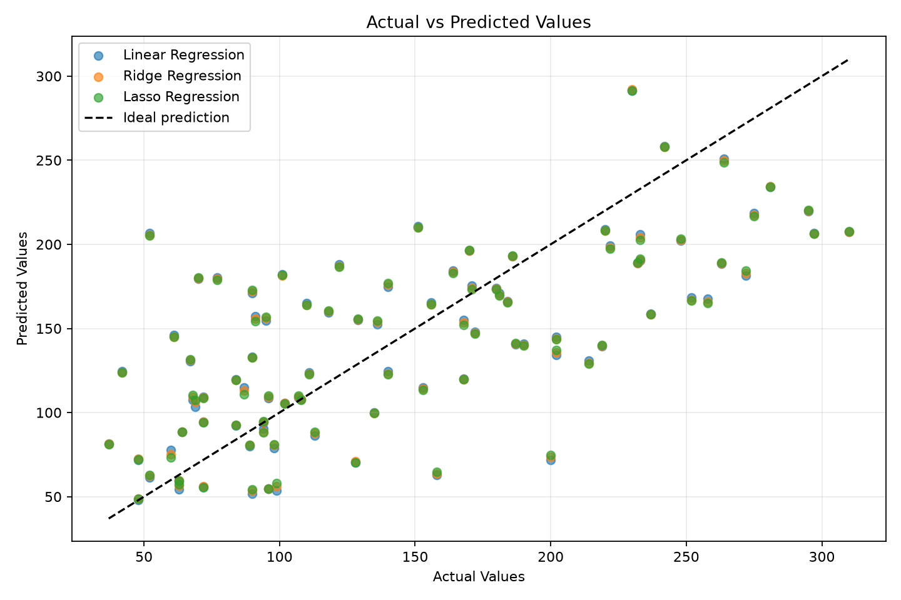
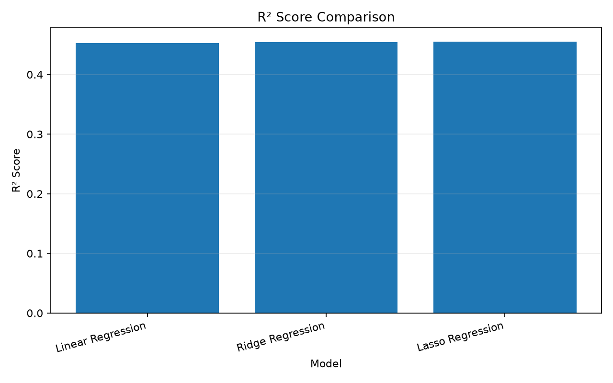
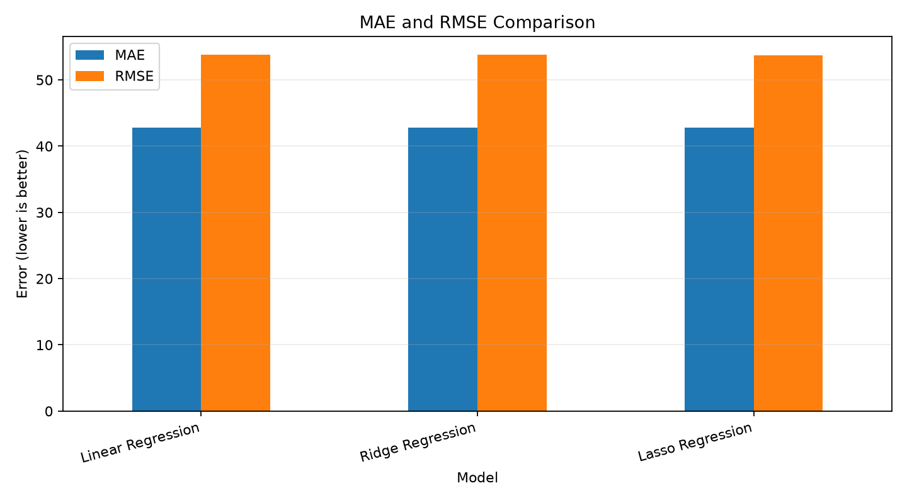
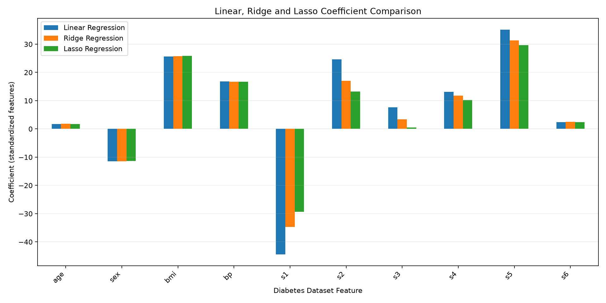

# PRACTICAL 1
## IMPLEMENTATION AND COMPARISON OF LINEAR, RIDGE AND LASSO REGRESSION

**Mapped Course Outcome:** CO3

**Course Outcome CO3:** Apply appropriate supervised, unsupervised, ensemble,
probabilistic, distributed, federated, image generation, and explainable AI
techniques to solve real-world machine learning problems.

**Programming Language:** Python 3

**Dataset:** Diabetes Dataset from Scikit-learn

---

# 1. AIM

To implement Ridge Regression and Lasso Regression using Python and compare
their performance with Linear Regression on a regression dataset.

# 2. OBJECTIVES

1. To understand the concept of regularization in regression.
2. To implement Linear Regression, Ridge Regression, and Lasso Regression.
3. To compare the models using performance metrics.
4. To analyse the effect of L1 and L2 regularization.
5. To identify which model gives better performance on the selected dataset.

# 3. TOOLS REQUIRED

- Python 3
- Jupyter Notebook / Google Colab
- NumPy
- Pandas
- Matplotlib
- Scikit-learn
- Ubuntu Terminal or a Python-compatible code editor

# 4. THEORY

## 4.1 Linear Regression

Linear Regression is a supervised machine learning algorithm used to predict
continuous numerical values. It estimates a relationship between input
features and a target variable by minimizing the sum of squared differences
between actual and predicted values.

The general equation is:

    y = b0 + b1*x1 + b2*x2 + ... + bn*xn

Where:

- y is the predicted target value.
- b0 is the intercept.
- b1, b2, ..., bn are model coefficients.
- x1, x2, ..., xn are the input features.

Linear Regression is easy to interpret, but its performance can be affected
by correlated features and high model variance.

## 4.2 Regularization

Regularization adds a penalty to the model's loss function to discourage
excessively large coefficients. It can improve generalization and help
control overfitting.

The strength of regularization is controlled by the parameter alpha.
A larger alpha generally applies a stronger penalty.

## 4.3 Ridge Regression

Ridge Regression is a linear regression technique that applies L2
regularization. It adds the squared magnitude of the coefficients to the
ordinary least-squares loss function.

Conceptually:

    Ridge Loss = Sum of Squared Errors + alpha * Sum of Squared Coefficients

Ridge Regression shrinks coefficients toward zero but generally does not
make them exactly zero. It is often useful when input features are correlated.

In this experiment, Ridge Regression uses alpha = 1.0.

## 4.4 Lasso Regression

Lasso Regression stands for Least Absolute Shrinkage and Selection Operator.
It applies L1 regularization by adding the absolute values of the coefficients
to the loss function.

Conceptually:

    Lasso Loss = Sum of Squared Errors + alpha * Sum of Absolute Coefficients

Lasso can shrink some coefficients exactly to zero. Therefore, it can also
perform feature selection by removing less influential features from the
fitted model.

In this experiment, Lasso Regression uses alpha = 0.1 and a maximum of
10,000 iterations.

## 4.5 Difference Between Linear, Ridge and Lasso Regression

| Property | Linear Regression | Ridge Regression | Lasso Regression |
|---|---|---|---|
| Regularization | No | L2 | L1 |
| Coefficient shrinkage | No penalty | Yes | Yes |
| Can set coefficients exactly to zero | Not through regularization | Generally no | Yes |
| Feature selection | No | Not typically | Possible |
| Main objective | Minimize squared errors | Control coefficient magnitude | Control coefficient magnitude and encourage sparsity |

# 5. METHODOLOGY

The following steps are performed:

1. Import the required Python libraries.
2. Load the Diabetes regression dataset.
3. Separate the input features and target values.
4. Split the dataset into training and testing subsets.
5. Apply feature scaling using StandardScaler.
6. Create Linear Regression, Ridge Regression and Lasso Regression models.
7. Train each model on the training dataset.
8. Predict target values using the test dataset.
9. Evaluate the predictions using MAE, MSE, RMSE and R-squared.
10. Compare the coefficients learned by each model.
11. Display the performance results in tabular form.
12. Generate graphs for actual versus predicted values, R-squared scores,
    model errors and regression coefficients.
13. Save the numerical report, tables and graphs in the output directory.
14. Analyse the results and draw a conclusion.

# 6. DATASET DESCRIPTION

The dataset used is the Diabetes Dataset provided by Scikit-learn.

It is a regression dataset containing 442 samples and 10 numerical features.
The target is a quantitative measure of disease progression one year after
baseline.

The features include:

- Age
- Sex
- Body Mass Index (BMI)
- Average Blood Pressure
- Serum measurements, including S1, S2, S3, S4, S5 and S6

The dataset is included with Scikit-learn, so no separate download is needed.

## 6.1 Dataset Split

The experiment uses an 80:20 training-testing split.

| Property | Value |
|---|---|
| Total samples | 442 |
| Number of features | 10 |
| Training proportion | 80% |
| Testing proportion | 20% |
| Random state | 42 |
| Ridge alpha | 1.0 |
| Lasso alpha | 0.1 |

The training data is used to fit the feature scaler. The fitted scaler is
then applied to the test data to avoid data leakage.

# 7. IMPLEMENTATION

The complete Python implementation is available in:

`experiment_1_ridge_lasso.py`

The program performs the following operations:

1. Loads the Diabetes dataset.
2. Splits the data into training and testing subsets.
3. Scales the input features.
4. Trains all three regression models.
5. Generates predictions for the test dataset.
6. Calculates performance metrics.
7. Compares the regression coefficients.
8. Generates and saves the graphs.
9. Saves the actual program output in a text report.

## 7.1 Installation of Required Libraries

The required packages are:

- NumPy
- Pandas
- Matplotlib
- Scikit-learn

Install them in a Python virtual environment using:

    python -m pip install numpy pandas matplotlib scikit-learn

## 7.2 Execution

Run the program from the experiment directory:

    source .venv/bin/activate
    python experiment_1_ridge_lasso.py

The program displays the results in the terminal and saves the report,
tables and graphs inside the `output/` directory.

# 8. PERFORMANCE METRICS

The models are evaluated using the following metrics.

## 8.1 Mean Absolute Error (MAE)

MAE is the average absolute difference between actual and predicted values.

    MAE = (1/n) * Sum(|actual - predicted|)

A lower MAE indicates smaller average absolute prediction errors.

## 8.2 Mean Squared Error (MSE)

MSE is the average of the squared differences between actual and predicted
values.

    MSE = (1/n) * Sum((actual - predicted)^2)

A lower MSE generally indicates better predictive performance. Because errors
are squared, larger errors have a stronger effect on this metric.

## 8.3 Root Mean Squared Error (RMSE)

RMSE is the square root of MSE.

    RMSE = sqrt(MSE)

RMSE uses the same units as the target variable. A lower RMSE is generally
preferred.

## 8.4 R-squared Score (R²)

R-squared measures how well the model explains variation in the target
relative to a baseline prediction based on the mean of the target values.

A higher R² is generally preferred. An R² value of 1 indicates a perfect
fit, while a value near 0 indicates performance similar to the mean baseline
under the standard definition. R² can also be negative when test predictions
perform worse than that baseline.

# 9. OUTPUT

The actual execution results are saved in:

`output/experiment_output.txt`

## 9.1 Model Performance Comparison

The program calculates the following values for each model:

| Model | MAE | MSE | RMSE | R² Score |
|---|---:|---:|---:|---:|
| Linear Regression | Actual execution value | Actual execution value | Actual execution value | Actual execution value |
| Ridge Regression | Actual execution value | Actual execution value | Actual execution value | Actual execution value |
| Lasso Regression | Actual execution value | Actual execution value | Actual execution value | Actual execution value |

**Important:** The actual numerical results are generated by running the
Python program. Refer to `output/experiment_output.txt` for the measured
values. The table above describes the result format and is not a substitute
for the actual output.

The full machine-readable comparison is also saved as:

`output/model_performance.csv`

## 9.2 Graph 1: Actual vs Predicted Values

This scatter plot compares actual target values with the predictions from
Linear Regression, Ridge Regression and Lasso Regression. The dashed
diagonal line represents ideal predictions. Points closer to this line
indicate more accurate predictions.

## 9.3 Graph 2: R² Score Comparison

This bar graph compares the R² scores of the three regression models.
A higher score indicates that the model explains more variation in the
test target values.

## 9.4 Graph 3: MAE and RMSE Comparison

This graph compares MAE and RMSE for all three models. Lower values indicate
smaller prediction errors. Both metrics should be considered when evaluating
model performance.

## 9.5 Graph 4: Coefficient Comparison

This graph compares the fitted coefficients for the ten dataset features.
Ridge generally shrinks coefficients toward zero, while Lasso can set
some coefficients exactly to zero. The coefficient table is also saved in
`output/coefficient_comparison.csv`.

## 9.6 Output Files

| File | Description |
|---|---|
| `output/experiment_output.txt` | Actual console results |
| `output/model_performance.csv` | MAE, MSE, RMSE and R² comparison |
| `output/coefficient_comparison.csv` | Coefficients for all three models |
| `output/actual_vs_predicted.png` | Actual versus predicted graph |
| `output/r2_score_comparison.png` | R² score comparison graph |
| `output/model_performance_comparison.png` | MAE and RMSE graph |
| `output/coefficient_comparison.png` | Regression coefficient graph |

The graphs will appear in the Markdown preview after the Python program
has executed successfully and generated the corresponding image files.

# 10. RESULT AND ANALYSIS

Linear Regression, Ridge Regression and Lasso Regression are implemented
and evaluated using the Scikit-learn Diabetes dataset.

Linear Regression provides a baseline without regularization. Ridge
Regression applies L2 regularization to reduce the magnitude of coefficients.
Lasso Regression applies L1 regularization and may set some coefficients
to zero, which can help with feature selection.

The MAE, MSE, RMSE and R² values allow the predictive performance of the
models to be compared. The coefficient table and graphs help explain how
regularization changes the fitted models.

The best-performing model should be identified from the actual test-set
metrics saved in `output/experiment_output.txt`. Ridge or Lasso should not
automatically be assumed to outperform Linear Regression on every dataset.

# 11. OUTCOME OF THE EXPERIMENT

After completing this experiment, the learner will be able to:

1. Explain the concept of regularization in regression.
2. Implement Linear Regression, Ridge Regression and Lasso Regression.
3. Understand L1 and L2 penalties.
4. Evaluate regression models using MAE, MSE, RMSE and R².
5. Interpret regression coefficients and their changes under regularization.
6. Explain how Lasso can support feature selection.
7. Compare model performance using numerical results and graphs.
8. Understand that the best model depends on the dataset and evaluation
   results.

# 12. CONCLUSION

Linear Regression, Ridge Regression and Lasso Regression are compared
using the Scikit-learn Diabetes regression dataset.

Ridge uses L2 regularization to penalize large coefficients, whereas Lasso
uses L1 regularization and can set some coefficients to zero. The experiment
evaluates all three models using MAE, MSE, RMSE and R², and presents the
results in tables and graphs.

The actual metric values determine which model performs best on the selected
test split. The experiment demonstrates the role of regularization in
regression and the importance of evaluating models rather than assuming
that one technique always performs best.

# 13. RELEVANT DEMONSTRATIVE VIDEO LINKS

The following search links can be used to find demonstrations of the topics:

1. Ridge and Lasso Regression using Python and Scikit-learn:
   https://www.youtube.com/results?search_query=Ridge+and+Lasso+Regression+Python+Scikit-learn

2. Ridge and Lasso Regression intuition:
   https://www.youtube.com/results?search_query=Ridge+and+Lasso+Regression+intuition

3. L1 and L2 regularization tutorial:
   https://www.youtube.com/results?search_query=L1+L2+regularization+machine+learning

# 14. REFERENCES AND OTHER RESOURCE MATERIALS

1. Scikit-learn Ridge Regression Documentation:
   https://scikit-learn.org/stable/modules/generated/sklearn.linear_model.Ridge.html

2. Scikit-learn Linear Models User Guide:
   https://scikit-learn.org/stable/modules/linear_model.html

3. Scikit-learn Diabetes Dataset Documentation:
   https://scikit-learn.org/stable/modules/generated/sklearn.datasets.load_diabetes.html

4. Scikit-learn Ordinary Least Squares and Ridge Regression Example:
   https://scikit-learn.org/stable/auto_examples/linear_model/plot_ols_ridge.html

5. DataCamp Ridge and Lasso Regression Tutorial:
   https://www.datacamp.com/tutorial/tutorial-lasso-ridge-regression

---

**END OF PRACTICAL 1**

**Mapped Course Outcome: CO3**
