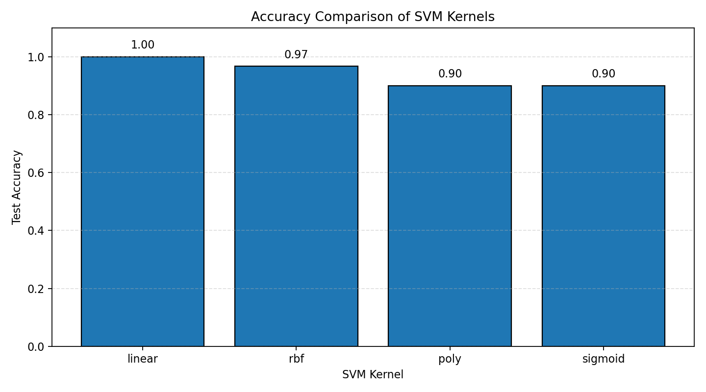
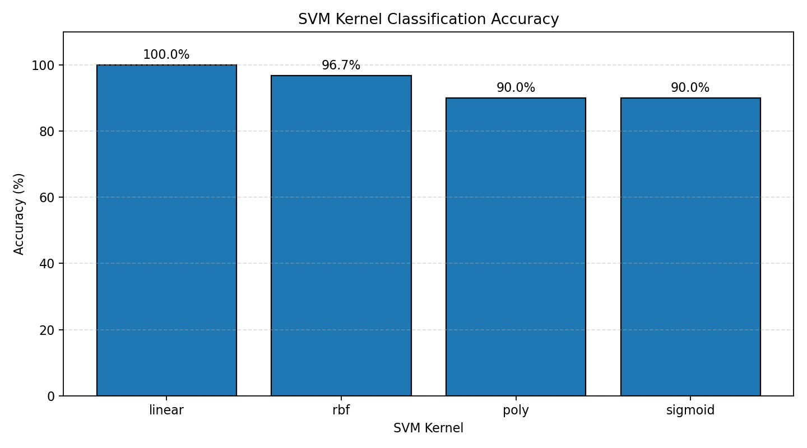
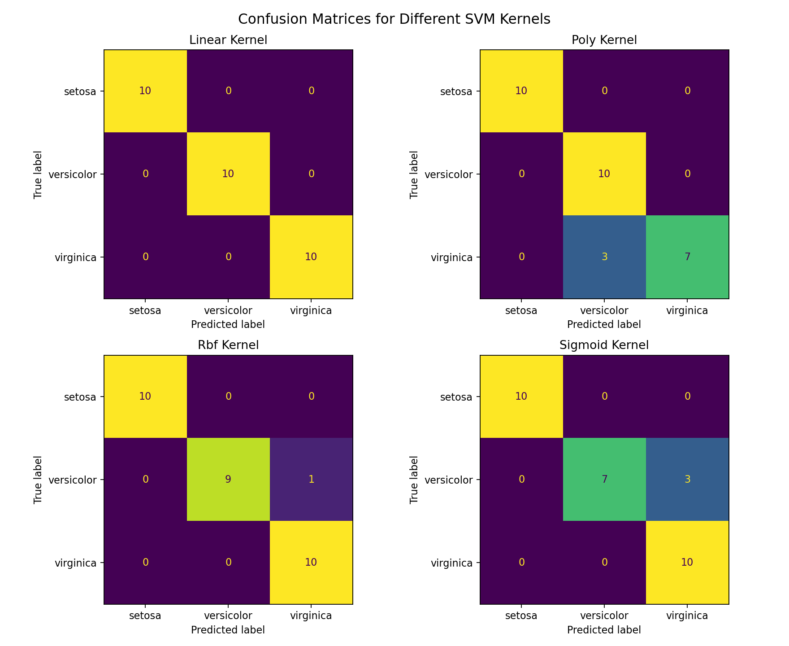
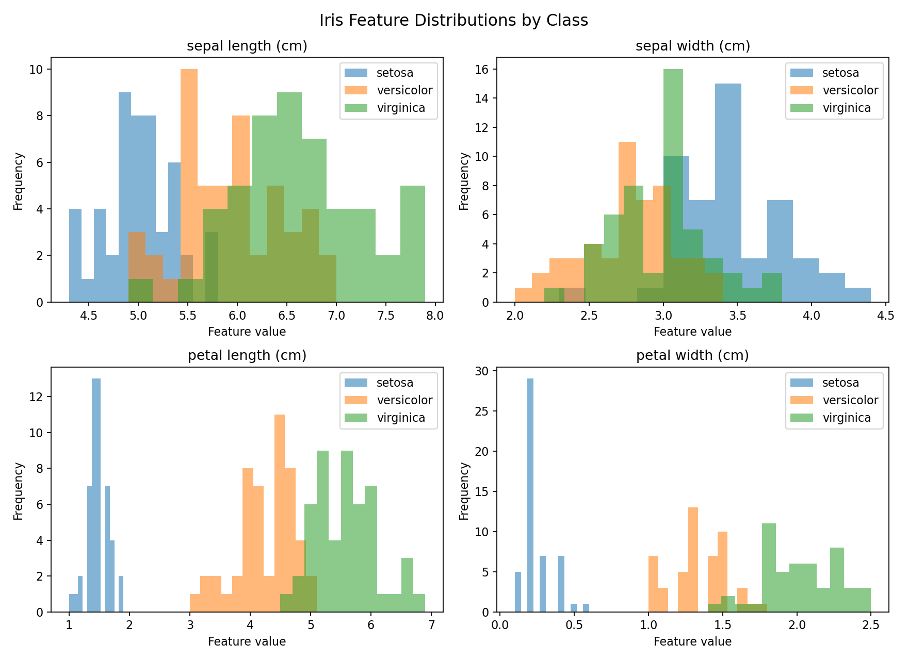

# PRACTICAL 2
## IMPLEMENTATION AND COMPARISON OF SVM CLASSIFICATION USING DIFFERENT KERNELS

**Mapped Course Outcome:** CO3

**Course Outcome CO3:** Apply appropriate supervised, unsupervised, ensemble, probabilistic, distributed, federated, image generation, and explainable AI techniques to solve real-world machine learning problems.

**Programming Language:** Python 3

**Dataset:** Iris Dataset from Scikit-learn

---

# 1. AIM

To implement a Support Vector Machine (SVM) classifier on a classification dataset and study the effect of different kernels on classification accuracy using Python.

# 2. OBJECTIVES

1. To understand the working of Support Vector Machine classification.
2. To implement SVM classification using Python.
3. To apply different SVM kernels, including Linear, Polynomial, RBF, and Sigmoid.
4. To compare classification accuracy for different kernels.
5. To analyse how kernel selection affects model performance.
6. To understand the importance of feature scaling in SVM classification.
7. To evaluate the models using accuracy, confusion matrices, and classification reports.
8. To visualize and interpret the performance of the different kernels.

# 3. TOOLS REQUIRED

- Python 3
- Jupyter Notebook / Google Colab
- NumPy
- Pandas
- Matplotlib
- Scikit-learn
- Ubuntu Terminal or a Python-compatible code editor

# 4. THEORY

## 4.1 Support Vector Machine

Support Vector Machine (SVM) is a supervised machine learning algorithm used for classification and regression. In classification, SVM identifies an optimal decision boundary called a **hyperplane** that separates samples belonging to different classes.

SVM attempts to find a decision boundary with a large margin between classes. The samples closest to the decision boundary are called **support vectors**. These samples play an important role in determining the position and orientation of the hyperplane.

SVM is effective in high-dimensional feature spaces and can classify both approximately linearly separable and nonlinear data.

## 4.2 Hyperplane and Margin

A hyperplane is a decision boundary used to separate classes in a feature space.

For a linear classifier, a hyperplane can be represented conceptually as:

    w · x + b = 0

Where:

- `w` represents the weight vector.
- `x` represents an input feature vector.
- `b` represents the bias or intercept.

The margin is the distance between the decision boundary and the closest training samples. SVM aims to find a suitable decision boundary with a large margin while balancing classification errors when necessary.

## 4.3 Support Vectors

Support vectors are training samples closest to the decision boundary. They are particularly important because they determine the fitted SVM decision function.

Changing the position of relevant support vectors can change the decision boundary. Other training samples may have little or no direct influence on the final decision boundary.

## 4.4 Kernel Functions

A kernel function enables SVM to model nonlinear relationships by computing relationships between samples in a transformed feature space.

Scikit-learn's `SVC` supports several kernel functions, including Linear, Polynomial, RBF, and Sigmoid. The default kernel in `SVC` is RBF, but this experiment explicitly specifies each kernel for comparison.

## 4.5 Linear Kernel

The Linear kernel is suitable when classes can be separated approximately by a straight decision boundary in the feature space.

Its kernel function is:

    K(x, y) = x · y

Where `x` and `y` are feature vectors.

The Linear kernel is relatively simple and can perform well when the data has approximately linear class boundaries.

## 4.6 Polynomial Kernel

The Polynomial kernel models relationships using polynomial combinations of the input features.

Its general form is:

    K(x, y) = (gamma * x · y + coef0)^degree

Where:

- `gamma` controls the influence of individual training samples.
- `coef0` is an independent constant.
- `degree` specifies the polynomial degree.

The Polynomial kernel can model curved decision boundaries and interactions between features.

## 4.7 Radial Basis Function (RBF) Kernel

The RBF kernel is widely used for nonlinear classification. It measures similarity between samples based on their distance in feature space.

Its kernel function is:

    K(x, y) = exp(-gamma * ||x - y||²)

The `gamma` parameter controls how far the influence of an individual sample extends. The RBF kernel can model complex nonlinear decision boundaries.

## 4.8 Sigmoid Kernel

The Sigmoid kernel uses a hyperbolic tangent function and resembles the activation function traditionally associated with neural networks.

Its general form is:

    K(x, y) = tanh(gamma * x · y + coef0)

The Sigmoid kernel can produce different classification results depending on the data and parameter values. Its performance should be assessed experimentally rather than assumed to be better or worse than other kernels.

## 4.9 Difference Between SVM Kernels

| Property | Linear | Polynomial | RBF | Sigmoid |
|---|---|---|---|---|
| Kernel type | Linear | Polynomial | Nonlinear | Nonlinear |
| Decision boundary | Linear | Can be curved | Can be highly nonlinear | Can be nonlinear |
| Main characteristic | Simple separation | Models polynomial relationships | Models complex relationships | Uses a sigmoid-based similarity function |
| Important consideration | Linear separability | Polynomial degree | Gamma value | Gamma and coefficient settings |
| Typical use | Approximately linear data | Data with polynomial interactions | Complex nonlinear data | Situations where the kernel is appropriate for the data |

The best kernel depends on the dataset, feature scaling, parameter settings, and evaluation method.

## 4.10 Importance of Feature Scaling

SVM is sensitive to feature scales because its decision function and kernel calculations depend on feature values and distances.

Features with large numerical ranges can dominate features with smaller ranges if scaling is not applied.

`StandardScaler` standardizes each feature using the mean and standard deviation calculated from the training dataset.

The scaler is fitted only on the training data and then applied to the test data. This avoids using test-set information during preprocessing and helps prevent data leakage.

# 5. METHODOLOGY

The following steps are performed in the experiment:

1. Import the required Python libraries.
2. Load the Iris dataset from Scikit-learn.
3. Convert the dataset into a Pandas DataFrame.
4. Display the first five rows and target classes.
5. Split the dataset into training and testing subsets.
6. Use stratified sampling to preserve the class distribution.
7. Apply feature scaling using StandardScaler.
8. Create SVM classifiers using Linear, Polynomial, RBF, and Sigmoid kernels.
9. Train each classifier on the scaled training dataset.
10. Predict class labels for the test dataset.
11. Calculate the classification accuracy for each kernel.
12. Generate confusion matrices and classification reports.
13. Compare the accuracy values in tabular form.
14. Save the numerical results and classification details.
15. Generate graphs for accuracy, confusion matrices, and feature distributions.
16. Analyse the results and draw a conclusion.

# 6. DATASET DESCRIPTION

The dataset used in this experiment is the **Iris Dataset**, which is included in Scikit-learn.

The Iris dataset is a well-known multiclass classification dataset containing measurements of iris flowers from three different species.

It contains 150 samples, four numerical input features, and three target classes.

## 6.1 Dataset Features

The four input features are:

1. Sepal length
2. Sepal width
3. Petal length
4. Petal width

These measurements are used by the SVM classifier to predict the species of an iris flower.

## 6.2 Target Classes

The target variable contains three classes:

- Setosa
- Versicolor
- Virginica

Each class contains 50 samples in the complete dataset.

## 6.3 Dataset Summary

| Property | Value |
|---|---|
| Dataset name | Iris |
| Total samples | 150 |
| Number of input features | 4 |
| Number of target classes | 3 |
| Samples per class | 50 |
| Training proportion | 80% |
| Testing proportion | 20% |
| Random state | 42 |
| Stratified split | Yes |
| Feature scaling | StandardScaler |

## 6.4 Training and Testing Split

The dataset is divided into training and testing subsets using an 80:20 ratio.

- Training samples: 120
- Testing samples: 30

The `random_state=42` parameter makes the split reproducible. Stratified sampling preserves the approximate proportion of each class in the training and testing subsets.

The feature scaler is fitted using the training data only. The resulting transformation is then applied to the training and testing data.

# 7. IMPLEMENTATION

The complete Python implementation is provided in:

`experiment_2_svm_kernels.py`

The program performs the following operations:

1. Loads the Iris dataset.
2. Displays dataset information and class distribution.
3. Splits the dataset into training and testing subsets.
4. Standardizes the input features.
5. Trains four SVM models using different kernels.
6. Predicts the target class for test samples.
7. Calculates accuracy for each model.
8. Generates confusion matrices and classification reports.
9. Saves the kernel accuracy comparison as a CSV file.
10. Saves the classification details in a text file.
11. Generates and saves the required graphs.
12. Writes the complete execution report to a text file.

## 7.1 Installation of Required Libraries

The required Python libraries are:

- NumPy
- Pandas
- Matplotlib
- Scikit-learn

Install the dependencies using:

    python -m pip install numpy pandas matplotlib scikit-learn

If a project virtual environment already exists, activate it before installing the dependencies.

## 7.2 Execution

Navigate to the experiment directory:

    cd "/home/probal/Downloads/5th  Sem/AML_L/Experiment - 2"

If the project has a virtual environment, activate it:

    source .venv/bin/activate

Run the program:

    python experiment_2_svm_kernels.py

The program prints the evaluation results in the terminal and saves the reports, tables, and graphs in the `output/` directory.

# 8. PERFORMANCE METRICS

The SVM models are evaluated using accuracy, confusion matrices, and classification reports.

## 8.1 Classification Accuracy

Accuracy measures the proportion of correctly predicted test samples.

    Accuracy = Correct Predictions / Total Predictions

For this experiment, the test set contains 30 samples.

For example, if a model correctly classifies 29 of the 30 test samples:

    Accuracy = 29 / 30 = 0.9667

The corresponding accuracy percentage is approximately 96.67%.

The example above illustrates the calculation; the actual model results are recorded in the generated output files.

A higher accuracy indicates that more test samples were classified correctly. However, accuracy alone does not describe which classes were misclassified.

## 8.2 Confusion Matrix

A confusion matrix compares actual class labels with predicted class labels.

For a three-class classification problem, the confusion matrix contains three rows and three columns.

The rows represent actual classes, and the columns represent predicted classes.

The diagonal values represent correct predictions. Values outside the diagonal represent misclassifications.

The confusion matrix helps identify whether a particular kernel has difficulty distinguishing specific Iris species.

## 8.3 Precision

Precision measures the proportion of samples predicted as a particular class that actually belong to that class.

    Precision = True Positives / (True Positives + False Positives)

Higher precision means fewer false-positive predictions for the class being evaluated.

## 8.4 Recall

Recall measures the proportion of actual samples of a class that the model correctly identifies.

    Recall = True Positives / (True Positives + False Negatives)

Higher recall means fewer actual samples of that class are missed.

## 8.5 F1-Score

The F1-score is the harmonic mean of precision and recall.

    F1-Score = 2 * Precision * Recall / (Precision + Recall)

The F1-score provides a combined measure of precision and recall. Scikit-learn calculates class-wise precision, recall, F1-score, and support in the classification report.

# 9. OUTPUT

The program saves the actual execution results in:

`output/experiment_output.txt`

The kernel comparison table is saved in:

`output/kernel_accuracy_comparison.csv`

The classification reports and confusion matrices are saved in:

`output/classification_details.txt`

## 9.1 Kernel Accuracy Comparison

The program compares the accuracy of the four SVM kernels.

| SVM Kernel | Test Accuracy |
|---|---|
| Linear | Actual execution value |
| Polynomial | Actual execution value |
| RBF | Actual execution value |
| Sigmoid | Actual execution value |

**Important:** The exact values must be taken from the actual program execution. The comparison CSV contains the measured accuracy, accuracy percentage, number of correct and incorrect predictions, and total support vectors for each model.

## 9.2 Graph 1: SVM Kernel Accuracy Comparison

This graph compares the test accuracy of the Linear, Polynomial, RBF, and Sigmoid kernels.

The height of each bar represents the accuracy achieved by the corresponding kernel. A higher bar indicates a larger proportion of correctly classified test samples.

The graph makes it easier to identify the best-performing kernel for this particular train-test split.

## 9.3 Graph 2: Accuracy Percentage Comparison

This graph presents the accuracy of each kernel as a percentage.

It provides an alternative representation of the same accuracy measurements and makes the differences between kernels easier to interpret.

## 9.4 Graph 3: Confusion Matrices

This figure presents the confusion matrix for each of the four SVM kernels.

Each matrix compares actual Iris species with predicted species.

The diagonal entries show correctly classified samples. Off-diagonal entries show incorrect predictions.

Comparing these matrices helps determine whether different kernels make different classification errors, even when their overall accuracy values are similar.

## 9.5 Graph 4: Iris Feature Distributions

This figure displays the distributions of the four Iris features for Setosa, Versicolor, and Virginica.

The plots help visualize how feature values differ across the classes.

Features with more distinct class distributions may help the SVM classifier separate species more effectively. Overlapping distributions may contribute to classification errors.

## 9.6 Output Files

| File | Description |
|---|---|
| `output/experiment_output.txt` | Complete experiment report and measured results |
| `output/iris_dataset.csv` | Iris dataset used in the experiment |
| `output/kernel_accuracy_comparison.csv` | Accuracy and prediction comparison for all kernels |
| `output/classification_details.txt` | Classification reports and confusion matrices |
| `output/kernel_accuracy_comparison.png` | Kernel accuracy comparison graph |
| `output/kernel_accuracy_percentage.png` | Accuracy percentage graph |
| `output/confusion_matrices.png` | Confusion matrices for all four kernels |
| `output/iris_feature_distributions.png` | Feature distributions for the three classes |

The graphs will appear in the Markdown preview after the Python program has successfully generated the image files.

# 10. RESULT AND ANALYSIS

The Support Vector Machine classifier is implemented using the Iris dataset. Four different kernel functions—Linear, Polynomial, RBF, and Sigmoid—are evaluated using the same training and testing subsets.

The models are compared using classification accuracy, confusion matrices, and classification reports.

The analysis should consider the following points:

1. **Linear kernel:** Its performance indicates how well the classes can be separated using a linear decision boundary.
2. **Polynomial kernel:** Its performance indicates whether a polynomial decision boundary is suitable for the dataset.
3. **RBF kernel:** Its performance indicates how effectively a nonlinear decision boundary models the relationships between the features.
4. **Sigmoid kernel:** Its performance illustrates how this alternative kernel behaves on the selected classification dataset.
5. **Confusion matrices:** These show which classes are correctly classified and which are confused with one another.
6. **Feature scaling:** Standardizing the features ensures that differences in their original scales do not dominate the kernel calculations.

The best-performing kernel should be identified from the actual results saved in `output/kernel_accuracy_comparison.csv`.

The expected accuracy values in a laboratory manual are illustrative and may differ from the measured results. The actual values depend on the dataset split, preprocessing, kernel settings, and software implementation.

A kernel with the highest accuracy on this test split is the best performer for this particular experiment, but this does not establish that it will be best for every dataset.

# 11. OUTCOME OF THE EXPERIMENT

After completing this experiment, the learner will be able to:

1. Explain the working principle of Support Vector Machine classification.
2. Understand hyperplanes, margins, and support vectors.
3. Implement SVM classification using Python and Scikit-learn.
4. Apply Linear, Polynomial, RBF, and Sigmoid kernels.
5. Prepare training and testing datasets using stratified sampling.
6. Understand the importance of feature scaling.
7. Evaluate classification models using accuracy, precision, recall, and F1-score.
8. Interpret confusion matrices and classification reports.
9. Compare different SVM kernels using tables and graphs.
10. Analyse the effect of kernel selection on classification performance.

# 12. CONCLUSION

In this experiment, a Support Vector Machine classifier is implemented using Python and the Iris dataset. Four different kernels—Linear, Polynomial, RBF, and Sigmoid—are trained and evaluated.

The dataset is divided into training and testing subsets using stratified sampling. StandardScaler is applied to standardize the features before training the models.

Classification accuracy, confusion matrices, and classification reports are generated to compare the performance of the kernels. The results demonstrate that kernel selection can influence classification performance and the types of errors made by a classifier.

The best kernel is determined from the actual measured results. The experiment demonstrates the importance of feature scaling, model evaluation, and selecting an appropriate kernel for a classification problem.

# 13. RELEVANT DEMONSTRATIVE VIDEO LINKS

The following links provide access to video demonstrations and tutorials:

1. SVM classification using Python and Scikit-learn:

   https://www.youtube.com/results?search_query=SVM+classification+Python+Scikit-learn

2. SVM using the Iris dataset in Python:

   https://www.youtube.com/results?search_query=SVM+Iris+dataset+Python

3. Support Vector Machine tutorial:

   https://www.youtube.com/results?search_query=Support+Vector+Machine+machine+learning+tutorial

4. Comparison of different SVM kernels:

   https://www.youtube.com/results?search_query=Linear+Polynomial+RBF+Sigmoid+SVM+kernels

# 14. REFERENCES AND OTHER RESOURCE MATERIALS

1. **Scikit-learn SVC Documentation**

   https://scikit-learn.org/stable/modules/generated/sklearn.svm.SVC.html

2. **Scikit-learn Support Vector Machines User Guide**

   https://scikit-learn.org/stable/modules/svm.html

3. **Scikit-learn Iris Dataset Documentation**

   https://scikit-learn.org/stable/modules/generated/sklearn.datasets.load_iris.html

4. **Scikit-learn Example: Classification Boundaries with Different SVM Kernels**

   https://scikit-learn.org/stable/auto_examples/svm/plot_svm_kernels.html

5. **DataCamp: SVM Classification Tutorial**

   https://www.datacamp.com/tutorial/svm-classification-scikit-learn-python

---

**END OF PRACTICAL 2**

**Mapped Course Outcome: CO3**

