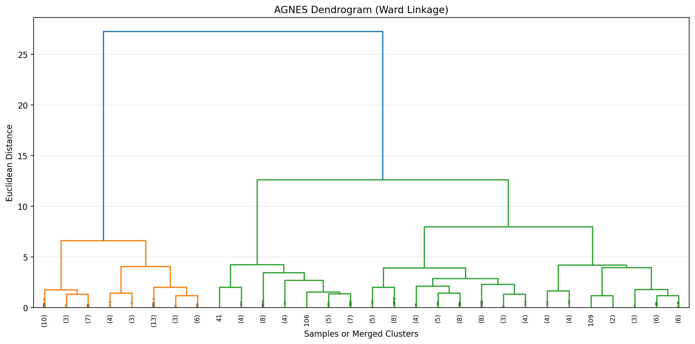
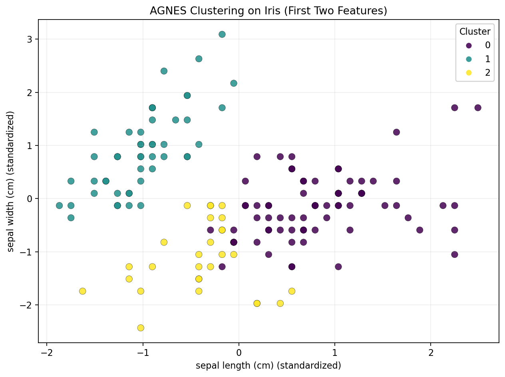
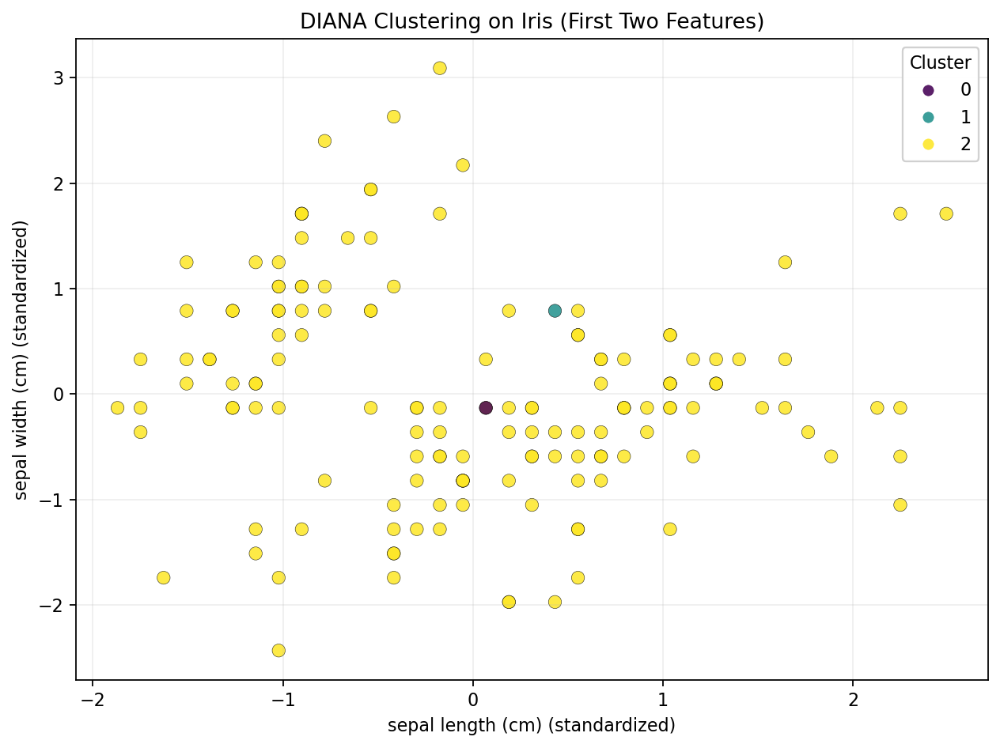
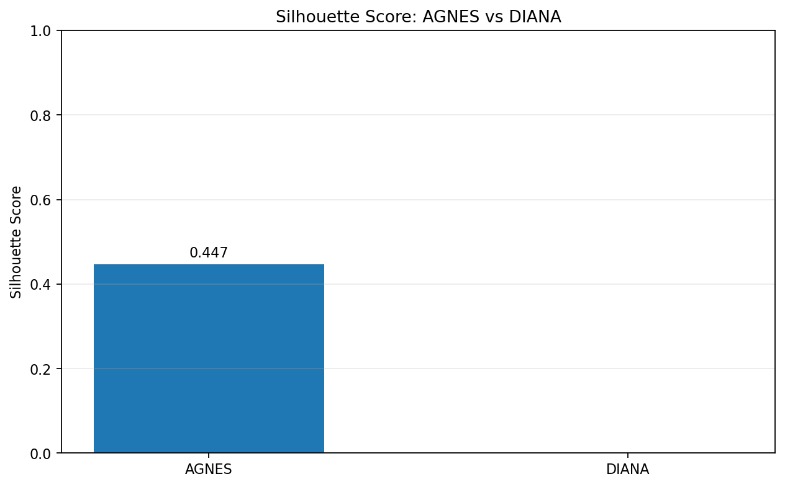

# PRACTICAL 3
## IMPLEMENTATION OF AGNES AND DIANA HIERARCHICAL CLUSTERING

**Mapped Course Outcome:** CO3

**Course Outcome CO3:** Apply appropriate supervised, unsupervised, ensemble,
probabilistic, distributed, federated, image generation, and explainable AI
techniques to solve real-world machine learning problems.

**Programming Language:** Python 3

**Dataset:** Iris Dataset from Scikit-learn

---

# 1. AIM

To implement AGNES (Agglomerative Nesting) and DIANA (Divisive Analysis)
for clustering a dataset using Python, visualize the resulting clusters
using dendrograms and scatter plots, and compare their performance using
suitable clustering evaluation metrics.

# 2. OBJECTIVES

1. To understand the concept of hierarchical clustering.
2. To implement AGNES, a bottom-up hierarchical clustering method.
3. To implement DIANA, a top-down hierarchical clustering method.
4. To visualize hierarchical clusters using a dendrogram.
5. To visualize the generated clusters using scatter plots.
6. To evaluate clustering performance using the silhouette score.
7. To compare the working of agglomerative and divisive clustering.
8. To understand the importance of feature scaling in distance-based clustering.

# 3. TOOLS REQUIRED

- Python 3
- Jupyter Notebook / Google Colab
- NumPy
- Pandas
- Matplotlib
- Scikit-learn
- SciPy
- Ubuntu Terminal or a Python-compatible code editor

# 4. THEORY

## 4.1 Hierarchical Clustering

Hierarchical clustering is an unsupervised machine learning technique used
to group similar observations into clusters. It creates a hierarchy of
clusters that can be represented by a tree-like diagram called a dendrogram.

Unlike methods that only produce a final cluster assignment, hierarchical
clustering also provides information about the relationships between
clusters at different levels.

There are two main approaches to hierarchical clustering:

1. Agglomerative clustering: a bottom-up approach.
2. Divisive clustering: a top-down approach.

## 4.2 AGNES — Agglomerative Nesting

AGNES is a bottom-up hierarchical clustering algorithm. It starts by treating
each data point as an individual cluster and repeatedly merges the closest
clusters until the required number of clusters is reached.

The steps involved in AGNES are:

1. Treat every observation as a separate cluster.
2. Calculate distances between clusters.
3. Find the closest pair of clusters using the selected linkage method.
4. Merge the closest pair.
5. Repeat the process until the stopping condition is satisfied.

Common linkage methods include:

- Single linkage: uses the minimum pairwise distance between two clusters.
- Complete linkage: uses the maximum pairwise distance between two clusters.
- Average linkage: uses the average pairwise distance between two clusters.
- Ward linkage: merges clusters to minimize the increase in within-cluster
  variance.

This experiment uses Ward linkage with Euclidean distance for AGNES.

## 4.3 DIANA — Divisive Analysis

DIANA is a top-down hierarchical clustering approach. It begins with all
observations in one cluster and repeatedly splits clusters into smaller
groups.

The general steps are:

1. Place all observations in one cluster.
2. Select a cluster for splitting.
3. Identify a highly dissimilar observation.
4. Create a splinter group containing the selected observation.
5. Move other observations according to the selected distance-based rule.
6. Repeat until the required number of clusters is obtained.

Scikit-learn provides a direct implementation of agglomerative clustering,
but not the original DIANA algorithm as a corresponding built-in estimator.

Therefore, this practical uses a simplified custom DIANA-style implementation.
It selects the non-singleton cluster with the largest diameter, initializes
a splinter group using a highly dissimilar observation, and moves observations
according to average distances.

This is an educational approximation of divisive clustering and should not
be interpreted as an exact implementation of every published DIANA variant.

## 4.4 Euclidean Distance

Euclidean distance measures the straight-line distance between two data
points in a multidimensional feature space.

For two observations x and y with n features, the distance is:

    d(x, y) = sqrt(Sum((xi - yi)^2)), for i = 1 to n

A smaller distance generally indicates that the observations are more
similar under the selected distance metric.

Distance calculations are important in hierarchical clustering because
they determine which clusters are merged or split.

## 4.5 Feature Scaling

The Iris dataset contains four numerical features that have different
measurement ranges.

Standardization transforms each feature using its mean and standard deviation:

    z = (x - mean) / standard_deviation

Where:

- x is the original feature value.
- mean is the mean of the feature.
- standard_deviation is the standard deviation of the feature.
- z is the standardized value.

Feature scaling prevents features with larger numerical ranges from
unnecessarily dominating distance calculations.

This experiment uses Scikit-learn's StandardScaler.

## 4.6 Dendrogram

A dendrogram is a tree-like diagram used to visualize hierarchical clustering.

In agglomerative clustering, the dendrogram shows which clusters are merged
and the distance at which each merge occurs.

The vertical height of a merge represents the linkage distance. Higher
merges indicate that the clusters were combined at a greater distance.

This experiment uses SciPy's linkage() and dendrogram() functions to generate
a dendrogram based on Ward linkage.

## 4.7 Silhouette Score

The silhouette score measures how well observations fit within their assigned
clusters compared with other clusters.

For an observation, the silhouette coefficient is:

    s = (b - a) / max(a, b)

Where:

- a is the average distance from the observation to other observations
  in the same cluster.
- b is the smallest average distance from the observation to observations
  in another cluster.

The score ranges from -1 to 1.

- A score close to 1 indicates well-separated clusters.
- A score close to 0 indicates overlapping clusters or observations near
  cluster boundaries.
- A negative score can indicate that an observation may be closer to
  another cluster.

A higher overall silhouette score generally indicates better cluster
cohesion and separation for the selected distance metric.

The silhouette score evaluates clustering quality; it is not a classification
accuracy score.

## 4.8 Difference Between AGNES and DIANA

| Property | AGNES | DIANA |
|---|---|---|
| Full form | Agglomerative Nesting | Divisive Analysis |
| Approach | Bottom-up | Top-down |
| Initial condition | Each observation is a separate cluster | All observations form one cluster |
| Main operation | Merges clusters | Splits clusters |
| Hierarchy | Built through successive merges | Built through successive divisions |
| Implementation in this practical | Scikit-learn AgglomerativeClustering | Custom divisive clustering function |
| Visualization | Dendrogram and scatter plot | Scatter plot |
| Evaluation | Silhouette score | Silhouette score |

# 5. METHODOLOGY

The following steps are performed:

1. Import the required Python libraries.
2. Load the Iris dataset from Scikit-learn.
3. Select the four numerical input features.
4. Apply feature scaling using StandardScaler.
5. Generate a hierarchical linkage matrix using Ward linkage.
6. Plot the AGNES dendrogram using SciPy.
7. Implement AGNES using AgglomerativeClustering.
8. Implement a simplified DIANA-style clustering function.
9. Generate cluster labels for both methods.
10. Calculate silhouette scores for both clustering methods.
11. Visualize AGNES clusters using a scatter plot.
12. Visualize DIANA clusters using a scatter plot.
13. Generate a silhouette score comparison graph.
14. Save the results, CSV files, graphs, and experiment report.
15. Compare the measured results and draw a conclusion.

The original Iris species labels are not used to generate the clusters because
this is an unsupervised learning experiment.

# 6. DATASET DESCRIPTION

The dataset used is the Iris Dataset provided by Scikit-learn.

The Iris dataset contains 150 observations and four numerical features.
It is commonly used to demonstrate classification and clustering techniques.

The four input features are:

- Sepal length in centimetres.
- Sepal width in centimetres.
- Petal length in centimetres.
- Petal width in centimetres.

The original dataset contains three Iris species:

- Setosa
- Versicolor
- Virginica

The species labels are not used during clustering. The algorithms work
only with the numerical feature values.

The dataset is included with Scikit-learn, so no separate download is needed.

## 6.1 Dataset Details

| Property | Value |
|---|---|
| Dataset name | Iris |
| Total observations | 150 |
| Number of numerical features | 4 |
| Number of original species | 3 |
| Learning type | Unsupervised learning |
| Feature scaling | StandardScaler |
| Requested number of clusters | 3 |
| Dataset source | Scikit-learn |

## 6.2 Dataset Loading

The dataset is loaded using:

    from sklearn.datasets import load_iris

The feature matrix is obtained from the dataset's data attribute.

The species labels are not passed to either clustering algorithm.

## 6.3 Feature Scaling

StandardScaler is used to standardize the four features before computing
distances. The same scaled dataset is supplied to AGNES and DIANA so the
comparison uses a common feature representation.

# 7. IMPLEMENTATION

The complete Python implementation is available in:

    experiment_3_agnes_diana.py

The program performs the following operations:

1. Loads the Iris dataset.
2. Displays the first five observations.
3. Standardizes the four numerical features.
4. Generates a Ward linkage matrix.
5. Saves the AGNES dendrogram.
6. Applies AgglomerativeClustering with three clusters.
7. Implements simplified DIANA-style divisive clustering.
8. Calculates silhouette scores for both methods.
9. Saves cluster assignments and comparison results.
10. Generates cluster scatter plots and a comparison graph.
11. Writes the actual execution results to a text report.

## 7.1 Installation of Required Libraries

The required packages are:

- NumPy
- Pandas
- Matplotlib
- Scikit-learn
- SciPy

Install the packages using:

    python -m pip install numpy pandas matplotlib scikit-learn scipy

If a Python virtual environment has already been created for this experiment,
activate it before installing or running the program.

## 7.2 AGNES Implementation

AGNES is implemented using Scikit-learn's AgglomerativeClustering.

The model is configured to generate three clusters and use Ward linkage.

A separate linkage matrix is generated with SciPy so the hierarchical
merging process can be visualized as a dendrogram.

## 7.3 DIANA Implementation

The custom DIANA-style function starts with all observations in one cluster.

At each iteration, it selects the non-singleton cluster with the largest
diameter and initializes a splinter group using the most dissimilar point.

The remaining observations are evaluated using average distances to the
splinter group and the remaining group. The process repeats until three
clusters are produced.

This simplified algorithm demonstrates the top-down principle of divisive
clustering. Its exact output can differ from the output of other DIANA
implementations because splitting rules and implementation details vary.

## 7.4 Execution

Navigate to the experiment directory:

    cd "/home/probal/Downloads/5th  Sem/AML_L/Experiment - 3"

Run the Python program:

    python experiment_3_agnes_diana.py

The program displays the results in the terminal and saves the reports,
CSV files, and graphs inside the output/ directory.

## 7.5 Verify Generated Results

Run the following commands to inspect the experiment output:

    cat output/experiment_output.txt

To view the clustering comparison table:

    cat output/clustering_comparison.csv

To list the generated files:

    find output -maxdepth 1 -type f -printf '%f\n' | sort

# 8. PERFORMANCE METRICS

The clustering methods are evaluated using the number of generated clusters,
cluster sizes, and silhouette score.

## 8.1 Number of Clusters

The number of clusters indicates how many distinct groups were generated
by the clustering algorithm.

This experiment requests three clusters for each method.

The actual number of clusters is calculated from the generated labels.

## 8.2 Cluster Sizes

Cluster sizes show how many observations are assigned to each cluster.

They help identify whether the observations are distributed evenly or
whether one cluster contains substantially more observations than others.

Cluster sizes are included in the experiment report.

## 8.3 Silhouette Score

The silhouette score measures the similarity of an observation to its own
cluster compared with other clusters.

The score ranges from -1 to 1. A higher score generally indicates better
cluster cohesion and separation.

The program calculates the silhouette score using:

    silhouette_score(X_scaled, cluster_labels)

The metric is calculated separately for AGNES and DIANA.

## 8.4 Comparison of Evaluation Metrics

| Metric | Purpose |
|---|---|
| Number of clusters | Verifies the generated cluster count |
| Cluster sizes | Shows the distribution of observations |
| Silhouette score | Evaluates cluster cohesion and separation |

The actual numerical values must be taken from the generated report rather
than assumed from example values in the laboratory manual.

# 9. OUTPUT

The actual execution results are saved in:

    output/experiment_output.txt

The program also generates CSV files and graph images for further analysis.

## 9.1 AGNES Dendrogram

The dendrogram visualizes the hierarchical merging process produced by
Ward linkage. The height of a merge represents the distance at which
clusters are combined.

The graph uses a truncated view to keep the hierarchy readable.

## 9.2 AGNES Cluster Visualization

This scatter plot visualizes the AGNES cluster assignments using the first
two standardized Iris features.

Different colors represent different cluster identifiers.

## 9.3 DIANA Cluster Visualization

This scatter plot visualizes the clusters generated by the custom
DIANA-style divisive algorithm.

Different colors represent the cluster labels returned by the function.

## 9.4 Silhouette Score Comparison

This bar graph compares the measured silhouette scores of AGNES and DIANA.

A higher score generally indicates better cluster cohesion and separation
for the selected dataset and distance metric.

The measured values must be interpreted together with the scatter plots
and cluster sizes.

## 9.5 Model Comparison Table

The program saves the actual comparison table in:

    output/clustering_comparison.csv

The table contains the following fields:

| Method | Approach | Linkage or Split Rule | Number of Clusters | Silhouette Score |
|---|---|---|---|---|
| AGNES | Bottom-up | Ward linkage | Measured by program | Measured by program |
| DIANA | Top-down | Largest-diameter split | Measured by program | Measured by program |

The exact numerical scores are generated when the program is executed.
They should be read from the CSV or text report rather than replaced with
the illustrative values from the laboratory manual.

## 9.6 Generated Output Files

| File | Description |
|---|---|
| output/experiment_output.txt | Actual experiment report, metrics, and cluster sizes |
| output/iris_scaled_features.csv | Standardized feature values |
| output/iris_cluster_assignments.csv | Iris features and AGNES/DIANA cluster labels |
| output/clustering_comparison.csv | Comparison of the two clustering methods |
| output/agnes_dendrogram.png | AGNES dendrogram |
| output/agnes_clusters.png | AGNES cluster scatter plot |
| output/diana_clusters.png | DIANA cluster scatter plot |
| output/silhouette_score_comparison.png | Silhouette score comparison graph |

The graph images appear in a Markdown preview after the program has generated
the corresponding files.

# 10. RESULT AND ANALYSIS

AGNES and DIANA-style hierarchical clustering are implemented using the
Iris dataset after standardizing the numerical features.

AGNES follows a bottom-up approach. It starts with individual observations
and merges clusters according to Ward linkage.

DIANA follows a top-down approach. It starts with one cluster and repeatedly
splits the selected cluster according to the custom distance-based rule.

The silhouette score provides a numerical method for comparing the cluster
assignments produced by both algorithms.

The actual scores generated by the program should be compared to determine
which method provides better silhouette-based cohesion and separation for
this configuration.

The cluster identifiers are arbitrary and do not directly represent the
original Iris species. Since the species labels are not used in clustering,
the experiment evaluates the generated group structure rather than supervised
classification accuracy.

The custom DIANA-style implementation may produce different results from
a full implementation of the original DIANA algorithm because its splitting
procedure is simplified.

# 11. OUTCOME OF THE EXPERIMENT

After completing this experiment, the learner will be able to:

1. Explain the concept of hierarchical clustering.
2. Implement AGNES using Scikit-learn.
3. Explain the bottom-up clustering approach.
4. Implement a simplified DIANA-style divisive clustering method.
5. Explain the top-down clustering approach.
6. Generate a dendrogram using SciPy.
7. Visualize cluster assignments using scatter plots.
8. Evaluate clustering results using silhouette scores.
9. Compare clustering approaches using numerical results.
10. Understand the importance of feature scaling in distance-based clustering.

# 12. CONCLUSION

AGNES and DIANA hierarchical clustering approaches are studied and
implemented using the Iris dataset.

AGNES follows a bottom-up approach by merging individual clusters, whereas
DIANA follows a top-down approach by repeatedly splitting a larger cluster.

The Iris features are standardized before clustering to support distance-based
analysis. A dendrogram is generated to visualize the AGNES hierarchy, while
scatter plots show the cluster assignments produced by both methods.

Silhouette scores are calculated to compare the quality of the generated
clusters. The actual program output determines which method achieves the
higher score for the selected dataset and configuration.

The practical demonstrates hierarchical clustering and the differences
between agglomerative and divisive approaches. The custom DIANA-style
implementation provides an educational demonstration and is not an exact
replacement for every published DIANA algorithm.

# 13. RELEVANT DEMONSTRATIVE VIDEO LINKS

The following links can be used to find demonstrations of the relevant topics.

1. Hierarchical Clustering Explained:

   https://www.youtube.com/results?search_query=hierarchical+clustering+explained

2. Agglomerative Hierarchical Clustering using Python:

   https://www.youtube.com/results?search_query=agglomerative+hierarchical+clustering+Python

3. DIANA Divisive Hierarchical Clustering:

   https://www.youtube.com/results?search_query=DIANA+divisive+hierarchical+clustering

4. Hierarchical Clustering and Dendrograms using SciPy:

   https://www.youtube.com/results?search_query=hierarchical+clustering+Python+SciPy+dendrogram

# 14. REFERENCES AND OTHER RESOURCE MATERIALS

1. Scikit-learn Agglomerative Clustering Documentation:

   https://scikit-learn.org/stable/modules/generated/sklearn.cluster.AgglomerativeClustering.html

2. Scikit-learn Clustering User Guide:

   https://scikit-learn.org/stable/modules/clustering.html

3. SciPy Hierarchical Clustering Documentation:

   https://docs.scipy.org/doc/scipy/reference/cluster.hierarchy.html

4. Scikit-learn Iris Dataset Documentation:

   https://scikit-learn.org/stable/modules/generated/sklearn.datasets.load_iris.html

5. Scikit-learn Silhouette Score Documentation:

   https://scikit-learn.org/stable/modules/generated/sklearn.metrics.silhouette_score.html

6. GeeksforGeeks Hierarchical Clustering Tutorial:

   https://www.geeksforgeeks.org/machine-learning/hierarchical-clustering/

---

**END OF PRACTICAL 3**

**Mapped Course Outcome: CO3**
