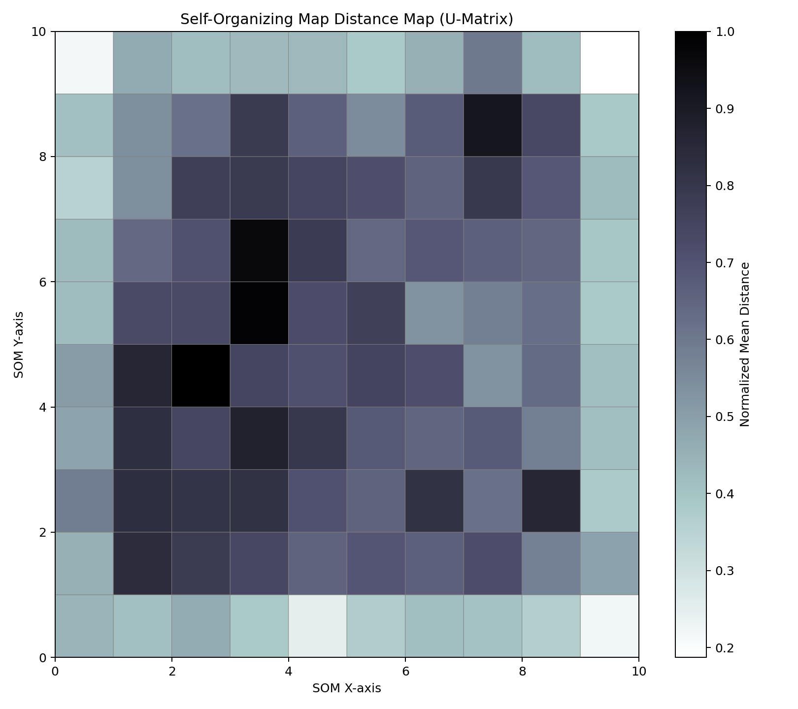
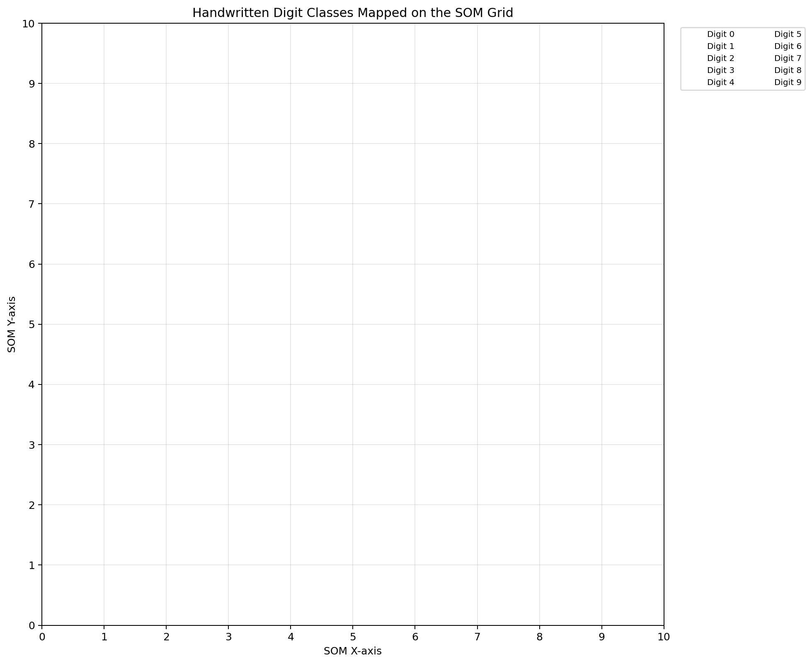
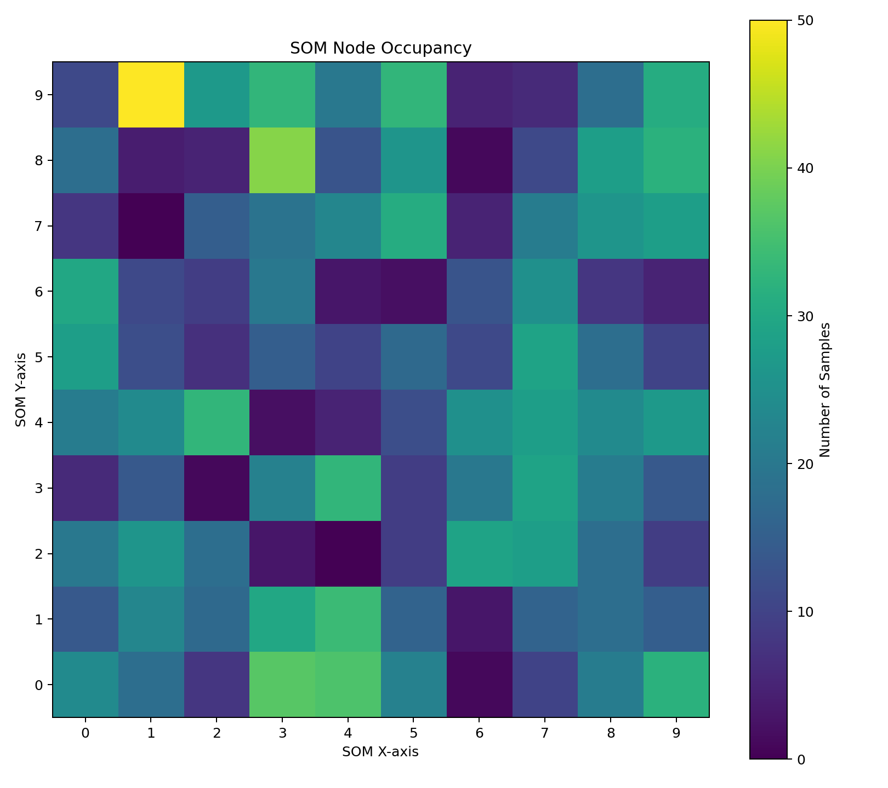
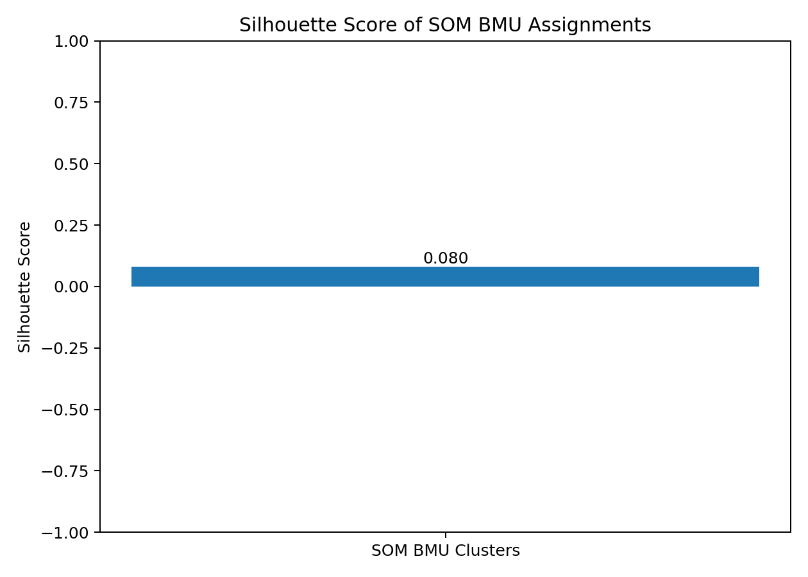

# PRACTICAL 4
## IMPLEMENTATION OF SELF-ORGANIZING MAP (SOM) FOR CLUSTERING AND VISUALIZATION

**Mapped Course Outcome:** CO3

**Course Outcome CO3:** Apply appropriate supervised, unsupervised, ensemble,
probabilistic, distributed, federated, image generation, and explainable AI
techniques to solve real-world machine learning problems.

**Programming Language:** Python 3

**Dataset:** Digits Dataset from Scikit-learn

---

# 1. AIM

To implement a Self-Organizing Map (SOM) using Python for clustering and
visualization of high-dimensional data, map similar observations to nearby
neurons, and analyze the resulting clusters and map structure.

# 2. OBJECTIVES

1. To understand the concept and working principle of Self-Organizing Maps.
2. To implement a SOM using Python and the MiniSom library.
3. To apply SOM to high-dimensional numerical data.
4. To group similar observations using a two-dimensional neuron grid.
5. To visualize high-dimensional data on a two-dimensional map.
6. To understand Best Matching Unit (BMU) selection.
7. To study neighborhood learning and weight-vector updates.
8. To visualize the SOM distance map and neuron occupancy.
9. To display the distribution of digit classes on the SOM grid.
10. To evaluate the generated map using suitable clustering metrics.

# 3. TOOLS REQUIRED

- Python 3
- Jupyter Notebook / Google Colab
- Ubuntu Terminal or a Python-compatible code editor
- NumPy
- Pandas
- Matplotlib
- Scikit-learn
- MiniSom
- A web browser or image viewer for inspecting generated graphs

# 4. THEORY

## 4.1 Self-Organizing Map

A Self-Organizing Map (SOM), also known as a Kohonen Map, is an unsupervised
neural network used to represent high-dimensional data on a lower-dimensional
grid, commonly a two-dimensional rectangular grid.

SOM learns the structure of input data without requiring class labels during
training. Similar input observations tend to activate nearby neurons on the map.

Each neuron contains a weight vector with the same number of components as
the input feature vector.

The SOM training process adjusts these weight vectors so that the map
preserves important similarity relationships in the input data.

## 4.2 Architecture of a SOM

A SOM generally consists of:

1. An input layer that receives the feature vector.
2. A two-dimensional grid of neurons.
3. A weight vector associated with every neuron.
4. A competition mechanism to identify the Best Matching Unit.
5. A neighborhood learning mechanism that updates the winning neuron and
   its neighboring neurons.

In this experiment, the SOM uses a 10 × 10 grid. Therefore, the map contains
100 neurons, and each neuron has a 64-dimensional weight vector corresponding
to the 64 input features of an image in the Digits dataset.

## 4.3 Best Matching Unit (BMU)

The Best Matching Unit is the neuron whose weight vector is closest to a
given input vector.

For an input vector \(x\) and a neuron with weight vector \(w_i\), the
Euclidean distance is:

    d(x, w_i) = sqrt(sum((x_j - w_ij)^2))

The Best Matching Unit is:

    BMU(x) = argmin_i d(x, w_i)

Where:

- \(x\) is the input feature vector.
- \(w_i\) is the weight vector of neuron \(i\).
- \(x_j\) is the \(j\)-th input feature.
- \(w_{ij}\) is the \(j\)-th component of neuron \(i\)'s weight vector.
- \(d(x, w_i)\) is the Euclidean distance between the input and neuron.

The winning neuron represents the input observation on the SOM grid.

## 4.4 SOM Learning Process

The SOM learning process consists of the following steps:

1. Initialize the weight vectors of all neurons.
2. Select an input observation.
3. Calculate the distance between the observation and each neuron's weight
   vector.
4. Identify the Best Matching Unit.
5. Determine the neighboring neurons around the winning neuron.
6. Update the weights of the winning neuron and its neighbors.
7. Reduce the learning rate and neighborhood influence during training.
8. Repeat the process for the required number of iterations.

The SOM gradually adapts its weight vectors to represent the distribution
of the input data.

## 4.5 Weight Update Rule

The general SOM weight update equation is:

    w_i(t + 1) = w_i(t) + alpha(t) * h_ci(t) * (x - w_i(t))

Where:

- \(w_i(t)\) is the weight vector of neuron \(i\) at time \(t\).
- \(x\) is the selected input vector.
- \(\alpha(t)\) is the learning rate at time \(t\).
- \(h_{ci}(t)\) is the neighborhood function between the winning neuron \(c\)
  and neuron \(i\).
- \(w_i(t+1)\) is the updated weight vector.

The learning rate controls the magnitude of weight updates. The neighborhood
function controls how strongly nearby neurons are influenced by the winning
neuron.

## 4.6 Neighborhood Function

The neighborhood function determines the influence of the winning neuron
on surrounding neurons.

A commonly used Gaussian neighborhood function is:

    h_ci(t) = exp(-||r_c - r_i||^2 / (2 * sigma(t)^2))

Where:

- \(r_c\) is the grid coordinate of the winning neuron.
- \(r_i\) is the grid coordinate of neuron \(i\).
- \(\sigma(t)\) is the neighborhood radius at time \(t\).

Neurons close to the winning neuron receive a stronger update than distant
neurons. During training, the neighborhood radius generally decreases so
that the map gradually becomes more specialized.

## 4.7 Feature Scaling

Feature scaling adjusts numerical features to a common range or scale.

The Digits dataset contains 64 pixel-intensity features for each image.
Pixel values range from 0 to 16.

This experiment uses MinMaxScaler to transform the feature values to the
range [0, 1].

The transformation is:

    x_scaled = (x - x_min) / (x_max - x_min)

Where:

- \(x\) is the original feature value.
- \(x_{\min}\) is the minimum value of the feature.
- \(x_{\max}\) is the maximum value of the feature.
- \(x_{\text{scaled}}\) is the scaled feature value.

Feature scaling helps prevent numerical magnitude differences from
unnecessarily influencing the distance calculations used by SOM.

## 4.8 Quantization Error

Quantization error measures the average distance between each input
observation and the weight vector of its Best Matching Unit.

It can be expressed as:

    QE = (1 / N) * sum(||x_i - w_BMU(i)||)

Where:

- \(N\) is the number of observations.
- \(x_i\) is an input observation.
- \(w_{BMU(i)}\) is the weight vector of its Best Matching Unit.

A lower quantization error generally indicates that the SOM weight vectors
represent the input observations more closely.

Quantization error should be interpreted alongside the map structure and
other evaluation measures.

## 4.9 Topographic Error

Topographic error estimates how well the SOM preserves neighborhood
relationships between input observations.

It examines whether the first and second Best Matching Units are adjacent
on the map. A lower topographic error generally indicates better preservation
of local topology.

The value depends on the map configuration, topology definition, dataset,
and training process.

## 4.10 Silhouette Score

The silhouette score evaluates the cohesion and separation of observations
assigned to clusters.

For an observation, the silhouette coefficient is:

    s = (b - a) / max(a, b)

Where:

- \(a\) is the average distance from the observation to other observations
  in the same cluster.
- \(b\) is the smallest average distance from the observation to observations
  in another cluster.

The score ranges from -1 to 1.

- A score close to 1 indicates well-separated clusters.
- A score close to 0 indicates overlapping clusters or observations near
  cluster boundaries.
- A negative score can indicate that an observation may be closer to another
  cluster.

In this experiment, SOM neuron coordinates are converted into map-node
identifiers for an exploratory cluster evaluation. Because observations
assigned to the same neuron share a node identifier, the resulting score
evaluates this particular node-based grouping, not every possible SOM
clustering method.

The score is calculated only when the generated labels satisfy the
requirements of the silhouette metric. If those requirements are not met,
the program may report the metric as unavailable.

## 4.11 U-Matrix or SOM Distance Map

The Unified Distance Matrix, commonly called a U-Matrix, visualizes distances
between neighboring SOM neuron weight vectors.

A distance map helps reveal the structure learned by the SOM:

- Lower distances can indicate regions of similar neuron weight vectors.
- Higher distances can indicate boundaries between regions.
- Patterns in the map can help identify potential group structure.

The distance map is a visualization of the learned map and should not
automatically be interpreted as a definitive cluster boundary.

## 4.12 SOM Grid and Digit Classes

Each input image is mapped to the grid coordinate of its Best Matching Unit.

The SOM grid can be used to visualize where the input observations are
represented. Observations with similar feature patterns may be mapped to
the same or neighboring neurons.

The original digit labels range from 0 to 9. They are used for visual
interpretation of the trained map, not as target labels during SOM training.

The presence of different digit classes in nearby regions can help illustrate
how the learned map organizes the input data.

## 4.13 Advantages and Limitations of SOM

Advantages:

1. Reduces high-dimensional data to a two-dimensional representation.
2. Supports exploratory visualization of complex datasets.
3. Does not require target labels during training.
4. Can reveal neighborhoods and patterns in input data.
5. Provides visual tools such as distance maps and neuron-occupancy maps.

Limitations:

1. Results depend on grid size, initialization, learning rate, and training
   duration.
2. Training can require additional computation for larger datasets.
3. Map regions do not always correspond to clearly separated clusters.
4. A two-dimensional map cannot preserve every relationship in high-dimensional
   data perfectly.
5. Cluster interpretation may require additional evaluation methods.

# 5. METHODOLOGY

The following steps are performed:

1. Import the required Python libraries.
2. Load the Digits dataset from Scikit-learn.
3. Retrieve the 64 numerical pixel-intensity features and digit labels.
4. Scale the features to the range [0, 1] using MinMaxScaler.
5. Configure a 10 × 10 SOM with sigma = 1.0 and learning rate = 0.5.
6. Initialize the SOM weight vectors.
7. Train the SOM for 1000 iterations using randomly selected observations.
8. Find the Best Matching Unit for each observation.
9. Convert BMU coordinates into node-based cluster identifiers.
10. Calculate the silhouette score when the generated labels permit it.
11. Calculate quantization error and topographic error.
12. Generate the SOM distance map.
13. Visualize digit-class distribution on the SOM grid.
14. Generate neuron-occupancy and silhouette-score graphs.
15. Save the metrics, cluster assignments, dataset, graphs, and text report.
16. Interpret the actual results generated by the program.

# 6. DATASET DESCRIPTION

The dataset used is the Digits dataset provided by Scikit-learn.

The Digits dataset contains small handwritten digit images. Each image is
represented by an 8 × 8 array of pixel intensities. Flattening this array
produces 64 numerical features for each observation.

The dataset contains 1797 observations representing ten digit classes,
from 0 through 9.

The dataset is suitable for demonstrating SOM because each observation has
multiple numerical features and the learned map can be visualized in two
dimensions.

## 6.1 Dataset Details

| Property | Value |
|---|---|
| Dataset name | Digits |
| Dataset source | Scikit-learn |
| Total observations | 1797 |
| Original image dimensions | 8 × 8 pixels |
| Number of input features | 64 |
| Number of digit classes | 10 |
| Pixel-intensity range | 0 to 16 |
| Learning type | Unsupervised learning |
| Feature scaling | MinMaxScaler |
| SOM grid | 10 × 10 |
| Total SOM neurons | 100 |

## 6.2 Dataset Loading

The dataset is loaded using:

    from sklearn.datasets import load_digits

The feature matrix is obtained from the dataset's data attribute, and
the original digit labels are obtained from its target attribute.

The digit labels are not used to train the SOM. They are retained for
visualizing the distribution of digit classes on the trained map.

## 6.3 Feature Scaling

MinMaxScaler transforms the input features to the range [0, 1].

The scaled feature matrix is supplied to the SOM for training and evaluation.

## 6.4 Training Configuration

| Parameter | Value |
|---|---|
| SOM grid rows | 10 |
| SOM grid columns | 10 |
| Input dimensions | 64 |
| Initial neighborhood radius (sigma) | 1.0 |
| Initial learning rate | 0.5 |
| Random seed | 42 |
| Training iterations | 1000 |
| Feature scaler | MinMaxScaler |

The configuration provides a reproducible starting point for the experiment.
Different settings may produce different map structures and metric values.

# 7. IMPLEMENTATION

The complete Python implementation is available in:

    experiment_4_som.py

The program performs the following operations:

1. Loads the Digits dataset.
2. Displays dataset information.
3. Scales the 64 input features.
4. Initializes the SOM with the specified configuration.
5. Trains the SOM for 1000 iterations.
6. Identifies the Best Matching Unit for each observation.
7. Generates a node-based identifier for each observation.
8. Calculates the silhouette score when valid.
9. Calculates quantization and topographic errors.
10. Saves cluster assignments and summary CSV files.
11. Generates the SOM distance map.
12. Visualizes digit classes on the SOM grid.
13. Generates neuron-occupancy and silhouette-score graphs.
14. Writes the actual execution results to a text report.

## 7.1 Installation of Required Libraries

The required packages are:

- NumPy
- Pandas
- Matplotlib
- Scikit-learn
- MiniSom

Install the packages using:

    python -m pip install numpy pandas matplotlib scikit-learn minisom

If a Python virtual environment has already been created for this experiment,
activate it before installing or running the program.

## 7.2 SOM Initialization

The SOM is configured with a 10 × 10 rectangular grid. The input length
is set to 64 because each image contains 64 pixel-intensity features.

The initial neighborhood radius is 1.0, and the learning rate is 0.5.
The random seed is set to 42 for reproducibility.

The SOM weights are initialized using the scaled input data.

## 7.3 SOM Training

The SOM is trained using randomly selected input observations for 1000
iterations.

For each selected observation, the algorithm identifies the Best Matching
Unit and updates the weights of the winning neuron and its neighborhood.

The learned weight vectors represent the structure of the scaled Digits
dataset on the two-dimensional grid.

## 7.4 Best Matching Unit and Cluster Assignments

After training, the program identifies the Best Matching Unit for every
observation.

The two-dimensional neuron coordinates are converted into a node identifier
using the row and column coordinates:

    node_id = row * som_grid_columns + column

With ten columns, this assigns an identifier from 0 to 99 to each SOM node.

These identifiers represent the winning SOM nodes. They should not be
interpreted as guaranteed semantic digit classes or as a universal clustering
solution.

## 7.5 Evaluation

The program calculates quantization error and topographic error using the
trained SOM.

It also calculates a silhouette score for the node-based labels when the
number of distinct labels satisfies the metric's requirements.

The actual values depend on the trained SOM and are saved in the experiment
report and metrics CSV file.

## 7.6 Execution

Navigate to the experiment directory:

    cd "/home/probal/Downloads/5th  Sem/AML_L/Experiment - 4"

Run the Python program:

    python experiment_4_som.py

The program displays the results in the terminal and saves reports, CSV
files, and graphs inside the output/ directory.

## 7.7 Verify Generated Results

Inspect the experiment report:

    cat output/experiment_output.txt

View the SOM metrics:

    cat output/som_metrics.csv

View the cluster summary:

    cat output/som_cluster_summary.csv

List the generated files:

    find output -maxdepth 1 -type f -printf '%f\n' | sort

# 8. PERFORMANCE METRICS

The experiment evaluates the learned SOM using quantization error,
topographic error, silhouette score, and neuron occupancy.

## 8.1 Quantization Error

Quantization error measures the average distance between each scaled
observation and the weight vector of its Best Matching Unit.

A lower value generally indicates that the SOM's weight vectors represent
the input observations more closely.

The value depends on the data scaling, SOM configuration, initialization,
and training process.

## 8.2 Topographic Error

Topographic error measures how frequently the first and second Best Matching
Units fail to be adjacent on the SOM grid.

A lower value generally indicates better preservation of local neighborhood
relationships.

## 8.3 Silhouette Score

The silhouette score evaluates the node-based grouping using distances
between observations.

Its range is -1 to 1. A higher score generally indicates stronger cohesion
and separation for the selected grouping, although interpretation depends
on the dataset and the chosen labels.

If the node-based labels do not satisfy the metric requirements, the score
is reported as unavailable rather than being assigned an invented value.

## 8.4 Neuron Occupancy

Neuron occupancy measures how many observations are mapped to each SOM
neuron.

The occupancy plot helps identify:

- Neurons that represent many observations.
- Neurons that represent few observations.
- Unoccupied neurons.
- Regions where observations are concentrated.

## 8.5 Comparison of Evaluation Metrics

| Metric | Purpose | General Interpretation |
|---|---|---|
| Quantization error | Measures input-to-BMU representation distance | Lower is generally better |
| Topographic error | Measures preservation of local topology | Lower is generally better |
| Silhouette score | Evaluates node-based grouping | Higher generally indicates better separation |
| Neuron occupancy | Shows observation distribution across neurons | Helps interpret map usage |

These metrics measure different aspects of the SOM and should be interpreted
together rather than relying on a single value.

# 9. OUTPUT

The actual execution results are saved in:

    output/experiment_output.txt

The program also generates CSV files and graph images for analysis.

## 9.1 SOM Distance Map

The distance map visualizes distances between neighboring SOM neuron
weight vectors. It helps identify regions of similarity and potential
boundaries in the learned map.

## 9.2 Digit-Class Distribution on the SOM Grid

This visualization shows how observations belonging to the original digit
classes are distributed across the trained SOM grid.

The digit labels are used for visualization and interpretation, not as
training targets for the unsupervised SOM.

## 9.3 SOM Neuron Occupancy

The neuron-occupancy graph shows how many observations are assigned to
each SOM node. It helps identify highly occupied and unoccupied neurons.

## 9.4 Silhouette Score

This graph visualizes the silhouette score produced by the program when
the score can be calculated for the generated node-based labels.

The actual value must be obtained from the generated output. It should
not be assumed from an illustrative example.

## 9.5 SOM Metrics Table

The program saves the evaluation metrics in:

    output/som_metrics.csv

The report includes the metrics calculated by the implementation, including
quantization error, topographic error, and the silhouette score when valid.

The actual numerical values are generated when the program is executed.
They should be read from the CSV or text report rather than invented.

## 9.6 Cluster Summary

The program saves the node-based cluster summary in:

    output/som_cluster_summary.csv

The summary describes the distribution of observations across the generated
SOM node identifiers.

## 9.7 Generated Output Files

| File | Description |
|---|---|
| output/experiment_output.txt | Actual experiment report and evaluation results |
| output/digits_dataset.csv | Digits dataset used by the experiment |
| output/som_cluster_assignments.csv | Observation features, digit labels, BMU coordinates, and node-based identifiers |
| output/som_cluster_summary.csv | Summary of observations assigned to SOM nodes |
| output/som_metrics.csv | SOM evaluation metrics |
| output/som_distance_map.png | SOM distance map |
| output/som_digit_class_map.png | Digit-class distribution on the SOM grid |
| output/som_node_occupancy.png | Neuron-occupancy visualization |
| output/som_silhouette_score.png | Silhouette-score visualization |

The graph images appear in a Markdown preview after the program has generated
the corresponding files.

# 10. RESULT AND ANALYSIS

A Self-Organizing Map is implemented using the Scikit-learn Digits dataset.
The 64-dimensional input features are scaled and mapped onto a two-dimensional
10 × 10 grid.

The SOM is trained for 1000 iterations using the specified learning rate,
neighborhood radius, and random seed.

After training, each observation is assigned to its Best Matching Unit.
The resulting node assignments provide a way to examine how the SOM
organizes the input observations.

The SOM distance map visualizes distances between neighboring neuron weight
vectors. The digit-class map provides a visual comparison between the
original digit labels and their positions on the learned map. The occupancy
plot shows how observations are distributed across the neurons.

Quantization error measures how closely the learned weight vectors represent
the input observations. Topographic error evaluates the preservation of
neighborhood relationships. The silhouette score evaluates the generated
node-based grouping when its metric requirements are satisfied.

The actual metric values must be read from the generated report and CSV
files. No fixed score is guaranteed because results depend on initialization,
training, software versions, and the SOM configuration.

The experiment demonstrates how an unsupervised neural network can provide
a two-dimensional visualization of high-dimensional data. However, SOM
nodes should not automatically be treated as the true digit classes, and
the learned map does not guarantee perfect separation of all ten classes.

# 11. OUTCOME OF THE EXPERIMENT

After completing this experiment, the learner will be able to:

1. Explain the concept and architecture of a Self-Organizing Map.
2. Implement SOM using the MiniSom library.
3. Prepare and scale high-dimensional numerical data.
4. Explain the Best Matching Unit selection process.
5. Describe neighborhood learning and weight updates.
6. Map high-dimensional observations onto a two-dimensional grid.
7. Generate and interpret a SOM distance map.
8. Visualize digit-class distribution on a SOM grid.
9. Analyze neuron occupancy.
10. Evaluate a SOM using quantization error and topographic error.
11. Interpret a silhouette score for node-based grouping.
12. Understand the strengths and limitations of SOM for exploratory data analysis.

# 12. CONCLUSION

The Self-Organizing Map is implemented using Python and the Scikit-learn
Digits dataset. The dataset contains 1797 observations, each represented
by 64 pixel-intensity features.

The features are scaled before training a 10 × 10 SOM. After training,
the Best Matching Unit for each observation is identified, and the resulting
map is visualized using a distance map, digit-class distribution, and
neuron-occupancy graph.

Quantization error, topographic error, and the silhouette score provide
additional information for analyzing the learned representation and
node-based grouping.

The actual program output determines the measured metric values. The
experiment demonstrates how SOM can support unsupervised learning and
high-dimensional data visualization while also showing that map quality
and interpretation depend on the training configuration and dataset.

# 13. RELEVANT DEMONSTRATIVE VIDEO LINKS

The following links can be used to find demonstrations of the relevant topics.

1. Self-Organizing Maps Explained:

   https://www.youtube.com/results?search_query=self+organizing+maps+explained

2. Implementing SOM using Python:

   https://www.youtube.com/results?search_query=Self+Organizing+Map+Python+MiniSom

3. Kohonen Maps and Best Matching Units:

   https://www.youtube.com/results?search_query=Kohonen+map+best+matching+unit

4. SOM Distance Maps and Visualization:

   https://www.youtube.com/results?search_query=self+organizing+map+U+matrix+visualization

# 14. REFERENCES AND OTHER RESOURCE MATERIALS

1. MiniSom GitHub Repository:

   https://github.com/JustGlowing/minisom/

2. MiniSom Python Package:

   https://pypi.org/project/MiniSom/

3. Scikit-learn Digits Dataset Documentation:

   https://scikit-learn.org/stable/modules/generated/sklearn.datasets.load_digits.html

4. Scikit-learn Digits Classification Example:

   https://scikit-learn.org/stable/auto_examples/classification/plot_digits_classification.html

5. Self-Organizing Maps Tutorial:

   https://builtin.com/articles/self-organizing-maps

6. DataCamp Self-Organizing Maps Tutorial:

   https://www.datacamp.com/tutorial/self-organizing-maps

7. Scikit-learn MinMaxScaler Documentation:

   https://scikit-learn.org/stable/modules/generated/sklearn.preprocessing.MinMaxScaler.html

8. Scikit-learn Silhouette Score Documentation:

   https://scikit-learn.org/stable/modules/generated/sklearn.metrics.silhouette_score.html

---

**END OF PRACTICAL 4**

**Mapped Course Outcome: CO3**
