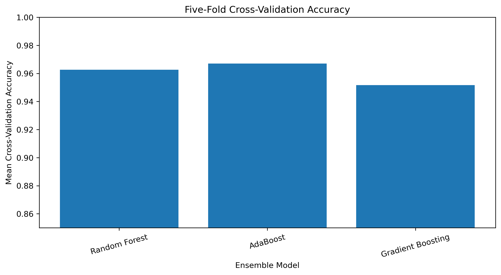
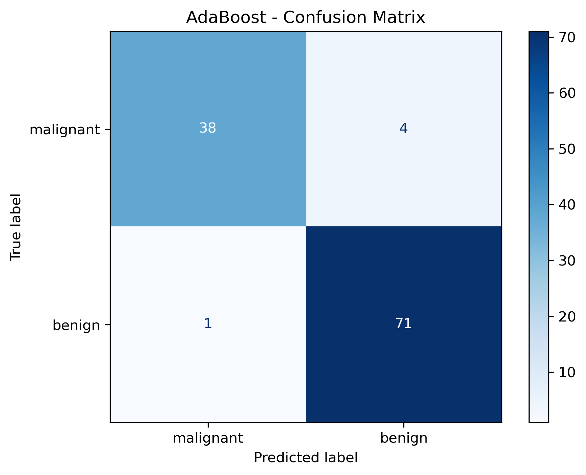
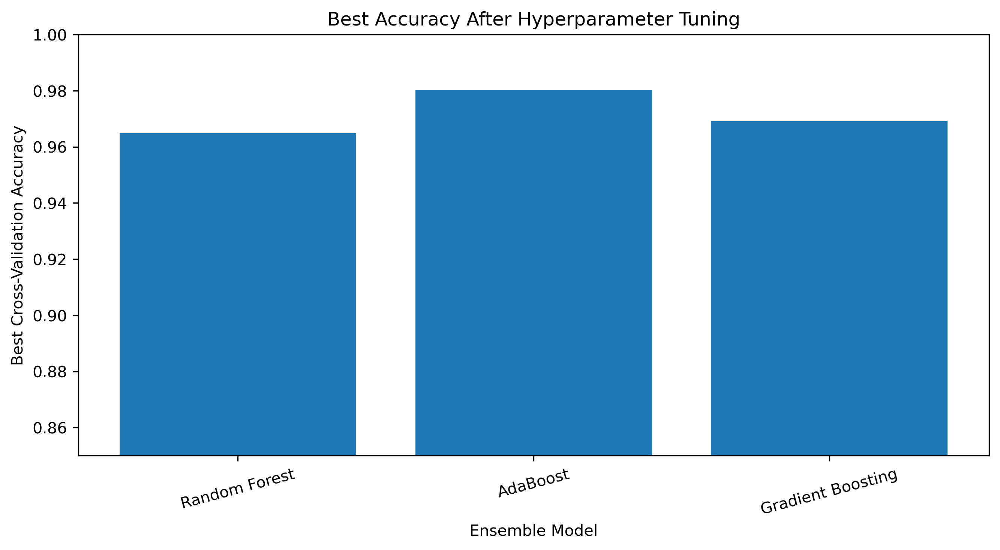
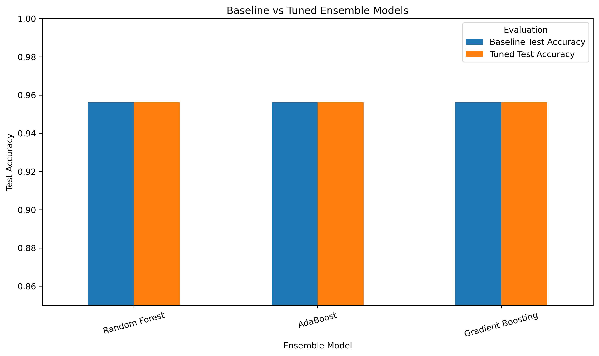
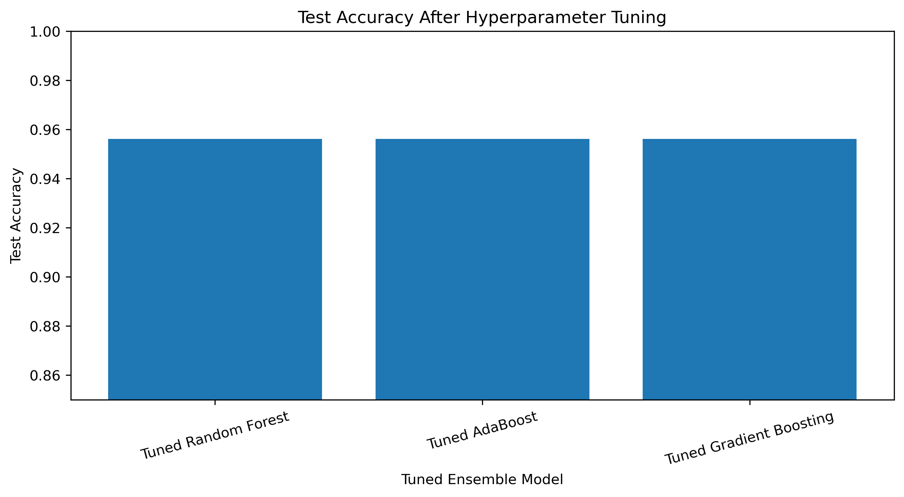
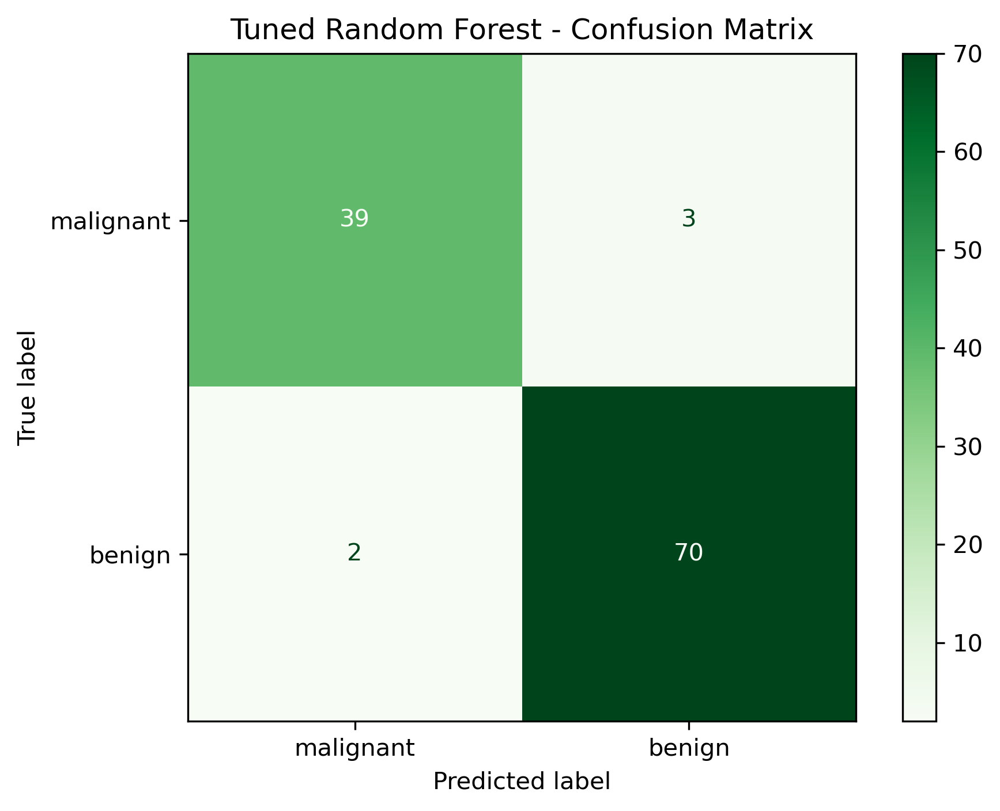
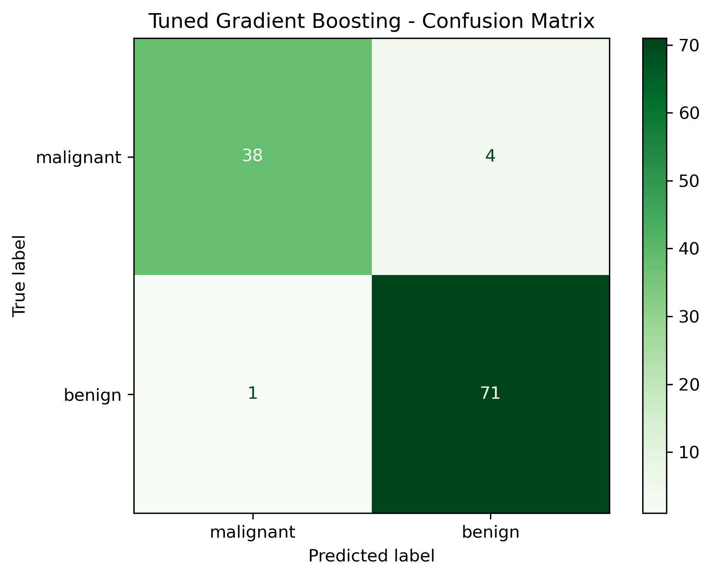

# PRACTICAL 5: ENSEMBLE LEARNING TECHNIQUES

**Course:** Applied Machine Learning Laboratory  
**Practical:** 5  
**CO Mapping:** CO3  
**Programming Language:** Python 3.13.5  
**Dataset:** Breast Cancer Wisconsin Dataset (Scikit-learn)

---

## 1. AIM

To implement ensemble learning techniques on a real-world dataset, evaluate their performance using cross-validation, and analyze the impact of hyperparameter tuning on model accuracy.

## 2. OBJECTIVES

1. Understand the concept and importance of ensemble learning.
2. Implement bagging and boosting techniques.
3. Train and evaluate Random Forest, AdaBoost, and Gradient Boosting classifiers.
4. Perform stratified cross-validation to measure model performance.
5. Apply GridSearchCV for hyperparameter optimization.
6. Compare baseline and tuned model performance.
7. Visualize classification results using confusion matrices and accuracy plots.

## 3. THEORY

### 3.1 Ensemble Learning

Ensemble learning is a machine learning technique that combines multiple individual models to produce a more accurate and reliable prediction than a single model.

The main idea is that combining several models can reduce prediction errors and improve generalization.

### 3.2 Bagging

Bagging stands for Bootstrap Aggregating. It trains multiple models independently using different bootstrap samples of the training dataset. Their predictions are combined to produce the final result.

**Random Forest** is an example of a bagging-based ensemble algorithm. It builds multiple decision trees and combines their predictions using majority voting for classification.

### 3.3 Boosting

Boosting is an ensemble technique in which models are trained sequentially. Each new model attempts to correct the errors made by the previous models.

The two boosting algorithms implemented in this practical are:

- **AdaBoost:** Assigns greater importance to incorrectly classified training samples so that subsequent weak learners focus more on difficult observations.
- **Gradient Boosting:** Builds models sequentially, where each new model attempts to reduce the errors of the existing ensemble by optimizing a loss function.

### 3.4 Cross-Validation

Cross-validation evaluates a machine learning model by dividing the dataset into multiple subsets.

In this practical, 5-fold Stratified Cross-Validation is used. The dataset is divided into five folds while maintaining the class distribution. Each fold is used once for validation, and the remaining folds are used for training.

### 3.5 Hyperparameter Tuning

Hyperparameters are configuration values specified before model training. Their values influence model complexity and predictive performance.

GridSearchCV evaluates different combinations of hyperparameters using cross-validation and identifies the combination with the highest mean validation accuracy.

## 4. SOFTWARE AND HARDWARE REQUIREMENTS

### Software Requirements

| Component | Version / Details |
|---|---|
| Operating System | Ubuntu 26.04.1 LTS |
| Programming Language | Python 3.13.5 |
| NumPy | 2.1.3 |
| Pandas | 2.2.3 |
| Matplotlib | 3.10.0 |
| Scikit-learn | 1.6.1 |
| Development Environment | Terminal / Python IDE |

### Hardware Requirements

- Processor: Intel Core i7 or equivalent
- RAM: Minimum 4 GB recommended
- Storage: Sufficient space for Python libraries and generated output files

## 5. DATASET DESCRIPTION

The Breast Cancer Wisconsin dataset is obtained directly from Scikit-learn using `load_breast_cancer()`.

It is a real-world classification dataset used to predict whether a breast tumor is malignant or benign.

| Property | Description |
|---|---|
| Dataset Name | Breast Cancer Wisconsin |
| Total Samples | 569 |
| Total Features | 30 |
| Number of Classes | 2 |
| Class 0 | Malignant |
| Class 1 | Benign |
| Feature Type | Numerical |
| Source | Scikit-learn built-in dataset |

The dataset contains numerical measurements computed from digitized images of fine needle aspirates of breast masses.

### Dataset Features

The dataset contains 30 numerical features describing characteristics such as:

- Radius
- Texture
- Perimeter
- Area
- Smoothness
- Compactness
- Concavity
- Concave points
- Symmetry
- Fractal dimension

Each characteristic is represented using mean, standard error, and worst-value measurements.

### Data Preprocessing

1. Load the dataset using Scikit-learn.
2. Separate input features and target labels.
3. Divide the dataset into training and testing subsets.
4. Use stratified splitting to preserve class distribution.
5. Use the original numerical features for model training.

**Methodological Note:** Feature scaling is not applied because the three tree-based ensemble algorithms used in this practical do not require standardization of numerical input features.

## 6. METHODOLOGY

The practical follows these steps:

1. Import the required Python libraries.
2. Load the Breast Cancer Wisconsin dataset.
3. Convert the dataset into a Pandas DataFrame.
4. Separate features and target labels.
5. Split the dataset into training and testing sets.
6. Initialize the ensemble classifiers.
7. Evaluate baseline models using 5-fold stratified cross-validation.
8. Train baseline models and calculate test accuracy.
9. Perform hyperparameter tuning using GridSearchCV.
10. Evaluate the best estimators on the testing dataset.
11. Generate classification reports and confusion matrices.
12. Save evaluation results and visualizations.
13. Compare baseline and tuned model performance.

### Train-Test Split

The dataset is divided using the following configuration:

| Parameter | Value |
|---|---|
| Training Data | 80% |
| Testing Data | 20% |
| Random State | 42 |
| Stratification | Enabled |

### Cross-Validation Configuration

| Parameter | Value |
|---|---|
| Technique | Stratified K-Fold |
| Number of Folds | 5 |
| Shuffling | Enabled |
| Random State | 42 |
| Evaluation Metric | Accuracy |

## 7. ENSEMBLE ALGORITHMS IMPLEMENTED

### 7.1 Random Forest Classifier

Random Forest is a bagging-based ensemble algorithm that constructs multiple decision trees using randomly selected training samples and feature subsets.

The final classification is determined through majority voting among the individual decision trees.

**Baseline Configuration:**

- Number of estimators: 100
- Random state: 42

**Hyperparameters Tuned:**

| Hyperparameter | Values |
|---|---|
| n_estimators | 50, 100, 150 |
| max_depth | None, 3, 5, 10 |
| min_samples_split | 2, 5, 10 |

Total combinations: **36**

### 7.2 AdaBoost Classifier

AdaBoost stands for Adaptive Boosting. It combines multiple weak learners into a stronger classifier by adjusting the importance of incorrectly classified samples during sequential training.

**Baseline Configuration:**

- Number of estimators: 50
- Learning rate: 1.0
- Random state: 42

**Hyperparameters Tuned:**

| Hyperparameter | Values |
|---|---|
| n_estimators | 50, 100, 150 |
| learning_rate | 0.01, 0.1, 0.5, 1.0 |

Total combinations: **12**

### 7.3 Gradient Boosting Classifier

Gradient Boosting is a boosting algorithm that builds an ensemble of decision trees sequentially. Each subsequent tree attempts to reduce the errors of the existing ensemble.

**Baseline Configuration:**

- Number of estimators: 100
- Learning rate: 0.1
- Maximum depth: 3
- Random state: 42

**Hyperparameters Tuned:**

| Hyperparameter | Values |
|---|---|
| n_estimators | 50, 100, 150 |
| learning_rate | 0.01, 0.1, 0.5 |
| max_depth | 2, 3, 5 |

Total combinations: **27**

## 8. HYPERPARAMETER TUNING CONFIGURATION

GridSearchCV is applied independently to all three ensemble classifiers.

| Model | Hyperparameter Combinations | CV Folds | Total CV Fits |
|---|---:|---:|---:|
| Random Forest | 36 | 5 | 180 |
| AdaBoost | 12 | 5 | 60 |
| Gradient Boosting | 27 | 5 | 135 |

**Scoring Metric:** Accuracy

**Selection Method:** The hyperparameter combination with the highest mean cross-validation accuracy is selected as the best estimator.

## 9. EXPERIMENTAL RESULTS

### 9.1 Baseline Cross-Validation Results

The three ensemble classifiers were evaluated using 5-fold Stratified Cross-Validation.

| Model | Mean CV Accuracy | Standard Deviation | Minimum Accuracy | Maximum Accuracy |
|---|---:|---:|---:|---:|
| Random Forest | 96.26% | 0.017855 | 93.41% | 98.90% |
| AdaBoost | 96.70% | 0.019658 | 94.51% | 98.90% |
| Gradient Boosting | 95.16% | 0.014906 | 93.41% | 97.80% |

AdaBoost achieved the highest baseline mean cross-validation accuracy of approximately 96.70%.

### 9.2 Baseline Test Results

| Model | Test Accuracy |
|---|---:|
| Random Forest | 95.61% |
| AdaBoost | 95.61% |
| Gradient Boosting | 95.61% |

All three baseline classifiers achieved the same test accuracy.

### 9.3 Best Hyperparameters

GridSearchCV identified the following best hyperparameter configurations:

| Model | Best Hyperparameters | Best CV Accuracy |
|---|---|---:|
| Random Forest | max_depth=None, min_samples_split=2, n_estimators=150 | 96.48% |
| AdaBoost | learning_rate=1.0, n_estimators=100 | 98.02% |
| Gradient Boosting | learning_rate=0.5, max_depth=2, n_estimators=100 | 96.92% |

AdaBoost achieved the highest tuned cross-validation accuracy of approximately 98.02%.

### 9.4 Tuned Model Test Results

| Model | Tuned Test Accuracy |
|---|---:|
| Random Forest | 95.61% |
| AdaBoost | 95.61% |
| Gradient Boosting | 95.61% |

All three tuned models achieved 95.61% accuracy on the held-out testing dataset.

### 9.5 Baseline vs Tuned Model Comparison

| Model | Baseline Test Accuracy | Tuned Test Accuracy | Improvement |
|---|---:|---:|---:|
| Random Forest | 95.61% | 95.61% | 0.00% |
| AdaBoost | 95.61% | 95.61% | 0.00% |
| Gradient Boosting | 95.61% | 95.61% | 0.00% |

Hyperparameter tuning improved the best cross-validation accuracy, particularly for AdaBoost. However, it did not change the held-out test accuracy for any of the three models.

## 10. VISUALIZATION AND OUTPUT ANALYSIS

The experiment generates visualizations to understand and compare the performance of the ensemble classifiers.

### 10.1 Cross-Validation Accuracy

The cross-validation accuracy plot compares the performance of Random Forest, AdaBoost, and Gradient Boosting across five validation folds.

### 10.2 Random Forest Confusion Matrix

The confusion matrix represents the actual and predicted class labels for the Random Forest classifier.

### 10.3 AdaBoost Confusion Matrix

The confusion matrix evaluates the classification performance of AdaBoost.

### 10.4 Gradient Boosting Confusion Matrix

The confusion matrix illustrates the classification performance of Gradient Boosting.

### 10.5 Best Hyperparameter CV Accuracy

This visualization compares the best cross-validation accuracy obtained by each tuned ensemble classifier.

### 10.6 Baseline vs Tuned Accuracy

This plot compares baseline and tuned model accuracy on the testing dataset.

### 10.7 Tuned Model Test Accuracy

This visualization compares the test accuracy of the three optimized ensemble classifiers.

### 10.8 Tuned Random Forest Confusion Matrix

### 10.9 Tuned AdaBoost Confusion Matrix

### 10.10 Tuned Gradient Boosting Confusion Matrix

## 11. OBSERVATIONS

1. All three ensemble algorithms performed well on the Breast Cancer Wisconsin dataset.
2. AdaBoost achieved the highest baseline mean cross-validation accuracy of approximately 96.70%.
3. Random Forest achieved a baseline mean cross-validation accuracy of approximately 96.26%.
4. Gradient Boosting achieved a baseline mean cross-validation accuracy of approximately 95.16%.
5. Hyperparameter tuning improved the best cross-validation accuracy of the models.
6. AdaBoost achieved the highest tuned cross-validation accuracy of approximately 98.02%.
7. All three tuned models achieved the same test accuracy of approximately 95.61%.
8. The held-out test accuracy remained unchanged after hyperparameter tuning.
9. Confusion matrices provide additional information about correct and incorrect classifications.
10. Cross-validation helps evaluate model stability across different training and validation subsets.

## 12. CONCLUSION

In this practical, three ensemble learning techniques—Random Forest, AdaBoost, and Gradient Boosting—were successfully implemented using the Breast Cancer Wisconsin dataset.

The models were evaluated using 5-fold Stratified Cross-Validation and an independent testing dataset. GridSearchCV was used to optimize model hyperparameters and analyze their impact on classification performance.

AdaBoost achieved the highest tuned cross-validation accuracy of approximately 98.02%. However, all three tuned classifiers achieved the same held-out test accuracy of approximately 95.61%.

The experiment demonstrates that ensemble learning techniques can provide strong classification performance and that cross-validation and hyperparameter tuning are useful for evaluating and optimizing machine learning models.

## 13. GENERATED FILES

### 13.1 Python Source File

| File | Description |
|---|---|
| `experiment_5_ensemble_learning.py` | Complete Python implementation of ensemble learning, cross-validation, hyperparameter tuning, evaluation, and visualization |

### 13.2 Output Directory

All generated results are stored in the `output/` directory.

**CSV Result Files**

| File | Description |
|---|---|
| `breast_cancer_dataset.csv` | Exported dataset |
| `cross_validation_results.csv` | Cross-validation accuracy results |
| `baseline_test_results.csv` | Baseline model test results |
| `tuned_model_test_results.csv` | Tuned model test results |
| `baseline_vs_tuned_comparison.csv` | Baseline and tuned accuracy comparison |
| `hyperparameter_tuning_summary.csv` | Best hyperparameters and CV accuracy |
| `random_forest_grid_search_results.csv` | Random Forest grid-search results |
| `adaboost_grid_search_results.csv` | AdaBoost grid-search results |
| `gradient_boosting_grid_search_results.csv` | Gradient Boosting grid-search results |
| `random_forest_classification_report.csv` | Random Forest classification report |
| `adaboost_classification_report.csv` | AdaBoost classification report |
| `gradient_boosting_classification_report.csv` | Gradient Boosting classification report |

**PNG Visualization Files**

| File | Description |
|---|---|
| `cross_validation_accuracy.png` | Cross-validation accuracy comparison |
| `random_forest_confusion_matrix.png` | Random Forest confusion matrix |
| `adaboost_confusion_matrix.png` | AdaBoost confusion matrix |
| `gradient_boosting_confusion_matrix.png` | Gradient Boosting confusion matrix |
| `best_hyperparameter_cv_accuracy.png` | Best tuned CV accuracy comparison |
| `baseline_vs_tuned_accuracy.png` | Baseline versus tuned accuracy |
| `tuned_model_test_accuracy.png` | Tuned model test accuracy |
| `tuned_random_forest_confusion_matrix.png` | Tuned Random Forest confusion matrix |
| `tuned_adaboost_confusion_matrix.png` | Tuned AdaBoost confusion matrix |
| `tuned_gradient_boosting_confusion_matrix.png` | Tuned Gradient Boosting confusion matrix |

**Additional Output**

| File | Description |
|---|---|
| `experiment_output.txt` | Saved experiment execution output |

## 14. REFERENCES

1. Scikit-learn Documentation: https://scikit-learn.org/
2. Scikit-learn Breast Cancer Wisconsin Dataset: https://scikit-learn.org/stable/modules/generated/sklearn.datasets.load_breast_cancer.html
3. Scikit-learn Random Forest Documentation: https://scikit-learn.org/stable/modules/generated/sklearn.ensemble.RandomForestClassifier.html
4. Scikit-learn AdaBoost Documentation: https://scikit-learn.org/stable/modules/generated/sklearn.ensemble.AdaBoostClassifier.html
5. Scikit-learn Gradient Boosting Documentation: https://scikit-learn.org/stable/modules/generated/sklearn.ensemble.GradientBoostingClassifier.html
6. Scikit-learn GridSearchCV Documentation: https://scikit-learn.org/stable/modules/generated/sklearn.model_selection.GridSearchCV.html
7. Scikit-learn Cross-Validation Documentation: https://scikit-learn.org/stable/modules/cross_validation.html

---

**END OF PRACTICAL 5**

**CO MAPPING: CO3**
