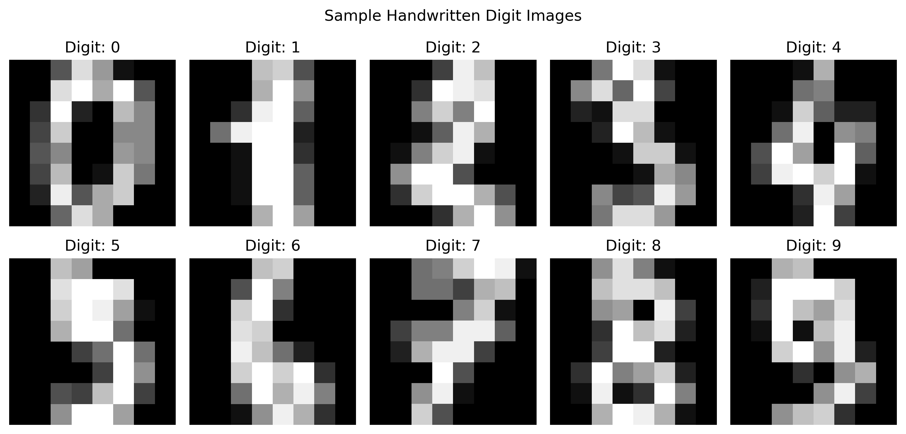
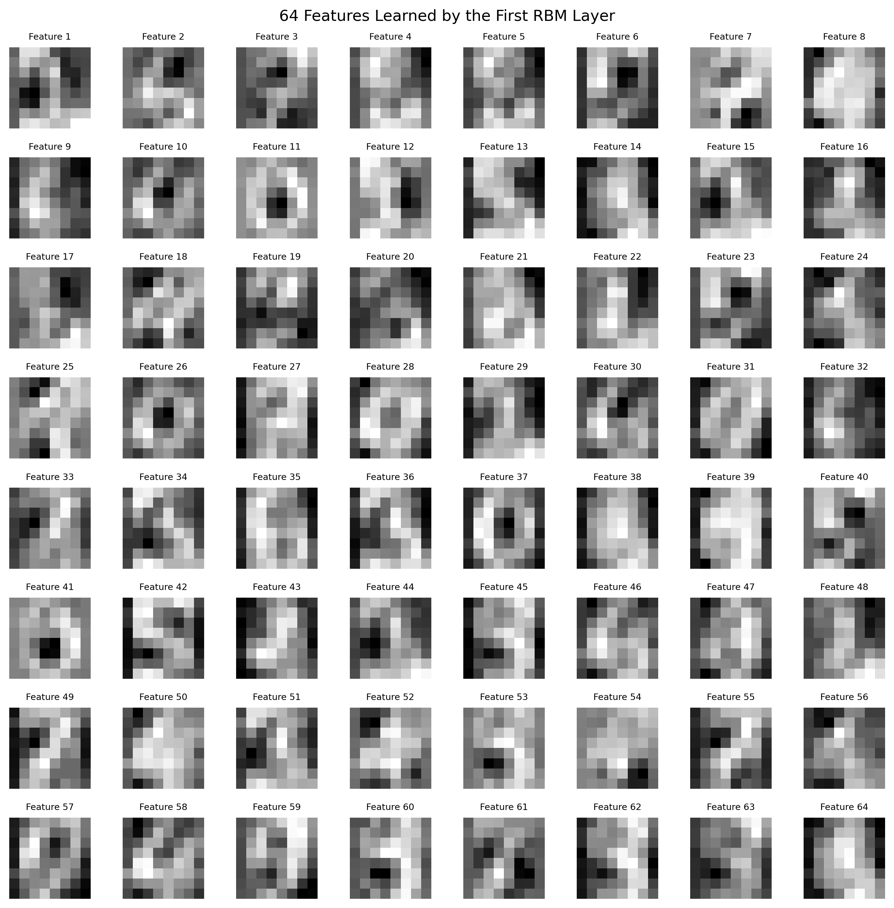
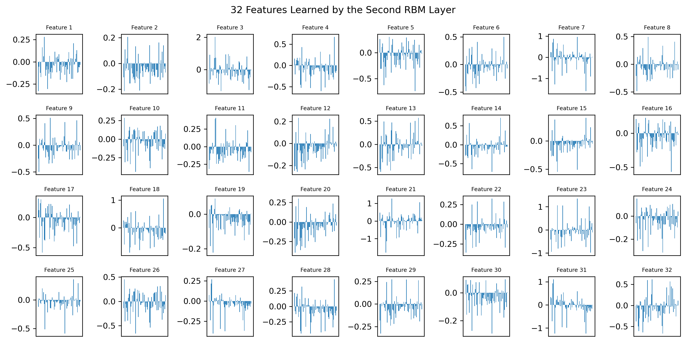
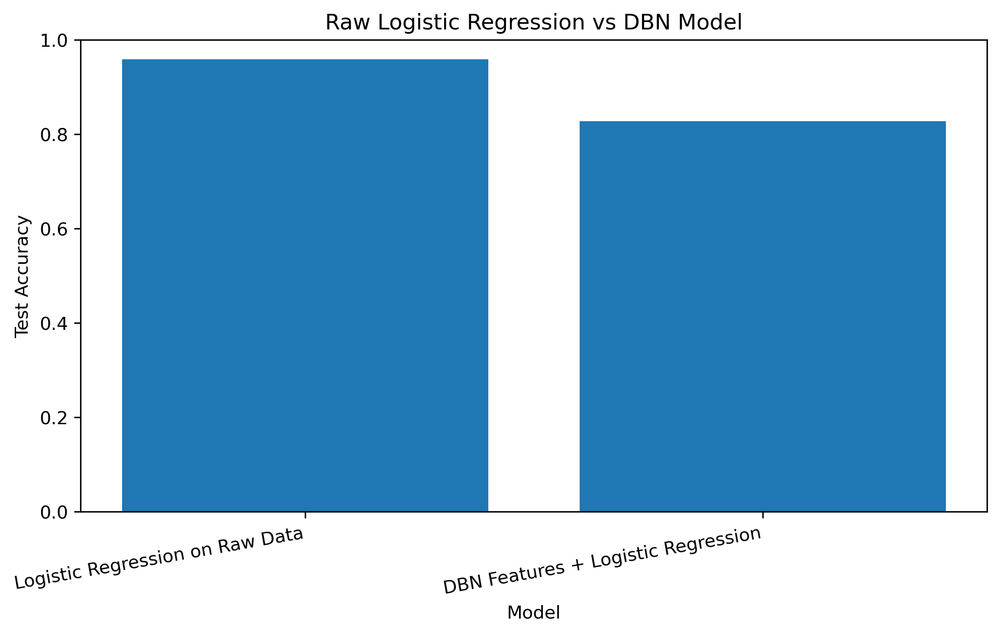
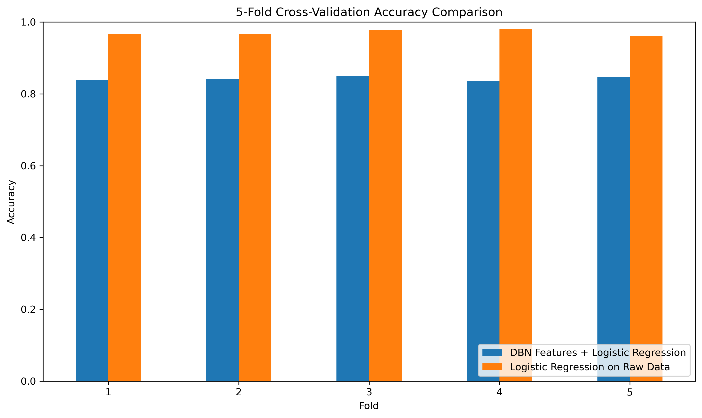
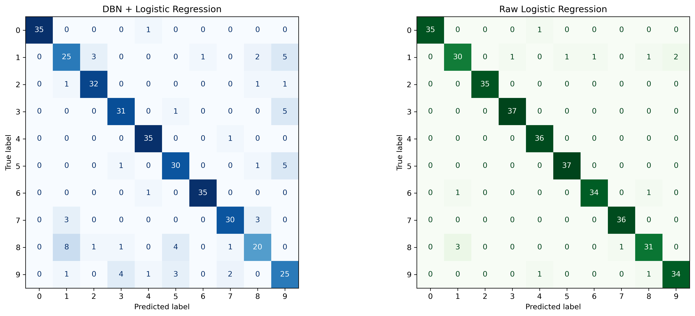

# PRACTICAL 6: IMPLEMENTATION OF DEEP BELIEF NETWORK (DBN)

**Course Outcome Mapping:** CO4  
**Course Outcome:** Analyse and evaluate ML models using suitable performance parameters and cross-validation to identify best-suited techniques for specific applications.  
**Programming Language:** Python 3  
**Dataset:** Scikit-learn Digits Dataset

---

## 01. AIM

To implement a Deep Belief Network (DBN)-like model using Restricted Boltzmann Machines (RBMs) on a simple image dataset, extract learned features, visualize the learned representations, and evaluate the model's classification performance.

## 02. OBJECTIVES

1. To understand the fundamental concepts and architecture of a Deep Belief Network.
2. To implement a DBN-like model using Python and Scikit-learn.
3. To understand the role of Restricted Boltzmann Machines in unsupervised feature learning.
4. To apply stacked RBM feature extraction to the Digits image dataset.
5. To visualize the original digit images and features learned by RBM layers.
6. To train a Logistic Regression classifier using the extracted features.
7. To compare the DBN-based classifier with a raw-data Logistic Regression baseline.
8. To evaluate both models using accuracy, precision, recall, F1-score, and cross-validation.

## 03. THEORY

### 3.1 Deep Belief Network

A Deep Belief Network (DBN) is a generative deep learning architecture composed of multiple layers of latent variables. It can learn hierarchical representations of input data through a sequence of feature-learning layers.

A traditional DBN is commonly constructed by stacking multiple Restricted Boltzmann Machines (RBMs). Each RBM learns a representation of the input received from the preceding layer.

The learned representations become progressively more abstract as information passes through the network.

### 3.2 Restricted Boltzmann Machine

A Restricted Boltzmann Machine is a stochastic neural network consisting of two layers:

- **Visible layer:** Receives the input data.
- **Hidden layer:** Learns patterns and representations from the input.

There are no connections between units within the same layer. Connections exist between the visible and hidden layers.

An RBM learns a probability distribution over its input data and discovers useful feature representations.

### 3.3 Visible and Hidden Layers

The visible layer represents the original input features. In this experiment, each image contains 64 pixel values because the Digits dataset contains 8 × 8 images.

The hidden layer learns a new representation of the input. The first RBM learns 64 hidden components, while the second RBM learns 32 components from the first RBM's output.

### 3.4 Unsupervised Feature Learning

RBMs are trained to discover useful patterns from input data without requiring class labels during the feature-learning stage.

The hidden representations generated by the RBMs are subsequently supplied to a supervised classifier.

This experiment uses the learned RBM representations as input to Logistic Regression.

### 3.5 Supervised Classification

After feature extraction, Logistic Regression is trained using the extracted features and their corresponding digit labels.

The classifier predicts one of ten digit classes, from 0 to 9.

### 3.6 Performance Evaluation

The experiment evaluates the models using the following performance parameters:

**Accuracy**

The proportion of correctly classified samples among all evaluated samples.

\[
Accuracy = \frac{TP+TN}{TP+TN+FP+FN}
\]

**Precision**

The proportion of positive predictions that are correct.

\[
Precision = \frac{TP}{TP+FP}
\]

**Recall**

The proportion of actual positive samples correctly identified.

\[
Recall = \frac{TP}{TP+FN}
\]

**F1-Score**

The harmonic mean of precision and recall.

\[
F1 = 2 \times \frac{Precision \times Recall}{Precision+Recall}
\]

**Cross-Validation**

Stratified five-fold cross-validation divides the dataset into five folds while preserving class proportions. Each fold is used once for validation, while the remaining folds are used for training.

The mean and standard deviation of the resulting scores help evaluate model performance and consistency.

### 3.7 DBN-Like Implementation Used in This Practical

This practical implements a stacked RBM feature-learning pipeline using Scikit-learn's `BernoulliRBM` implementation.

The architecture is:

1. MinMaxScaler for input normalization.
2. First BernoulliRBM with 64 hidden components.
3. Second BernoulliRBM with 32 hidden components.
4. Logistic Regression for final classification.

**Important implementation note:** This is a DBN-like stacked RBM feature-learning implementation followed by a supervised classifier. It demonstrates the central feature-learning idea of a DBN using Scikit-learn; it is not presented as a complete general-purpose DBN framework.

## 04. SOFTWARE AND HARDWARE REQUIREMENTS

### 4.1 Software Requirements

| Software / Library | Version / Description |
|---|---|
| Operating System | Ubuntu Linux |
| Programming Language | Python 3 |
| NumPy | 2.1.3 |
| Pandas | 2.2.3 |
| Matplotlib | 3.10.0 |
| Scikit-learn | 1.6.1 |
| BernoulliRBM | Scikit-learn neural network module |
| Code Editor | Any Python-compatible editor |
| Terminal | Linux Terminal |

### 4.2 Hardware Requirements

| Component | Tested System |
|---|---|
| Processor | Intel Core i7-8665U |
| RAM | Approximately 14 GB |
| Graphics | Intel UHD Graphics 620 |
| Storage | Sufficient space for Python libraries and generated results |

### 4.3 Required Python Libraries

- NumPy
- Pandas
- Matplotlib
- Scikit-learn

## 05. DATASET DESCRIPTION

### 5.1 Dataset Name

Scikit-learn Digits Dataset.

### 5.2 Dataset Overview

The Digits dataset is a collection of handwritten digit images available directly through the Scikit-learn library.

Each image represents a handwritten digit from 0 to 9 and has a resolution of 8 × 8 pixels.

### 5.3 Dataset Characteristics

| Property | Value |
|---|---:|
| Total samples | 1,797 |
| Image dimensions | 8 × 8 pixels |
| Input features | 64 |
| Number of classes | 10 |
| Class labels | 0–9 |
| Training samples | 1,437 |
| Testing samples | 360 |

### 5.4 Input and Output

**Input:** A 64-dimensional feature vector representing the pixel values of an 8 × 8 handwritten digit image.

**Output:** One predicted digit class from 0 to 9.

### 5.5 Dataset Loading

The dataset is loaded using Scikit-learn's `load_digits()` function.

The image data is represented as numerical feature vectors, while the target array contains the corresponding digit labels.

The input data is normalized using `MinMaxScaler` as part of the model pipeline.

## 06. METHODOLOGY

The experiment follows these steps:

1. Import the required Python libraries.
2. Load the Scikit-learn Digits dataset.
3. Separate the input features and target labels.
4. Divide the dataset into training and testing sets using an 80:20 stratified split.
5. Define a Logistic Regression baseline using the original input features.
6. Define a stacked RBM feature-learning pipeline.
7. Train the first RBM to learn an initial hidden representation.
8. Train the second RBM using the representation produced by the first RBM.
9. Extract learned features from the stacked RBM layers.
10. Train Logistic Regression using the learned features.
11. Generate predictions for the test dataset.
12. Calculate accuracy, precision, recall, and F1-score.
13. Perform stratified five-fold cross-validation for both models.
14. Generate classification reports and confusion matrices.
15. Visualize original digit images and the learned RBM features.
16. Compare model performance and save the experimental results.

### 6.1 Data Splitting

The dataset is divided using:

- Training set: 80% (1,437 samples).
- Testing set: 20% (360 samples).
- Random state: 42.
- Stratification: Enabled.

Stratification helps preserve the relative distribution of digit classes in the training and testing sets.

### 6.2 Data Normalization

`MinMaxScaler` is used to scale input values into the range [0, 1].

The scaler is placed inside the model pipelines so that it is fitted separately within each training fold during cross-validation. This helps prevent data leakage from validation samples.

### 6.3 Model Comparison

Two approaches are evaluated:

**Model 1: Logistic Regression on Raw Data**

The original normalized 64-dimensional pixel features are supplied directly to Logistic Regression.

**Model 2: DBN Features + Logistic Regression**

The input features pass through two stacked RBM layers. The learned representation is then supplied to Logistic Regression for classification.

### 6.4 Evaluation Strategy

Both models are evaluated using the same train-test split and stratified five-fold cross-validation.

The following metrics are recorded:

- Accuracy
- Weighted precision
- Weighted recall
- Weighted F1-score
- Mean cross-validation score
- Standard deviation of cross-validation score

## 07. ALGORITHMS AND MODEL CONFIGURATION

### 7.1 Dataset Preparation Algorithm

1. Start.
2. Load the Digits dataset.
3. Extract input features and target labels.
4. Split the dataset into training and testing sets.
5. Apply feature normalization through the model pipelines.
6. Continue to model training.

### 7.2 Stacked RBM Feature-Learning Algorithm

1. Initialize the first RBM.
2. Train the first RBM using the normalized input data.
3. Transform the input data into the first hidden representation.
4. Initialize the second RBM.
5. Train the second RBM using the first RBM's representation.
6. Transform the first representation into the second hidden representation.
7. Use the resulting features for classification.

### 7.3 Classification Algorithm

1. Receive the extracted RBM features.
2. Train Logistic Regression using the training features and labels.
3. Predict the digit classes for the testing features.
4. Compare predictions with actual labels.
5. Calculate the evaluation metrics.

### 7.4 Model Configuration

| Parameter | Configuration |
|---|---|
| Dataset | Scikit-learn Digits |
| Train-test ratio | 80:20 |
| Random state | 42 |
| Cross-validation | Stratified 5-fold |
| Cross-validation shuffle | True |
| First RBM components | 64 |
| Second RBM components | 32 |
| RBM learning rate | 0.05 |
| RBM iterations | 30 |
| RBM batch size | 10 |
| RBM implementation | BernoulliRBM |
| Classifier | Logistic Regression |
| Logistic Regression maximum iterations | 5000 |
| Scaling | MinMaxScaler |
| Evaluation metrics | Accuracy, Precision, Recall, F1-score |

### 7.5 Cross-Validation Configuration

Stratified five-fold cross-validation is used to evaluate both models. Accuracy, weighted precision, weighted recall, and weighted F1-score are recorded for each fold.

The mean, standard deviation, minimum, and maximum scores are saved for comparison.

### 7.6 Reproducibility

A fixed random state of 42 is used for the train-test split and cross-validation configuration. This supports reproducible data partitioning and evaluation.

## 08. EXPERIMENTAL RESULTS

### 8.1 Execution Summary

The Practical 6 Python program executed successfully.

The experiment loaded the Scikit-learn Digits dataset, trained both classification approaches, performed five-fold cross-validation, generated evaluation reports, and saved the resulting CSV files and visualizations.

| Parameter | Actual Result |
|---|---:|
| Dataset | Scikit-learn Digits |
| Total samples | 1,797 |
| Input features | 64 |
| Number of classes | 10 |
| Training samples | 1,437 |
| Testing samples | 360 |
| Execution status | Successful |

### 8.2 Test Set Model Comparison

The following results were obtained from the 360 testing samples.

| Model | Accuracy | Precision | Recall | F1-Score |
|---|---:|---:|---:|---:|
| Logistic Regression on Raw Data | 95.83% | 95.79% | 95.83% | 95.78% |
| DBN Features + Logistic Regression | 82.78% | 83.00% | 82.78% | 82.73% |

### 8.3 Cross-Validation Accuracy

The following table shows the actual five-fold cross-validation accuracy.

| Fold | Raw Logistic Regression | DBN Features + Logistic Regression |
|---|---:|---:|
| Fold 1 | 96.67% | 83.89% |
| Fold 2 | 96.67% | 84.17% |
| Fold 3 | 97.77% | 84.96% |
| Fold 4 | 98.05% | 83.57% |
| Fold 5 | 96.10% | 84.68% |
| **Mean** | **97.05%** | **84.25%** |

### 8.4 Cross-Validation Summary

| Model | Metric | Mean | Standard Deviation |
|---|---|---:|---:|
| Raw Logistic Regression | Accuracy | 97.05% | 0.74% |
| Raw Logistic Regression | Weighted Precision | 97.16% | 0.71% |
| Raw Logistic Regression | Weighted Recall | 97.05% | 0.74% |
| Raw Logistic Regression | Weighted F1-score | 97.06% | 0.73% |
| DBN Features + Logistic Regression | Accuracy | 84.25% | 0.51% |
| DBN Features + Logistic Regression | Weighted Precision | 84.71% | 0.53% |
| DBN Features + Logistic Regression | Weighted Recall | 84.25% | 0.51% |
| DBN Features + Logistic Regression | Weighted F1-score | 84.22% | 0.48% |

### 8.5 Classification Report Observations

The test-set classification reports provide class-wise precision, recall, F1-score, and support.

**Raw Logistic Regression:**

- Test accuracy: 95.83%.
- Weighted precision: 95.79%.
- Weighted recall: 95.83%.
- Weighted F1-score: 95.78%.
- The classifier achieved an F1-score of 1.00 for digit class 2.
- The lowest class-wise F1-score was approximately 0.86 for digit class 1.

**DBN Features + Logistic Regression:**

- Test accuracy: 82.78%.
- Weighted precision: 83.00%.
- Weighted recall: 82.78%.
- Weighted F1-score: 82.73%.
- The classifier achieved an F1-score of approximately 0.99 for digit class 0.
- Digit classes 1, 8, and 9 showed comparatively weaker classification performance.

### 8.6 Actual Experimental Interpretation

The raw-data Logistic Regression model performed better than the stacked RBM feature-learning model in this experiment.

The raw model achieved 95.83% test accuracy, whereas the DBN-based pipeline achieved 82.78%.

The DBN model's five-fold mean accuracy was 84.25%, with a standard deviation of approximately 0.51%. This indicates relatively consistent performance across the five validation folds, although its accuracy was lower than that of the raw-data baseline.

The learned RBM representations did not preserve all the discriminative information required for the best classification performance under the selected architecture and hyperparameters.

This result demonstrates that feature extraction through an unsupervised learning method does not automatically improve the performance of a supervised classifier. Model architecture, feature quality, and hyperparameter selection can influence the final result.

## 09. VISUALIZATION OF EXPERIMENTAL RESULTS

The experiment generated six PNG visualizations. These figures are stored in the `output/` directory.

### 9.1 Original Digit Images

The visualization displays sample handwritten digit images from the Scikit-learn Digits dataset.

It provides a visual understanding of the input data used in the experiment.



**Figure 9.1: Original Digit Images from the Scikit-learn Digits Dataset**

### 9.2 First RBM Learned Features

This visualization represents the learned features from the first RBM layer.

The first RBM contains 64 hidden components and learns an initial representation of the input digit images.



**Figure 9.2: Features Learned by the First RBM Layer**

### 9.3 Second RBM Learned Features

This visualization represents the learned features from the second RBM layer.

The second RBM contains 32 hidden components and learns a further representation from the first RBM's output.



**Figure 9.3: Features Learned by the Second RBM Layer**

### 9.4 Model Accuracy Comparison

This figure compares the test-set accuracy of Logistic Regression on raw data and Logistic Regression using DBN-extracted features.

The raw-data baseline achieved higher accuracy in the experiment.



**Figure 9.4: Test Accuracy Comparison Between the Two Models**

### 9.5 Cross-Validation Accuracy

This figure compares the accuracy obtained by both models across the five cross-validation folds.

It helps illustrate the consistency and performance differences between the two approaches.



**Figure 9.5: Five-Fold Cross-Validation Accuracy Comparison**

### 9.6 Confusion Matrix Comparison

The confusion matrix visualization compares the classification results of the raw-data baseline and DBN-based classifier.

It helps identify correct predictions and misclassifications across the ten digit classes.



**Figure 9.6: Confusion Matrix Comparison of Both Classification Models**

## 10. OBSERVATIONS

1. The Scikit-learn Digits dataset contains 1,797 handwritten digit samples, with 64 input features and 10 output classes.
2. The dataset was divided into 1,437 training samples and 360 testing samples.
3. Two RBM layers were used to learn hierarchical feature representations.
4. The first RBM used 64 hidden components, while the second RBM used 32 hidden components.
5. Logistic Regression was used as the final classifier for both the raw-data and DBN-feature approaches.
6. The raw-data Logistic Regression model achieved 95.83% test accuracy.
7. The DBN-feature Logistic Regression model achieved 82.78% test accuracy.
8. The raw-data baseline achieved a higher five-fold mean accuracy of 97.05%, compared with 84.25% for the DBN-based model.
9. The DBN-based model achieved a cross-validation accuracy standard deviation of approximately 0.51%.
10. The feature visualizations demonstrate the representations learned by the two RBM layers.
11. The confusion matrices and classification reports help identify class-wise prediction performance.
12. The experiment demonstrates that unsupervised feature learning does not necessarily outperform direct classification using original features.
13. The results indicate that further tuning of RBM components, learning rate, iterations, and classifier parameters could be explored to improve performance.

## 11. CONCLUSION

The Deep Belief Network practical was successfully implemented using Python and Scikit-learn's BernoulliRBM.

The Scikit-learn Digits dataset was used to demonstrate stacked RBM feature learning. Two RBM layers were configured to learn feature representations, and Logistic Regression was applied to classify the extracted features.

The experiment also implemented a raw-data Logistic Regression baseline for performance comparison. Both models were evaluated using accuracy, precision, recall, F1-score, classification reports, confusion matrices, and stratified five-fold cross-validation.

The raw-data Logistic Regression model achieved 95.83% test accuracy, while the DBN-feature model achieved 82.78%. Their respective five-fold mean accuracies were 97.05% and 84.25%.

Although the DBN-based model did not outperform the baseline in this experiment, it successfully demonstrated stacked RBM feature learning, feature visualization, and model evaluation.

Thus, the practical helped develop an understanding of DBN concepts, RBM-based unsupervised feature extraction, supervised classification, and performance evaluation using suitable metrics and cross-validation.

## 12. GENERATED FILES AND OUTPUT STRUCTURE

### 12.1 Project Directory Structure

```text
Experiment - 6/
│
├── experiment_6_deep_belief_network.py
├── README.md
│
└── output/
    │
    ├── digits_dataset.csv
    ├── dbn_training_features.csv
    ├── dbn_testing_features.csv
    ├── model_comparison.csv
    ├── cross_validation_results.csv
    ├── cross_validation_summary.csv
    ├── raw_classification_report.csv
    ├── dbn_classification_report.csv
    ├── raw_confusion_matrix.csv
    ├── dbn_confusion_matrix.csv
    │
    ├── original_digit_images.png
    ├── rbm1_learned_features.png
    ├── rbm2_learned_features.png
    ├── model_accuracy_comparison.png
    ├── cross_validation_accuracy.png
    ├── confusion_matrix_comparison.png
    │
    └── experiment_output.txt
```

### 12.2 Python Source File
File	Description
experiment_6_deep_belief_network.py	Complete implementation of the stacked RBM feature-learning experiment, model comparison, evaluation, and visualization.

12.3 Generated CSV Files
File Name	Description
digits_dataset.csv	Exported Digits dataset containing input features and labels.
dbn_training_features.csv	Learned features extracted from the training dataset.
dbn_testing_features.csv	Learned features extracted from the testing dataset.
model_comparison.csv	Test-set accuracy, precision, recall, and F1-score comparison.
cross_validation_results.csv	Individual evaluation metrics for all five folds and both models.
cross_validation_summary.csv	Mean, standard deviation, minimum, and maximum cross-validation scores.
raw_classification_report.csv	Class-wise classification report for the raw-data baseline.
dbn_classification_report.csv	Class-wise classification report for the DBN-feature model.
raw_confusion_matrix.csv	Confusion matrix for the raw-data baseline.
dbn_confusion_matrix.csv	Confusion matrix for the DBN-feature model.

12.4 Generated PNG Files
File Name	Description
original_digit_images.png	Sample original handwritten digit images.
rbm1_learned_features.png	Learned feature visualization from the first RBM.
rbm2_learned_features.png	Learned feature visualization from the second RBM.
model_accuracy_comparison.png	Comparison of both models' test accuracy.
cross_validation_accuracy.png	Accuracy comparison across five validation folds.
confusion_matrix_comparison.png	Visual comparison of both models' confusion matrices.

12.5 Execution Log
File	Description
experiment_output.txt	Console output containing execution progress, model evaluation, classification reports, and final results.

12.6 Generated File Summary
File Type	Count
Python source files	1
CSV files	10
PNG visualization files	6
Execution log files	1
README files	1

## 13. REFERENCES
1. Scikit-learn, BernoulliRBM Documentation.
   https://scikit-learn.org/stable/modules/generated/sklearn.neural_network.BernoulliRBM.html
2. Scikit-learn, Restricted Boltzmann Machine Features for Digit Classification.
   https://scikit-learn.org/stable/auto_examples/neural_networks/plot_rbm_logistic_classification.html
3. Research paper on Deep Belief Networks.
   https://arxiv.org/abs/2107.12521
4. PyImageSearch, Applying Deep Learning: RBM on MNIST Using Python.
   https://pyimagesearch.com/2014/06/23/applying-deep-learning-rbm-mnist-using-python/
5. GeeksforGeeks, Deep Belief Network (DBN) in Deep Learning.
   https://www.geeksforgeeks.org/deep-learning/deep-belief-network-dbn-in-deep-learning/
6. Scikit-learn, Digits Dataset Documentation.
   https://scikit-learn.org/stable/modules/generated/sklearn.datasets.load_digits.html
7. Scikit-learn, Logistic Regression Documentation.
   https://scikit-learn.org/stable/modules/generated/sklearn.linear_model.LogisticRegression.html
## 14. FINAL RESULT
The Deep Belief Network practical was successfully implemented using a stacked RBM feature-learning approach on the Scikit-learn Digits dataset.

The experiment successfully trained and evaluated both the raw-data Logistic Regression baseline and the DBN-feature Logistic Regression model. It also generated learned-feature visualizations, classification reports, confusion matrices, accuracy comparisons, and cross-validation results.

Final Experimental Results:
Evaluation Parameter	Raw Logistic Regression	DBN Features + Logistic Regression
Test Accuracy	95.83%	82.78%
Mean 5-Fold CV Accuracy	97.05%	84.25%

Execution Status: Successfully Completed.

Generated Results: 10 CSV files and 6 PNG visualizations.

Conclusion: The experiment successfully demonstrated RBM-based feature learning and DBN-like classification. The raw-data Logistic Regression baseline achieved higher classification performance under the selected experimental configuration.

END OF PRACTICAL

CO MAPPING: CO4
