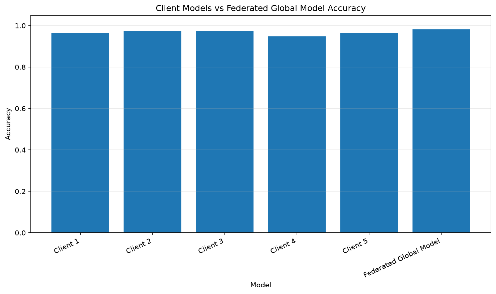
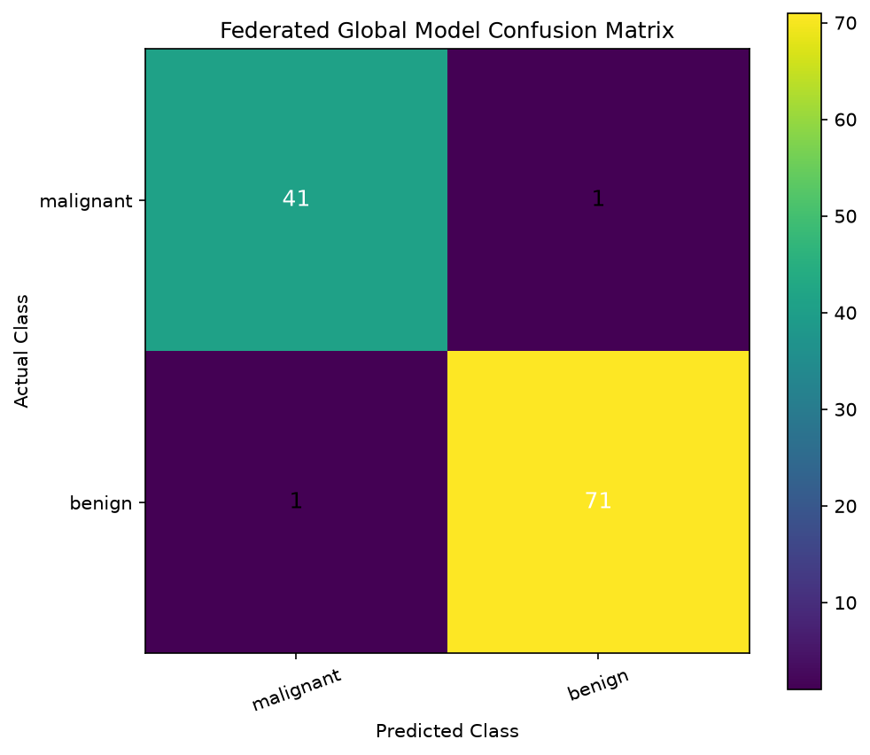
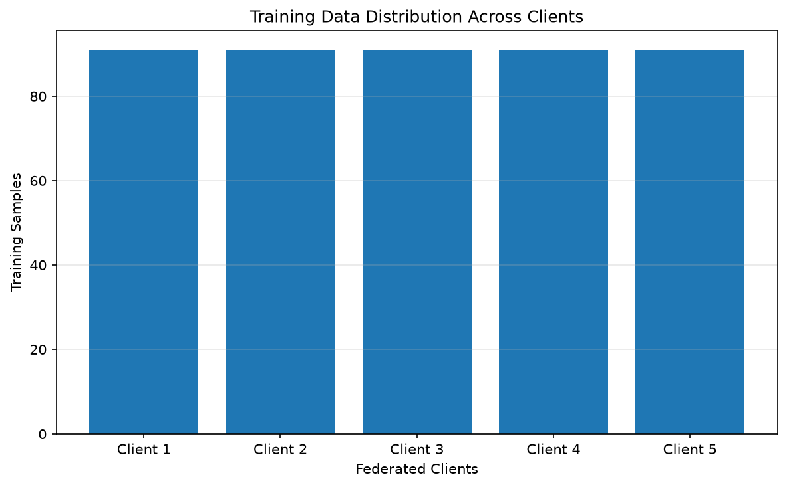

# EXPERIMENT 09: IMPLEMENTATION OF FEDERATED LEARNING USING A MACHINE LEARNING MODEL

**Course:** Applied Machine Learning Laboratory (AML Lab)  
**Experiment:** 09  
**Course Outcome:** CO4  
**Programming Language:** Python  
**Machine Learning Algorithm:** Logistic Regression  
**Federated Learning Simulation:** Five Clients with Majority Voting  
**Dataset:** Breast Cancer Wisconsin Dataset

---

## 01. AIM

To implement and demonstrate a Federated Learning system using a machine learning model by simulating multiple clients, training local models on separate portions of a common dataset, combining their predictions, and evaluating the performance of the resulting global prediction system.

## 02. OBJECTIVES

1. To understand the basic concept and working principle of Federated Learning.
2. To simulate multiple independent clients using a single dataset.
3. To divide the training dataset into separate client-specific partitions.
4. To train individual machine learning models on different client datasets.
5. To combine local model predictions using a majority voting mechanism.
6. To evaluate individual client models and the combined prediction system.
7. To understand how Federated Learning can reduce the need to centralize raw training data.
8. To study the use of machine learning in privacy-conscious collaborative applications.

## 03. THEORY

### 3.1 Introduction to Federated Learning

Federated Learning (FL) is a machine learning approach in which multiple clients collaboratively contribute to a learning task while keeping their local training data at their respective locations.

In conventional centralized machine learning, training data from different sources is collected and stored on a central server. A machine learning model is then trained using the combined dataset.

In Federated Learning, each participating client trains a model using its own local dataset. Instead of directly sharing raw training records, clients communicate model-related information or predictions according to the aggregation method being used.

The general idea is to support collaborative model development without requiring all raw training data to be collected in one central location.

### 3.2 Centralized Learning vs Federated Learning

| Centralized Learning | Federated Learning |
|---|---|
| Training data is collected centrally. | Training data is maintained by individual clients. |
| A central dataset is used for training. | Clients train using their local datasets. |
| Raw data is transferred to a central location. | Raw data need not be transferred for local training. |
| Centralized data storage is required. | Multiple participating clients are involved. |
| Data governance may become more difficult across organizations. | Can support collaborative learning with reduced raw-data movement. |

### 3.3 Architecture of Federated Learning

The simulated architecture contains five clients and one global prediction stage.

```text
                  COMMON TRAINING DATASET
                            |
                     Data Preprocessing
                            |
                   Training Data Split
                            |
          +-----------------+-----------------+
          |                 |                 |
      CLIENT 1          CLIENT 2          CLIENT 3
      91 Samples       91 Samples       91 Samples
          |                 |                 |
      Local Model       Local Model       Local Model
     (Logistic Reg.)   (Logistic Reg.)   (Logistic Reg.)
          |                 |                 |
          +-----------------+-----------------+
                            |
                      CLIENT 4 / 5
                            |
                 Local Model Predictions
                            |
                 Majority Voting Aggregation
                            |
                  GLOBAL PREDICTION OUTPUT
                            |
                    Model Evaluation
                            |
             Accuracy, Confusion Matrix,
                Precision, Recall, F1
```

**Note:** The diagram represents this experiment's prediction-level simulation. It is not a parameter-aggregation implementation such as Federated Averaging (FedAvg).

### 3.4 Local Client Training

Each client receives a separate partition of the training dataset and trains its own Logistic Regression classifier.

In this experiment:

- Total training samples: 455
- Number of clients: 5
- Training samples per client: 91
- Local algorithm: Logistic Regression

The clients train independently and generate predictions for the same test dataset.

### 3.5 Logistic Regression

Logistic Regression is a supervised machine learning algorithm commonly used for classification problems.

It estimates the probability that an input belongs to a particular class.

The logistic sigmoid function is:

\[
\sigma(z)=\frac{1}{1+e^{-z}}
\]

Where:

- \(z\) is the linear combination of input features and model coefficients.
- \(\sigma(z)\) represents the predicted probability.

For binary classification, the predicted class is selected using a probability threshold.

### 3.6 Majority Voting Aggregation

In this experiment, predictions from five local client models are combined using majority voting.

For each test sample, every client provides a class prediction. The class receiving the highest number of votes becomes the final global prediction.

The majority voting function can be represented as:

\[
\hat{y}_{global} =
\operatorname{Mode}
(\hat{y}_1,\hat{y}_2,\hat{y}_3,\hat{y}_4,\hat{y}_5)
\]

Where:

- \(\hat{y}_i\) represents the prediction from client \(i\).
- \(\hat{y}_{global}\) represents the aggregated prediction.
- Mode represents the most frequently predicted class.

### 3.7 Performance Evaluation Metrics

The experiment evaluates the global predictions using the following metrics.

**Accuracy**

\[
Accuracy=\frac{TP+TN}{TP+TN+FP+FN}
\]

**Precision**

\[
Precision=\frac{TP}{TP+FP}
\]

**Recall**

\[
Recall=\frac{TP}{TP+FN}
\]

**F1-Score**

\[
F1=2\times\frac{Precision\times Recall}{Precision+Recall}
\]

Where:

- TP = True Positive
- TN = True Negative
- FP = False Positive
- FN = False Negative

A confusion matrix is also used to compare actual class labels with predicted class labels.

### 3.8 Privacy Considerations and Scope

Federated Learning can reduce the need to transfer raw training data to a central location. However, this experiment is a local simulation and does not implement a complete production-grade privacy-preserving system.

The implementation does not include:

- Secure aggregation.
- Differential privacy.
- Encrypted client-server communication.
- Distributed deployment across separate devices.
- Federated parameter aggregation such as FedAvg.

Therefore, the experiment demonstrates the basic collaborative-learning concept through separate local training partitions and prediction aggregation. It should not be interpreted as a guarantee of data privacy.

### 3.9 Cross-Validation Scope

The practical's CO4 describes evaluating machine learning models using suitable performance parameters and cross-validation.

This implementation uses a stratified train-test split and evaluates the client and aggregated predictions on a common held-out test dataset. It does not implement K-Fold or other cross-validation procedures. Therefore, the reported results are test-set evaluation results, not cross-validation scores.

## 04. SOFTWARE AND HARDWARE REQUIREMENTS

### 4.1 Software Requirements

| Software / Library | Purpose |
|---|---|
| Ubuntu Linux | Operating system |
| Python 3 | Programming language |
| NumPy | Numerical computation |
| Pandas | Dataset and result handling |
| Matplotlib | Data visualization |
| Scikit-learn | Dataset loading, preprocessing, model training and evaluation |
| SciPy | Majority voting using statistical mode |
| Virtual Environment | Python dependency isolation |
| Terminal | Program execution |

### 4.2 Hardware Requirements

| Component | Requirement |
|---|---|
| Processor | Intel/AMD compatible processor |
| RAM | Minimum 4 GB recommended |
| Storage | Sufficient free space for Python libraries and output files |
| Display | Standard monitor |
| Internet | Required initially if dependencies need installation |

### 4.3 Python Libraries

The experiment uses the following Python libraries:

```python
import numpy as np
import pandas as pd
import matplotlib.pyplot as plt

from sklearn.datasets import load_breast_cancer
from sklearn.model_selection import train_test_split
from sklearn.preprocessing import StandardScaler
from sklearn.linear_model import LogisticRegression
from sklearn.metrics import (
    accuracy_score,
    confusion_matrix,
    classification_report
)

from scipy.stats import mode
```

## 05. DATASET DESCRIPTION

### 5.1 Breast Cancer Wisconsin Dataset

The Breast Cancer Wisconsin dataset is a built-in dataset provided by Scikit-learn. It is used for binary classification of breast cancer diagnostic cases.

The dataset contains measurements computed from digitized images of fine needle aspirates of breast masses.

The task is to classify each sample into one of two categories:

- Malignant
- Benign

### 5.2 Dataset Information

| Parameter | Description |
|---|---|
| Dataset Name | Breast Cancer Wisconsin Dataset |
| Source | Scikit-learn |
| Total Samples | 569 |
| Total Features | 30 |
| Number of Classes | 2 |
| Class 0 | Malignant |
| Class 1 | Benign |
| Training Samples | 455 |
| Testing Samples | 114 |
| Number of Clients | 5 |
| Samples per Client | 91 |

### 5.3 Dataset Features

The dataset contains 30 numerical features describing characteristics of cell nuclei.

Examples include:

1. Mean radius
2. Mean texture
3. Mean perimeter
4. Mean area
5. Mean smoothness
6. Mean compactness
7. Mean concavity
8. Mean concave points
9. Mean symmetry
10. Mean fractal dimension

Additional features describe standard error and worst-case measurements of these characteristics.

### 5.4 Dataset Loading

The dataset is loaded using:

```python
from sklearn.datasets import load_breast_cancer

dataset = load_breast_cancer()

X = dataset.data
y = dataset.target
```

Where:

- `X` contains the input feature values.
- `y` contains the target class labels.

### 5.5 Data Preprocessing

The dataset is divided into training and testing portions using a stratified split.

The experiment uses:

- Training portion: 80%
- Testing portion: 20%
- Random state: 42

Feature standardization is performed using StandardScaler. The scaler is fitted only on the training data and then applied to the test data to avoid test-data leakage.

## 06. METHODOLOGY

The following steps are performed to implement the Federated Learning simulation.

### Step 1: Import Required Libraries

Import NumPy, Pandas, Matplotlib, Scikit-learn and SciPy libraries.

### Step 2: Load the Dataset

Load the Breast Cancer Wisconsin dataset using the Scikit-learn dataset loader.

### Step 3: Separate Features and Labels

Separate the dataset into:

- Input features (`X`)
- Target labels (`y`)

### Step 4: Split the Dataset

Divide the dataset into training and testing portions using an 80:20 stratified split.

### Step 5: Standardize the Features

Apply StandardScaler to the training data and transform the test data using the same fitted scaler.

### Step 6: Create Client Partitions

Divide the 455 training samples into five separate client partitions.

Each client receives 91 training samples.

### Step 7: Initialize Local Models

Create an independent Logistic Regression model for each client.

### Step 8: Train Local Models

Train each client model using only its own training partition.

### Step 9: Generate Local Predictions

Each trained client model predicts the class labels of the common test dataset.

### Step 10: Collect Predictions

Collect predictions from all five clients into a single prediction matrix.

The resulting matrix has the shape:

\[
5\times114
\]

### Step 11: Aggregate Predictions

Apply majority voting to the client prediction matrix using SciPy's statistical mode function.

### Step 12: Evaluate Client Models

Calculate the accuracy of each individual client model on the common test dataset.

### Step 13: Evaluate Global Predictions

Evaluate the aggregated predictions using accuracy, confusion matrix, precision, recall and F1-score.

### Step 14: Save Results and Visualizations

Save the generated CSV files, PNG charts and execution log inside the `output/` directory.

## 07. ALGORITHMS AND MODEL CONFIGURATION

### 7.1 Algorithm Used

**Logistic Regression**

Logistic Regression is used as the local classification algorithm for all five clients.

Each client trains an independent model using its own training partition.

### 7.2 Model Configuration

| Parameter | Value |
|---|---|
| Algorithm | Logistic Regression |
| Number of Clients | 5 |
| Maximum Iterations | 1000 |
| Random State | 42 |
| Test Size | 20% |
| Training Size | 80% |
| Aggregation Method | Majority Voting |
| Standardization | StandardScaler |

### 7.3 Client Data Distribution

The 455 training samples are divided equally among five clients.

| Client | Training Samples |
|---|---:|
| Client 1 | 91 |
| Client 2 | 91 |
| Client 3 | 91 |
| Client 4 | 91 |
| Client 5 | 91 |
| **Total** | **455** |

### 7.4 Local Model Training

Each client independently performs the following operations:

1. Receives its assigned training partition.
2. Initializes a Logistic Regression model.
3. Fits the model using local training features and labels.
4. Predicts class labels for the common test dataset.
5. Calculates its individual test accuracy.

### 7.5 Global Prediction Generation

After all five clients generate their predictions, the predictions are combined into a matrix.

The statistical mode is calculated across the client dimension to obtain one final prediction per test sample.

The global predictions are then compared with the actual test labels to calculate the final performance metrics.

## 08. EXPERIMENTAL RESULTS

### 8.1 Execution Summary

The Federated Learning simulation was successfully executed using the Breast Cancer Wisconsin dataset.

The dataset was divided into training and testing portions. The training portion was distributed equally among five clients. Each client trained an independent Logistic Regression model and generated predictions for the common test dataset.

The local predictions were combined using majority voting to produce the global prediction output.

### 8.2 Dataset Execution Details

| Parameter | Obtained Result |
|---|---:|
| Total Dataset Samples | 569 |
| Total Features | 30 |
| Training Samples | 455 |
| Testing Samples | 114 |
| Number of Clients | 5 |
| Training Samples per Client | 91 |
| Prediction Matrix Shape | (5, 114) |
| Total Global Predictions | 114 |

### 8.3 Individual Client Accuracy

The accuracy of each client was calculated using the common test dataset.

| Client | Training Samples | Accuracy |
|---|---:|---:|
| Client 1 | 91 | 96.49% |
| Client 2 | 91 | 97.37% |
| Client 3 | 91 | 97.37% |
| Client 4 | 91 | 94.74% |
| Client 5 | 91 | 96.49% |

### 8.4 Global Prediction Accuracy

After combining the predictions from all five clients using majority voting, the global prediction system achieved the following result:

| Parameter | Result |
|---|---:|
| Global Prediction Accuracy | 98.25% |
| Correct Predictions | 112 |
| Incorrect Predictions | 2 |
| Total Test Samples | 114 |

The global prediction system correctly classified 112 out of 114 test samples.

\[
Accuracy=\frac{112}{114}\times100
\]

\[
Accuracy=98.25\%
\]

### 8.5 Confusion Matrix

The confusion matrix obtained from the global predictions is:

| Actual Class | Predicted Malignant | Predicted Benign |
|---|---:|---:|
| Malignant | 41 | 1 |
| Benign | 1 | 71 |

Matrix representation:

\[
\begin{bmatrix}
41 & 1\\
1 & 71
\end{bmatrix}
\]

Interpretation:

- 41 malignant cases were correctly classified as malignant.
- 1 malignant case was incorrectly classified as benign.
- 1 benign case was incorrectly classified as malignant.
- 71 benign cases were correctly classified as benign.

### 8.6 Classification Report

The following classification metrics were obtained:

| Class / Metric | Precision | Recall | F1-Score | Support |
|---|---:|---:|---:|---:|
| Malignant | 0.98 | 0.98 | 0.98 | 42 |
| Benign | 0.99 | 0.99 | 0.99 | 72 |
| Macro Average | 0.98 | 0.98 | 0.98 | 114 |
| Weighted Average | 0.98 | 0.98 | 0.98 | 114 |

### 8.7 Client and Global Accuracy Comparison

The global prediction accuracy was higher than the accuracy of each individual client in this particular experiment.

| Model | Accuracy |
|---|---:|
| Client 1 | 96.49% |
| Client 2 | 97.37% |
| Client 3 | 97.37% |
| Client 4 | 94.74% |
| Client 5 | 96.49% |
| Federated Global Prediction | 98.25% |

**Result:** The majority voting approach achieved 98.25% accuracy on the held-out test dataset.

**Note:** This result belongs to this particular dataset split and simulation. It does not guarantee that majority voting will always outperform every individual client model.

## 09. VISUALIZATION OF EXPERIMENTAL RESULTS

The program generates three graphical visualizations to understand the client distribution and model performance.

### 9.1 Client and Global Accuracy Comparison

This graph compares the accuracy of all five individual client models with the global prediction system.



**Description:** The graph shows that the global prediction system achieved 98.25% accuracy, while the individual client accuracies ranged from 94.74% to 97.37%.

### 9.2 Federated Confusion Matrix

The confusion matrix visualizes the correct and incorrect classifications made by the aggregated global predictions.



**Description:** The matrix indicates 112 correct predictions and 2 incorrect predictions across the 114 test samples.

### 9.3 Client Training Distribution

This graph represents the distribution of training samples among the five clients.



**Description:** Each client receives an equal partition of 91 training samples, giving a total of 455 training samples across all five clients.

## 10. OBSERVATIONS

1. The Breast Cancer Wisconsin dataset contains 569 samples and 30 numerical features.
2. The dataset was divided into 455 training samples and 114 testing samples.
3. The training dataset was equally distributed among five clients.
4. Each client received 91 training samples.
5. Every client trained an independent Logistic Regression model.
6. All five client models generated predictions for the same test dataset.
7. The prediction matrix contained 5 rows and 114 columns.
8. Majority voting combined the predictions of all five clients.
9. Individual client accuracy ranged from 94.74% to 97.37%.
10. The global prediction system achieved 98.25% accuracy.
11. The confusion matrix showed 112 correct predictions and 2 incorrect predictions.
12. The classification report showed strong precision, recall and F1-score for both classes.
13. The experiment demonstrates how multiple locally trained models can contribute to a combined prediction system.
14. The implementation is a simulation of prediction-level aggregation and not a complete distributed Federated Learning deployment.

## 11. CONCLUSION

The Federated Learning simulation was successfully implemented using the Breast Cancer Wisconsin dataset and Logistic Regression.

The dataset was divided into five separate client partitions, and each client independently trained a local machine learning model using its assigned training samples.

The predictions generated by all five clients were combined using the majority voting technique. The resulting global prediction system achieved an accuracy of 98.25% on the common held-out test dataset.

The performance was evaluated using accuracy, confusion matrix, precision, recall and F1-score. The results demonstrate that prediction aggregation can combine outputs from multiple locally trained models and provide an effective classification result for this experiment.

The practical helped demonstrate the fundamental concept of collaborative learning while reducing the need to centralize raw training partitions during local model training.

However, this implementation is an educational simulation. It does not implement parameter aggregation such as FedAvg, secure aggregation, differential privacy or real distributed communication. It also uses a train-test split rather than cross-validation.

## 12. GENERATED FILES AND OUTPUT STRUCTURE

### 12.1 Project Directory Structure

The experiment directory contains the Python implementation, virtual environment, README documentation and generated output files.

```text
Experiment - 09/
│
├── experiment_9_federated_learning.py
├── README.md
│
├── .venv/
│   └── Python virtual environment
│
├── output/
│   │
│   ├── dataset_preview.csv
│   ├── federated_accuracy_comparison.csv
│   ├── federated_classification_report.csv
│   ├── federated_confusion_matrix.csv
│   ├── federated_predictions.csv
│   │
│   ├── federated_accuracy_comparison.png
│   ├── federated_confusion_matrix.png
│   ├── client_training_distribution.png
│   │
│   └── experiment_output.txt
│
└── __pycache__/
    └── Python compiled cache
```

### 12.2 Description of Generated Files

| File Name | Description |
|---|---|
| `experiment_9_federated_learning.py` | Main Python implementation |
| `README.md` | Experiment documentation |
| `dataset_preview.csv` | Preview of the dataset |
| `federated_accuracy_comparison.csv` | Client and global accuracy values |
| `federated_classification_report.csv` | Precision, recall and F1-score |
| `federated_confusion_matrix.csv` | Actual and predicted class counts |
| `federated_predictions.csv` | Aggregated predictions for test samples |
| `federated_accuracy_comparison.png` | Accuracy comparison chart |
| `federated_confusion_matrix.png` | Confusion matrix visualization |
| `client_training_distribution.png` | Client sample distribution chart |
| `experiment_output.txt` | Program execution log |

### 12.3 Commands to Execute the Experiment

Activate the virtual environment:

```bash
source .venv/bin/activate
```

Run the Python program:

```bash
python experiment_9_federated_learning.py
```

Check the generated output files:

```bash
ls -lh output/
```

Deactivate the virtual environment:

```bash
deactivate
```

## 13. REFERENCES

1. TensorFlow Federated — Official Documentation  
   https://www.tensorflow.org/federated

2. TensorFlow Federated — Tutorials  
   https://www.tensorflow.org/federated/tutorials/tutorials_overview

3. Google AI — Federated Learning: Collaborative Machine Learning without Centralized Training Data  
   https://blog.google/technology/ai/federated-learning-collaborative-machine-learning-without-centralized-training-data/

4. Scikit-learn — Breast Cancer Wisconsin Dataset  
   https://scikit-learn.org/stable/modules/generated/sklearn.datasets.load_breast_cancer.html

5. Scikit-learn — Logistic Regression  
   https://scikit-learn.org/stable/modules/generated/sklearn.linear_model.LogisticRegression.html

6. Scikit-learn — Model Evaluation  
   https://scikit-learn.org/stable/modules/model_evaluation.html

7. SciPy — Statistical Mode  
   https://docs.scipy.org/doc/scipy/reference/generated/scipy.stats.mode.html

8. NumPy — Official Documentation  
   https://numpy.org/doc/

9. Pandas — Official Documentation  
   https://pandas.pydata.org/docs/

10. Matplotlib — Official Documentation  
    https://matplotlib.org/stable/

## 14. FINAL RESULT

The Federated Learning simulation was successfully implemented using five independent Logistic Regression client models and a majority voting aggregation mechanism.

The Breast Cancer Wisconsin dataset was divided into five equal training partitions, and each client trained its own local model. The predictions from the five clients were combined to generate the final global prediction output.

The global prediction system achieved **98.25% accuracy** on the held-out test dataset, correctly classifying 112 out of 114 test samples.

The experiment demonstrates the basic concept of Federated Learning, local model training, prediction aggregation and performance evaluation.

**Course Outcome Mapping: CO4**

This practical supports CO4 by demonstrating machine learning model evaluation using suitable performance parameters, including accuracy, precision, recall, F1-score and confusion matrix. Cross-validation is not implemented in this particular program.

---

**END OF EXPERIMENT 09**

**CO4: Analyse and evaluate machine learning models using suitable performance parameters and cross-validation to identify the best-suited techniques for specific applications.**
