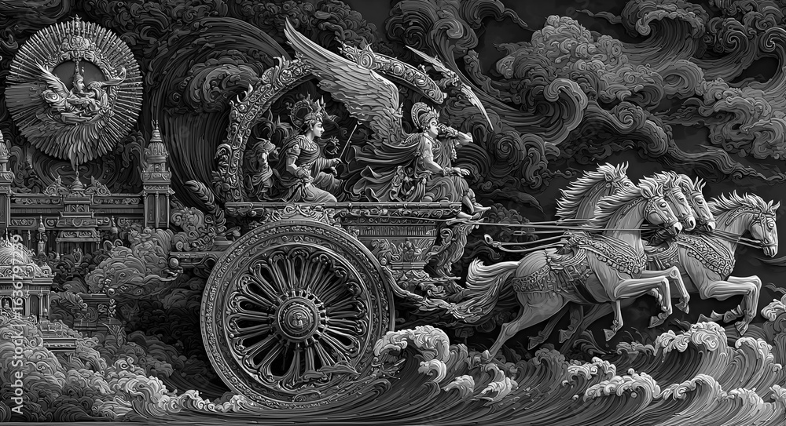
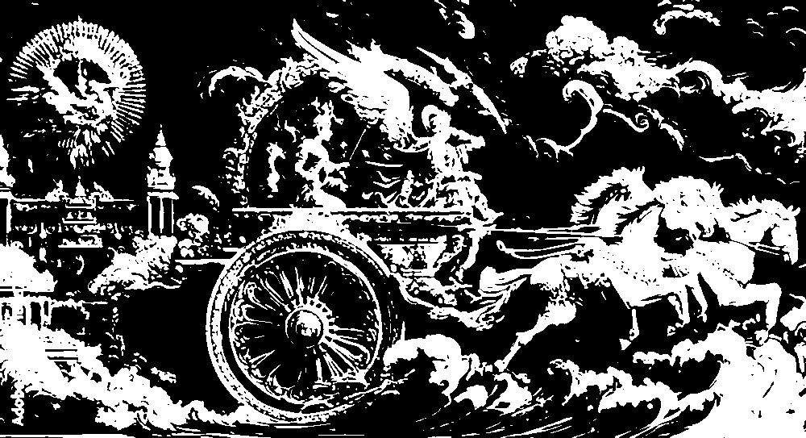
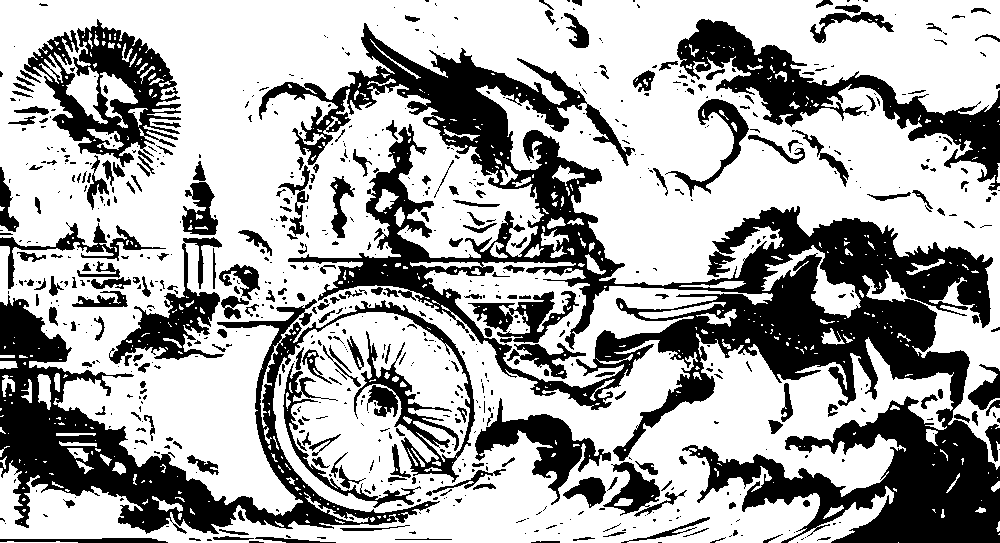
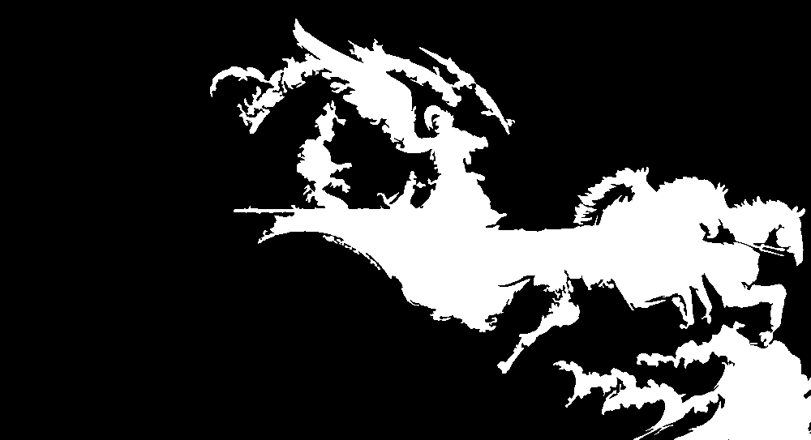
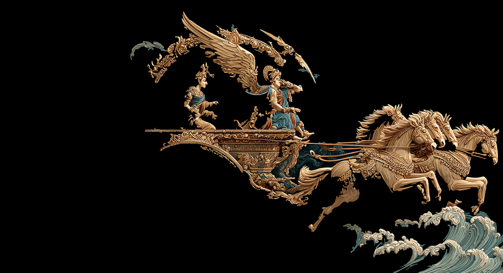
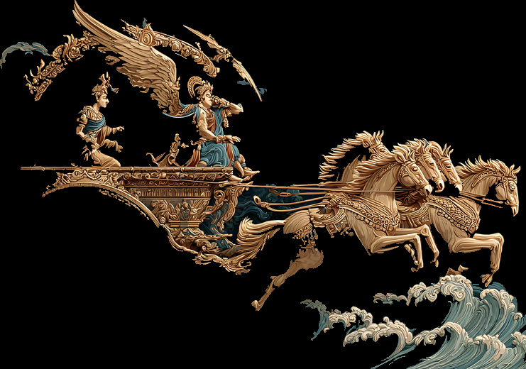
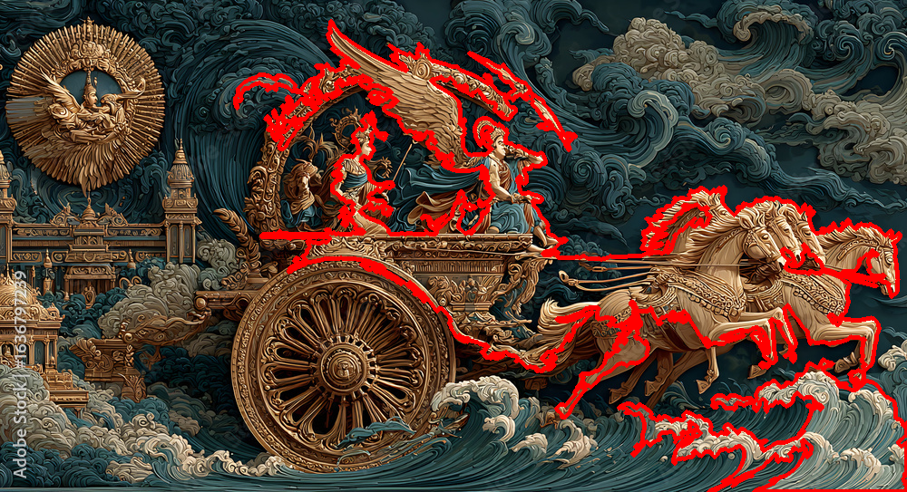
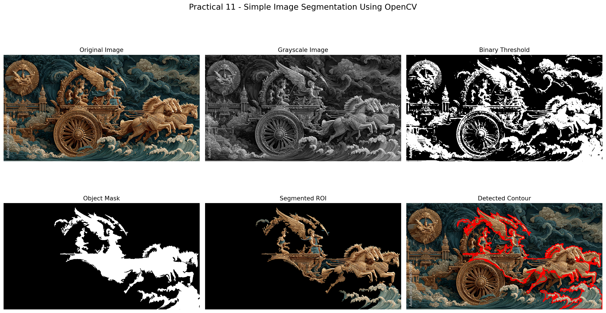
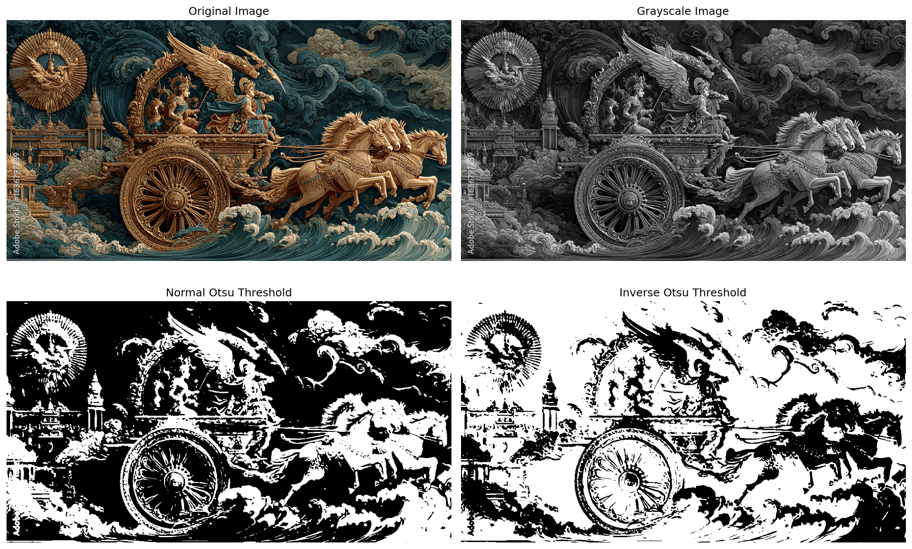

# PRACTICAL 11: SIMPLE IMAGE SEGMENTATION USING OPENCV

**Course Outcome Mapping:** CO5

**CO5:** Create: Design and implement optimized machine learning solutions by integrating advanced supervised algorithms, unsupervised learning methods, ensemble learning, federated learning, image generation, and explainable AI for complex predictive and decision-making problems.

**Programming Language:** Python 3

**Libraries:** OpenCV, NumPy, Matplotlib

**Dataset:** Single input image (`input/object.jpg`)

---

## 1. AIM

To implement a simple image segmentation technique using Python and OpenCV to separate a Region of Interest (ROI) from an input image using grayscale conversion, thresholding, and contour detection.

## 2. OBJECTIVES

1. Understand the concept of image segmentation in computer vision.
2. Learn how to read and process images using OpenCV.
3. Convert a colour image into grayscale.
4. Apply thresholding techniques to obtain a binary image.
5. Detect object boundaries using contour detection.
6. Extract and visualize a Region of Interest (ROI).
7. Understand the applications of image segmentation in computer vision.

## 3. TOOLS REQUIRED

| Tool / Library | Purpose |
|---|---|
| Python 3 | Programming language |
| OpenCV (`cv2`) | Image processing and contour detection |
| NumPy | Array and numerical operations |
| Matplotlib | Visualization of images and results |
| Ubuntu Linux | Development and execution environment |

## 4. THEORY

### 4.1 Image Segmentation

Image segmentation is the process of dividing an image into multiple regions or segments based on characteristics such as intensity, colour, or texture. It helps identify meaningful objects and regions within an image.

### 4.2 Grayscale Conversion

A colour image contains multiple channels. Grayscale conversion transforms the image into a single intensity channel, simplifying subsequent image-processing operations.

### 4.3 Gaussian Blurring

Gaussian blur is used to reduce noise and small variations in an image before thresholding.

The Gaussian function is:

\[
G(x,y)=\frac{1}{2\pi\sigma^2}
e^{-\frac{x^2+y^2}{2\sigma^2}}
\]

### 4.4 Thresholding

Thresholding converts a grayscale image into a binary image by comparing pixel intensities with a threshold value.

\[
B(x,y)=
\begin{cases}
255 & I(x,y)>T\\
0 & I(x,y)\leq T
\end{cases}
\]

Where:

- \(I(x,y)\) = grayscale pixel intensity.
- \(T\) = threshold value.
- \(B(x,y)\) = resulting binary pixel.

### 4.5 Otsu Thresholding

Otsu's method automatically determines a threshold by maximizing the separation between foreground and background intensity classes.

In this experiment, OpenCV's `cv2.THRESH_BINARY + cv2.THRESH_OTSU` is used.

### 4.6 Contour Detection

Contours are continuous curves joining boundary points of objects having the same intensity. OpenCV provides `cv2.findContours()` for contour detection.

The experiment uses:

- `cv2.RETR_EXTERNAL` to retrieve external contours.
- `cv2.CHAIN_APPROX_SIMPLE` to compress contour points.
- `cv2.contourArea()` to calculate contour area.
- `cv2.boundingRect()` to obtain the bounding rectangle.

### 4.7 Region of Interest (ROI)

A Region of Interest is a selected portion of an image containing the region or object to be analyzed. A binary mask is used to extract the selected region.

## 5. METHODOLOGY

The experiment follows these steps:

1. Import OpenCV, NumPy, and Matplotlib.
2. Load the input image using `cv2.imread()`.
3. Convert the image from BGR to RGB for visualization.
4. Convert the image into grayscale.
5. Apply Gaussian blur using a \(5 \times 5\) kernel.
6. Apply Otsu binary thresholding.
7. Detect external contours in the normal binary threshold image.
8. Select the largest detected contour.
9. Create a binary mask using the selected contour.
10. Extract the ROI using bitwise masking.
11. Draw the detected contour on the original image.
12. Display and save the generated results.

### Methodology Flow

```text
             START
               |
               v
        Load Input Image
               |
               v
       Convert BGR to RGB
               |
               v
       Convert to Grayscale
               |
               v
        Gaussian Blurring
               |
               v
       Otsu Thresholding
               |
               v
        Find External Contours
               |
               v
       Select Largest Contour
               |
               v
          Create Mask
               |
               v
       Extract ROI using Mask
               |
               v
       Draw and Visualize Contour
               |
               v
         Save Output Images
               |
               v
              END
```

## 6. DATASET DESCRIPTION

No fixed dataset is required for this practical. A single image is used as the input.

The input image is stored at:

`input/object.jpg`

| Property | Value |
|---|---|
| File name | `object.jpg` |
| Image format | JPEG |
| Width | 1000 pixels |
| Height | 543 pixels |
| Colour channels | 3 |
| File size | 545,064 bytes |
| Image dimensions | 1000 × 543 |

Images containing sufficient foreground-background intensity contrast are generally more suitable for threshold-based segmentation.

## 7. IMPLEMENTATION

### 7.1 Python Program

The complete implementation is available in:

`experiment_11_image_segmentation.py`

The program performs:

- Image loading and validation.
- BGR-to-RGB and grayscale conversion.
- Gaussian blurring.
- Otsu thresholding.
- External contour detection.
- Largest-contour selection.
- Binary mask generation.
- ROI extraction.
- Contour visualization.
- Saving the output images and experiment log.

### 7.2 Important OpenCV Functions

| Function | Description |
|---|---|
| `cv2.imread()` | Reads an image from a file |
| `cv2.cvtColor()` | Converts image colour spaces |
| `cv2.GaussianBlur()` | Reduces image noise |
| `cv2.threshold()` | Performs thresholding |
| `cv2.findContours()` | Detects contours |
| `cv2.contourArea()` | Calculates contour area |
| `cv2.boundingRect()` | Calculates a contour's bounding rectangle |
| `cv2.drawContours()` | Draws contours |
| `cv2.bitwise_and()` | Applies a binary mask to an image |

### 7.3 Execution Commands

```bash
python -m py_compile experiment_11_image_segmentation.py
python experiment_11_image_segmentation.py
```

## 8. PERFORMANCE METRICS

This practical demonstrates classical image-processing operations rather than training a supervised machine-learning model. Therefore, classification accuracy, precision, recall, F1-score, and model loss are not applicable.

The following measurements are recorded:

| Metric | Experimental Value |
|---|---:|
| Input width | 1000 pixels |
| Input height | 543 pixels |
| Otsu threshold | 81 |
| Normal threshold contours | 724 |
| Largest contour area | 109,169.50 pixels² |
| ROI bounding rectangle width | 741 pixels |
| ROI bounding rectangle height | 520 pixels |
| Mask foreground pixels | 21.00% of image |

Contour area and foreground percentage describe the selected mask; they do not independently establish segmentation accuracy.

## 9. OUTPUT

The following output images were generated successfully.

### 9.1 Original, Grayscale, and Threshold Images

**Grayscale Image**



**Binary Threshold Image**



**Inverse Threshold Image**



### 9.2 Object Mask and Segmented ROI

**Object Mask**



**Segmented ROI**



**Extracted ROI Crop**



### 9.3 Contour Detection and Combined Result

**Contour Detection**



**Final Combined Visualization**



**Threshold Diagnostic**



## 10. RESULT AND ANALYSIS

The image segmentation program was implemented and executed successfully using Python and OpenCV.

The input image was loaded with dimensions of 1000 × 543 pixels. It was converted into grayscale and smoothed using Gaussian blur.

Otsu thresholding automatically selected a threshold value of 81. External contour detection identified 724 contours in the normal binary threshold image.

The largest detected contour had an area of 109,169.50 pixels². Its bounding rectangle was:

\[
(x,y,w,h)=(259,23,741,520)
\]

The corresponding mask covered 21.00% of the image pixels.

The program successfully generated the binary threshold image, mask, segmented image, ROI crop, contour visualization, and combined result.

**Analysis note:** The largest-contour selection is a simple demonstration of ROI extraction. The bounding rectangle is relatively large, so the result should not be interpreted as proof of perfectly isolated object segmentation. More advanced segmentation or contour filtering may be required for images with complex backgrounds.

## 11. OUTCOME OF THE EXPERIMENT

After completing this practical, the following learning outcomes were achieved:

1. Understood the concept and importance of image segmentation.
2. Learned to read and process images using OpenCV.
3. Converted colour images into grayscale images.
4. Applied Gaussian blurring to reduce image noise.
5. Implemented Otsu thresholding for binary image generation.
6. Detected external contours and calculated contour areas.
7. Created a binary mask and extracted a Region of Interest.
8. Visualized and saved segmentation results.

## 12. CONCLUSION

The Simple Image Segmentation practical was implemented successfully using Python, OpenCV, NumPy, and Matplotlib.

The experiment demonstrated grayscale conversion, Gaussian blurring, Otsu thresholding, contour detection, binary mask generation, and ROI extraction. The generated images and execution log provide evidence of the image-processing workflow.

The experiment also demonstrated that selecting the largest contour does not always guarantee perfect object isolation. The quality of segmentation depends on foreground-background contrast and image characteristics.

## 13. RELEVANT DEMONSTRATIVE VIDEO LINKS

The practical manual identifies the following video-resource topics:

- OpenCV Image Segmentation Tutorial
- OpenCV Contour Detection Tutorial
- Python Image Processing Using OpenCV

Specific video URLs were not supplied in the practical manual.

## 14. REFERENCES AND OTHER RESOURCE MATERIALS

1. OpenCV Documentation — Image Thresholding:  
   https://docs.opencv.org/4.x/d7/d4d/tutorial_py_thresholding.html

2. OpenCV Documentation — Contour Features:  
   https://docs.opencv.org/4.x/dd/d49/tutorial_py_contour_features.html

3. LearnOpenCV — Contour Detection:  
   https://learnopencv.com/contour-detection-using-opencv-python-c/

4. PyImageSearch — Thresholding:  
   https://pyimagesearch.com/2021/04/28/opencv-thresholding-cv2-threshold/

5. GeeksforGeeks — OpenCV Tutorial:  
   https://www.geeksforgeeks.org/python-opencv/

6. OpenCV Python Library:  
   https://opencv.org/

---

# GENERATED FILES

| File | Description |
|---|---|
| `experiment_11_image_segmentation.py` | Complete Python implementation |
| `input/object.jpg` | Input image |
| `output/grayscale_image.png` | Grayscale image |
| `output/blurred_image.png` | Gaussian-blurred image |
| `output/binary_threshold.png` | Normal binary threshold |
| `output/inverse_threshold.png` | Inverse binary threshold |
| `output/object_mask.png` | Selected contour mask |
| `output/segmented_roi.png` | Segmented image |
| `output/roi_crop.png` | Extracted ROI crop |
| `output/contour_detection.png` | Contour visualization |
| `output/threshold_diagnostic.png` | Threshold comparison |
| `output/contour_comparison.png` | Top-five contour comparison |
| `output/image_segmentation_result.png` | Combined visualization |
| `output/experiment_log.txt` | Execution details |

---

**END OF PRACTICAL 11**

**CO5: Create optimized machine learning solutions using advanced learning methods and explainable AI for complex predictive and decision-making problems.**
