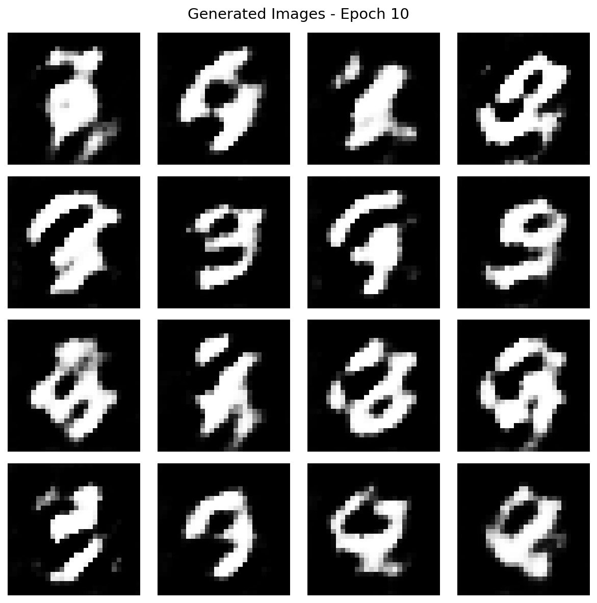
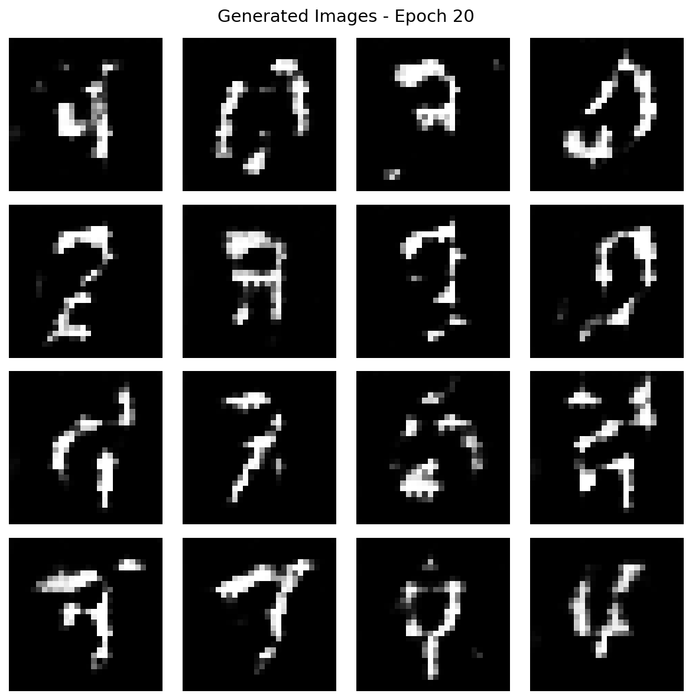
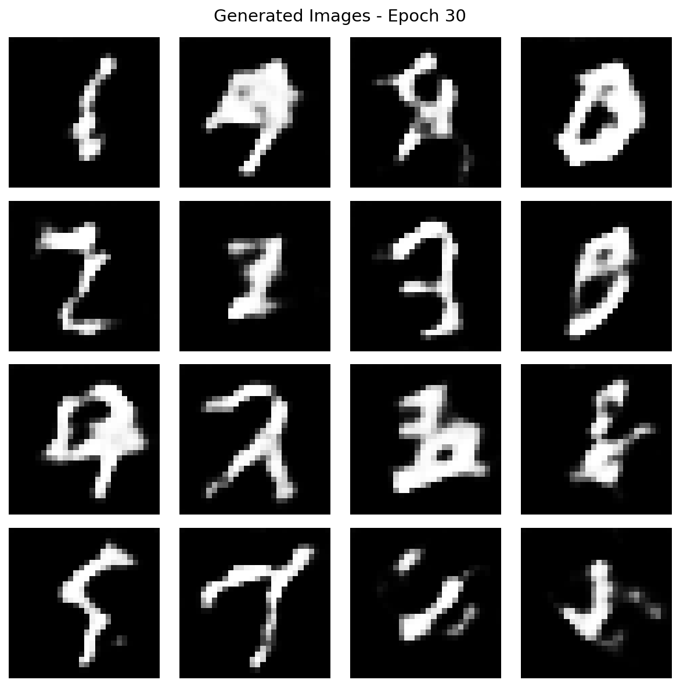
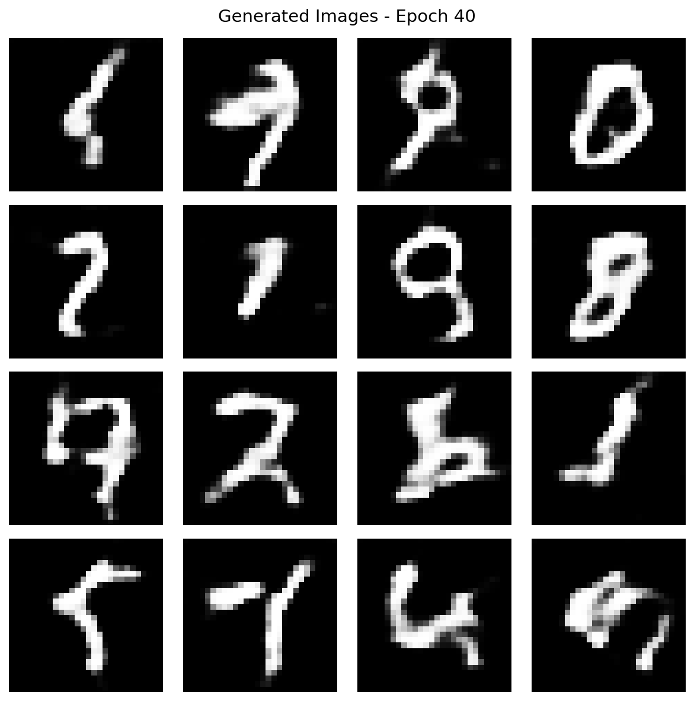
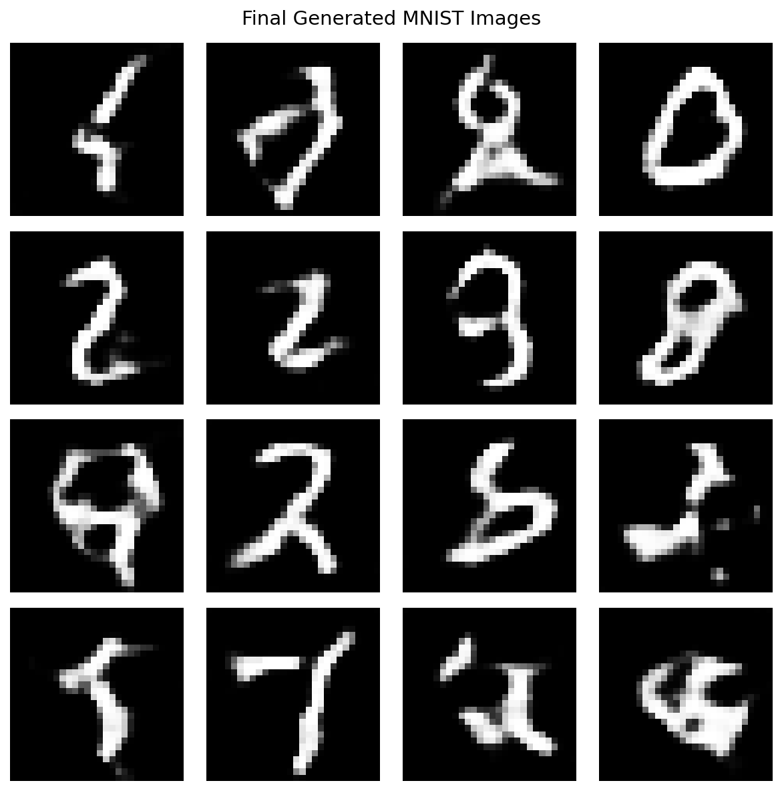
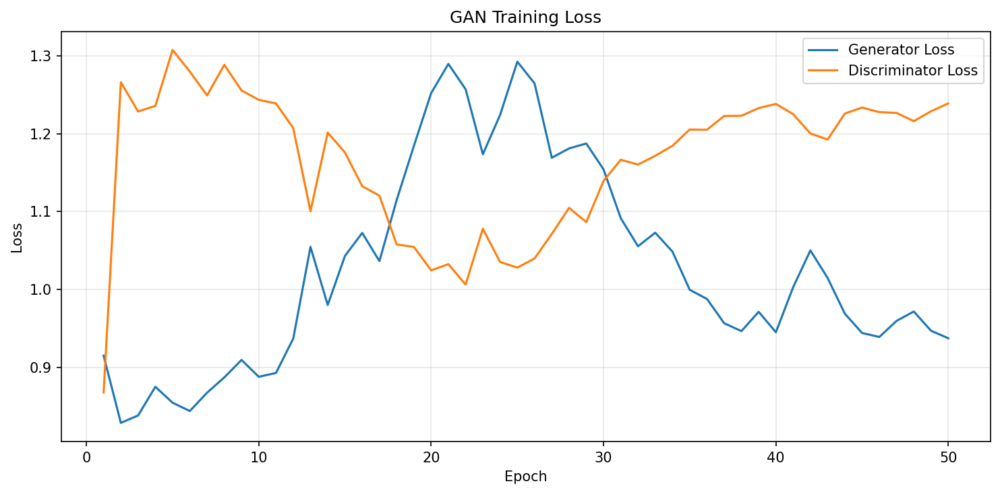

# PRACTICAL 12: IMPLEMENTATION OF A BASIC GENERATIVE ADVERSARIAL NETWORK (GAN)

**Course:** Applied Machine Learning Laboratory (AML_L)  
**Practical Number:** 12  
**Course Outcome:** CO5  
**Programming Language:** Python 3.12.11  
**Deep Learning Framework:** TensorFlow / Keras  
**Dataset:** MNIST Handwritten Digits Dataset  
**Execution Environment:** Ubuntu Linux (CPU)

---

## 01. AIM

To implement a basic Generative Adversarial Network (GAN) using Python and TensorFlow/Keras to generate synthetic handwritten digit-like images from random noise using the MNIST dataset.

## 02. OBJECTIVES

1. To understand the fundamental concept and working principle of Generative Adversarial Networks.
2. To implement a simple GAN using Python and TensorFlow/Keras.
3. To design a Generator network that creates synthetic images from random noise.
4. To design a Discriminator network that distinguishes real images from generated images.
5. To train the Generator and Discriminator through adversarial learning.
6. To generate synthetic handwritten digit-like images from random noise.
7. To visualize generated images at different stages of training.
8. To monitor Generator and Discriminator losses during the training process.

## 03. THEORY

### 3.1 Introduction to Generative Adversarial Networks

A Generative Adversarial Network (GAN) is a deep learning architecture consisting of two neural networks called the Generator and the Discriminator. These networks are trained together in an adversarial manner.

The Generator creates synthetic data from random noise, while the Discriminator evaluates whether an input image is real or generated.

The two networks compete with each other during training. The Generator attempts to produce realistic images that can fool the Discriminator, while the Discriminator attempts to correctly identify real and generated images.

### 3.2 Generator

The Generator receives a random noise vector as input and transforms it into a synthetic image.

In this experiment:

- Input: Random noise vector of dimension 100.
- Architecture: Dense layer, Batch Normalization, LeakyReLU, Reshape and Conv2DTranspose layers.
- Output: Synthetic grayscale image of size 28 × 28 × 1.
- Activation of output layer: Tanh.

The Generator learns to produce images resembling handwritten digits from the MNIST dataset.

### 3.3 Discriminator

The Discriminator receives an image and predicts whether it is real or generated.

In this experiment:

- Input: Grayscale image of size 28 × 28 × 1.
- Architecture: Conv2D layers, LeakyReLU, Dropout, Flatten and Dense.
- Output: One logit representing the real/fake classification score.

The Discriminator learns to distinguish original MNIST images from synthetic images produced by the Generator.

### 3.4 Adversarial Learning

Both networks are trained together:

1. Random noise is supplied to the Generator.
2. The Generator converts noise into synthetic images.
3. Real MNIST images and generated images are supplied to the Discriminator.
4. The Discriminator learns to classify real images as real and generated images as fake.
5. The Generator receives feedback through the adversarial objective and improves its generated images.
6. This process is repeated over multiple training epochs.

### 3.5 GAN Architecture

The overall workflow is:

```text
              RANDOM NOISE
             (100 Dimensions)
                    |
                    v
             +-------------+
             | GENERATOR   |
             | Neural Net  |
             +-------------+
                    |
                    v
          SYNTHETIC FAKE IMAGES
                    |
                    |
                    v
REAL MNIST IMAGES ---> +----------------+
                       | DISCRIMINATOR  |
                       | Neural Network |
                       +----------------+
                               |
                               v
                      REAL / FAKE SCORE
                               |
                               v
                    ADVERSARIAL TRAINING
                               |
                    +----------+----------+
                    |                     |
                    v                     v
              UPDATE GENERATOR      UPDATE DISCRIMINATOR
                    |                     |
                    +----------+----------+
                               |
                               v
                       IMPROVED GAN MODEL
                               |
                               v
                    GENERATE NEW DIGITS
```

### 3.6 Loss Functions
Binary Cross-Entropy is used to calculate the adversarial losses.
The Discriminator is trained to classify real images as 1 and generated images as 0.
The Generator is trained to make the Discriminator classify generated images as real.
The experiment uses:
- Binary Cross-Entropy loss with from_logits=True.
- Adam optimizer.
- Learning rate of 0.0001.
The Generator and Discriminator losses are monitored during training to observe their adversarial learning behavior.
## 04. SOFTWARE AND HARDWARE REQUIREMENTS
4.1 Software Requirements
Component	Specification
Operating System	Ubuntu Linux
Programming Language	Python 3.12.11
Deep Learning Framework	TensorFlow 2.21.0
Neural Network API	Keras
Numerical Computing	NumPy 2.5.4
Data Visualization	Matplotlib 3.11.2
Dataset	MNIST
Development Environment	Python Virtual Environment
Code Editor	Visual Studio Code / Cursor
Execution Mode	CPU
4.2 Hardware Requirements
Component	Specification
Processor	Intel Core i7-8665U
CPU Cores	4 Cores / 8 Logical CPUs
RAM	14 GB
Graphics	Intel UHD Graphics 620
GPU Acceleration	Not used
Storage	Sufficient free disk space for dataset and generated models
4.3 Python Libraries
The following libraries are used:
- TensorFlow: Building and training the Generator and Discriminator.
- Keras: Defining neural network layers and model architectures.
- NumPy: Numerical operations and data preprocessing.
- Matplotlib: Visualizing generated images and training losses.
- Pandas: Organizing and exporting training history.
- CSV: Storing epoch-wise training metrics.
## 05. DATASET DESCRIPTION
5.1 MNIST Dataset
The MNIST dataset is a standard handwritten digit dataset containing grayscale images of digits from 0 to 9.
Each image has a resolution of 28 × 28 pixels.
Dataset Property	Description
Dataset Name	MNIST
Image Type	Handwritten digits
Image Format	Grayscale
Image Width	28 pixels
Image Height	28 pixels
Number of Channels	1
Number of Classes	10
Digit Categories	0 to 9
Training Images Available	60,000
Testing Images Available	10,000
Images Used in This Experiment	60,000 training images
5.2 Data Preprocessing
The MNIST training images are loaded using the TensorFlow/Keras dataset API.
The following preprocessing operations are performed:
1. Load the MNIST dataset.
2. Select the training images.
3. Convert image pixel values into the float32 data type.
4. Normalize pixel values from the original range [0, 255] to [-1, 1].
5. Add a channel dimension to each image.
6. Shuffle the dataset.
7. Divide the dataset into batches of 256 images.
Normalization formula:
X_train = (X_train.astype("float32") - 127.5) / 127.5


The resulting image shape is:
(60000, 28, 28, 1)


The normalized pixel range is:
-1.0 to 1.0


The MNIST testing portion is not used for GAN training in this implementation.
## 06. METHODOLOGY
The experiment follows these steps:
Step 1: Environment Setup
Create an isolated Python virtual environment and install the required libraries, including TensorFlow, NumPy, Matplotlib and Pandas.
Step 2: Dataset Loading
Load the MNIST handwritten digit dataset using the TensorFlow/Keras dataset API.
Step 3: Data Preprocessing
Normalize image pixels to the range [-1, 1] and reshape the training images to 28 × 28 × 1.
Step 4: Generator Construction
Build a Generator that accepts a 100-dimensional random noise vector and produces a synthetic 28 × 28 grayscale image.
Step 5: Discriminator Construction
Build a Discriminator that accepts a 28 × 28 grayscale image and produces a real/fake classification logit.
Step 6: Loss and Optimizer Configuration
Configure Binary Cross-Entropy loss functions and Adam optimizers with a learning rate of 0.0001.
Step 7: GAN Training
Train both networks using TensorFlow GradientTape and adversarial learning.
For every training batch:
- Generate random noise.
- Generate synthetic images.
- Evaluate real images with the Discriminator.
- Evaluate generated images with the Discriminator.
- Calculate Generator and Discriminator losses.
- Calculate gradients.
- Update the trainable parameters of both networks.
Step 8: Image Generation and Visualization
Generate and save a 4 × 4 grid of synthetic images after every 10 epochs and after the final epoch.
Step 9: Training History and Model Saving
Save epoch-wise losses and duration in a CSV file. Save the trained Generator and Discriminator models in Keras format.
Step 10: Performance Visualization
Generate a loss graph showing the Generator and Discriminator losses across the training epochs.
## 07. ALGORITHMS AND MODEL CONFIGURATION
7.1 Algorithm
Input: MNIST training images and random noise vectors.
Output: Trained Generator and Discriminator models and synthetic handwritten digit-like images.
1. Initialize the GAN configuration and random seed.
2. Load the MNIST training dataset.
3. Normalize the images to the range [-1, 1].
4. Add the grayscale channel dimension.
5. Create the Generator model.
6. Create the Discriminator model.
7. Initialize Binary Cross-Entropy loss functions.
8. Initialize Adam optimizers for both networks.
9. Repeat for each training epoch:
   - Shuffle and batch the training dataset.
   - Generate random noise for the current batch.
   - Generate synthetic images using the Generator.
   - Pass real and generated images through the Discriminator.
   - Calculate Generator and Discriminator losses.
   - Calculate gradients using GradientTape.
   - Update both networks.
   - Record the average losses and training duration.
10. Generate and save sample images at every 10th epoch.
11. Save the final generated image grid.
12. Save the trained Generator and Discriminator models.
13. Save the training history as a CSV file.
14. Plot and save the training loss graph.
7.2 Training Configuration
Parameter	Value
Random Seed	42
Buffer Size	60,000
Batch Size	256
Noise Dimension	100
Number of Epochs	50
Generated Examples	16
Learning Rate	0.0001
Loss Function	Binary Cross-Entropy
Optimizer	Adam
Generator Output Activation	Tanh
Discriminator Output	Single Logit
Training Device	CPU
7.3 Generator Architecture
The Generator converts random noise into a 28 × 28 grayscale image.
Layer	Configuration	Output Shape
Dense	7 × 7 × 256 units	12544
BatchNormalization	Default	12544
LeakyReLU	Activation	12544
Reshape	7 × 7 × 256	7 × 7 × 256
Conv2DTranspose	128 filters, kernel 5, stride 1	7 × 7 × 128
BatchNormalization	Default	7 × 7 × 128
LeakyReLU	Activation	7 × 7 × 128
Conv2DTranspose	64 filters, kernel 5, stride 2	14 × 14 × 64
BatchNormalization	Default	14 × 14 × 64
LeakyReLU	Activation	14 × 14 × 64
Conv2DTranspose	1 filter, kernel 5, stride 2, Tanh	28 × 28 × 1
Total Parameters: 2,330,944
Trainable Parameters: 2,305,472
Non-Trainable Parameters: 25,472
7.4 Discriminator Architecture
The Discriminator analyzes input images and produces a real/fake classification logit.
Layer	Configuration	Output Shape
Conv2D	64 filters, kernel 5, stride 2	14 × 14 × 64
LeakyReLU	Activation	14 × 14 × 64
Dropout	0.3	14 × 14 × 64
Conv2D	128 filters, kernel 5, stride 2	7 × 7 × 128
LeakyReLU	Activation	7 × 7 × 128
Dropout	0.3	7 × 7 × 128
Flatten	Default	6272
Dense	1 unit	1
Total Parameters: 212,865
Trainable Parameters: 212,865
Non-Trainable Parameters: 0
7.5 Loss and Optimization
The experiment uses two separate loss functions:
Discriminator Loss:
The Discriminator loss combines the classification error for real images and generated images.
Generator Loss:
The Generator loss measures how effectively generated images are classified as real by the Discriminator.
Both networks use the Adam optimizer with a learning rate of 0.0001. The losses are calculated using Binary Cross-Entropy with logits.


## 08. EXPERIMENTAL RESULTS

### 8.1 Training Environment

The GAN was trained using the complete MNIST training dataset containing 60,000 handwritten digit images.

| Parameter | Actual Result |
|---|---:|
| TensorFlow Version | 2.21.0 |
| Python Version | 3.12.11 |
| Dataset Images | 60,000 |
| Training Epochs | 50 |
| Batch Size | 256 |
| Noise Dimension | 100 |
| Execution Device | CPU |
| Total Training Time | 17,085.11 seconds |
| Total Training Time (Approx.) | 4 hours 45 minutes |

No CUDA-compatible GPU was available. Therefore, the experiment was executed using the CPU.

### 8.2 Training Loss Results

The following table presents the actual Generator and Discriminator losses recorded during training.

| Epoch | Generator Loss | Discriminator Loss |
|---:|---:|---:|
| 1 | 0.9151 | 0.8678 |
| 2 | 0.8288 | 1.2660 |
| 3 | 0.8384 | 1.2285 |
| 4 | 0.8751 | 1.2356 |
| 5 | 0.8547 | 1.3074 |
| 6 | 0.8440 | 1.2797 |
| 7 | 0.8675 | 1.2491 |
| 8 | 0.8871 | 1.2883 |
| 9 | 0.9096 | 1.2554 |
| 10 | 0.8880 | 1.2434 |
| 11 | 0.8929 | 1.2387 |
| 12 | 0.9369 | 1.2071 |
| 13 | 1.0547 | 1.1005 |
| 14 | 0.9801 | 1.2013 |
| 15 | 1.0430 | 1.1759 |
| 16 | 1.0726 | 1.1326 |
| 17 | 1.0364 | 1.1204 |
| 18 | 1.1148 | 1.0578 |
| 19 | 1.1843 | 1.0546 |
| 20 | 1.2520 | 1.0246 |
| 21 | 1.2895 | 1.0325 |
| 22 | 1.2570 | 1.0063 |
| 23 | 1.1736 | 1.0780 |
| 24 | 1.2240 | 1.0353 |
| 25 | 1.2924 | 1.0281 |
| 26 | 1.2645 | 1.0398 |
| 27 | 1.1691 | 1.0713 |
| 28 | 1.1810 | 1.1048 |
| 29 | 1.1873 | 1.0865 |
| 30 | 1.1542 | 1.1393 |
| 31 | 1.0915 | 1.1665 |
| 32 | 1.0555 | 1.1603 |
| 33 | 1.0729 | 1.1716 |
| 34 | 1.0486 | 1.1844 |
| 35 | 0.9996 | 1.2053 |
| 36 | 0.9879 | 1.2050 |
| 37 | 0.9567 | 1.2227 |
| 38 | 0.9466 | 1.2229 |
| 39 | 0.9713 | 1.2328 |
| 40 | 0.9452 | 1.2381 |
| 41 | 1.0029 | 1.2250 |
| 42 | 1.0502 | 1.2002 |
| 43 | 1.0148 | 1.1925 |
| 44 | 0.9689 | 1.2258 |
| 45 | 0.9442 | 1.2335 |
| 46 | 0.9391 | 1.2277 |
| 47 | 0.9597 | 1.2266 |
| 48 | 0.9717 | 1.2160 |
| 49 | 0.9470 | 1.2288 |
| 50 | 0.9374 | 1.2388 |

### 8.3 Final Training Metrics

| Metric | Value |
|---|---:|
| Final Generator Loss | 0.9374 |
| Final Discriminator Loss | 1.2388 |
| Final Epoch | 50 |
| Training Records | 50 |
| Generated Examples per Grid | 16 |
| Saved Generator Model | generator.keras |
| Saved Discriminator Model | discriminator.keras |

### 8.4 Generated Images

The trained Generator produces synthetic grayscale images from random noise vectors. A grid containing 16 generated examples is saved at the end of training.

Generated image grids are saved at epochs 10, 20, 30, 40 and 50, along with the final generated image grid.

## 09. VISUALIZATION OF EXPERIMENTAL RESULTS

### 9.1 Generated Images at Epoch 10

The following image contains 16 synthetic samples generated after the first 10 training epochs.



**Figure 9.1:** Synthetic handwritten digit-like images after 10 epochs.

### 9.2 Generated Images at Epoch 20



**Figure 9.2:** Synthetic handwritten digit-like images after 20 epochs.

### 9.3 Generated Images at Epoch 30



**Figure 9.3:** Synthetic handwritten digit-like images after 30 epochs.

### 9.4 Generated Images at Epoch 40



**Figure 9.4:** Synthetic handwritten digit-like images after 40 epochs.

### 9.5 Generated Images at Epoch 50


**Figure 9.5:** Synthetic handwritten digit-like images after 50 epochs.

### 9.6 Final Generated Images



**Figure 9.6:** Final grid containing 16 synthetic images generated by the trained Generator.

### 9.7 GAN Training Loss Graph

The following graph represents the Generator and Discriminator losses recorded over 50 epochs.



**Figure 9.7:** Generator and Discriminator training loss across 50 epochs.

## 10. OBSERVATIONS

1. The GAN successfully loaded all 60,000 MNIST training images.
2. The images were normalized to the range [-1, 1] and reshaped to 28 × 28 × 1.
3. The Generator was configured to transform 100-dimensional random noise vectors into 28 × 28 grayscale images.
4. The Discriminator was configured to distinguish real MNIST images from generated images.
5. Both networks were trained using adversarial learning for 50 epochs.
6. The training history contains 50 valid records of Generator loss, Discriminator loss and epoch duration.
7. The Generator loss was 0.9151 in epoch 1 and 0.9374 in epoch 50.
8. The Discriminator loss was 0.8678 in epoch 1 and 1.2388 in epoch 50.
9. The losses fluctuated during training, demonstrating the changing competition between the Generator and Discriminator.
10. The experiment successfully generated and saved image grids at epochs 10, 20, 30, 40 and 50.
11. The final Generator and Discriminator models were saved in Keras format.
12. Training was completed on the CPU because no CUDA-compatible GPU was available.

## 11. CONCLUSION

The Basic Generative Adversarial Network was successfully implemented using Python and TensorFlow/Keras.

The experiment used the MNIST handwritten digit dataset containing 60,000 training images. A Generator and a Discriminator were developed and trained together using adversarial learning.

The Generator learned to transform random noise vectors into synthetic grayscale images, while the Discriminator learned to distinguish real MNIST images from generated images.

The complete training process was executed for 50 epochs on the CPU. Generator and Discriminator losses were recorded, and generated image grids were saved at different training stages.

The trained Generator and Discriminator models, training history and loss visualization were successfully saved.

Thus, the experiment demonstrates the basic working principle of Generative Adversarial Networks and the generation of synthetic handwritten digit-like images from random noise.

## 12. GENERATED FILES AND OUTPUT STRUCTURE

The experiment generated Python source code, trained models, image visualizations, training metrics and log files.

### 12.1 Project Directory Structure

```text
Experiment - 12/
│
├── experiment_12_gan.py
├── experiment_12_gan.py.before-loss-fix.bak
├── README.md
├── .venv/
│
└── output/
    │
    ├── generated_images/
    │   ├── epoch_010.png
    │   ├── epoch_020.png
    │   ├── epoch_030.png
    │   ├── epoch_040.png
    │   ├── epoch_050.png
    │   └── final_generated_images.png
    │
    ├── models/
    │   ├── generator.keras
    │   └── discriminator.keras
    │
    ├── plots/
    │   └── gan_training_loss.png
    │
    ├── logs/
    │   ├── training_history.csv
    │   └── training.log
    │
    └── smoke_test/
        ├── generated_images/
        ├── models/
        ├── plots/
        └── logs/
```

### 12.2 Description of Generated Files
File / Directory	Description
experiment_12_gan.py	Main Python implementation of the GAN
README.md	Practical documentation
output/generated_images/	Generated image grids at different epochs
epoch_010.png	Generated images after epoch 10
epoch_020.png	Generated images after epoch 20
epoch_030.png	Generated images after epoch 30
epoch_040.png	Generated images after epoch 40
epoch_050.png	Generated images after epoch 50
final_generated_images.png	Final generated image grid
output/models/generator.keras	Trained Generator model
output/models/discriminator.keras	Trained Discriminator model
output/plots/gan_training_loss.png	Training loss visualization
output/logs/training_history.csv	Epoch-wise training metrics
output/logs/training.log	Detailed execution and training log
output/smoke_test/	Preserved artifacts from the initial smoke test
### 12.3 Training History CSV
The file training_history.csv stores the following information:
- Epoch number
- Generator loss
- Discriminator loss
- Training duration in seconds
The CSV file contains 50 training records.
### 12.4 Saved Models
The Generator and Discriminator are saved in .keras format so that they can be loaded later for further experimentation or inference.
## 13. REFERENCES
1. TensorFlow, "Deep Convolutional Generative Adversarial Network (DCGAN)."
   tensorflow.org
2. TensorFlow, "MNIST Dataset."
   tensorflow.org
3. Keras, "Conditional GAN."
   keras.io
4. PyTorch, "DCGAN Tutorial."
   docs.pytorch.org
5. Machine Learning Mastery, "How to Develop a Generative Adversarial Network for an MNIST Handwritten Digits from Scratch in Keras."
   machinelearningmastery.com
## 14. FINAL RESULT
The Basic Generative Adversarial Network was successfully implemented using Python and TensorFlow/Keras.
The Generator and Discriminator were trained adversarially for 50 epochs using all 60,000 MNIST training images. Synthetic handwritten digit-like image grids were generated and saved at different training stages.
The final Generator model, Discriminator model, training history CSV, training log and loss graph were successfully created and verified.
Result: The implementation of a basic GAN for generating synthetic handwritten digit-like images from random noise was successfully completed.

END OF PRACTICAL 12
COURSE OUTCOME MAPPING: CO5
