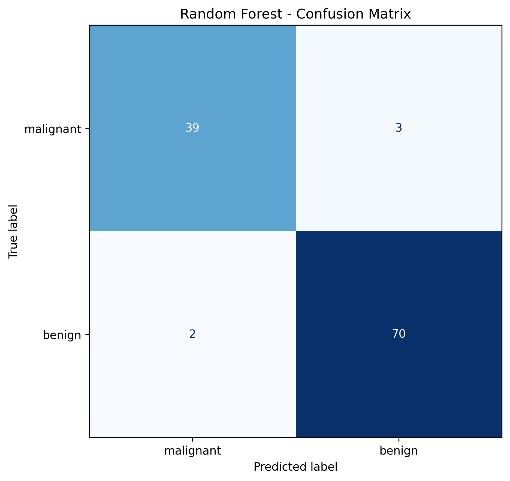
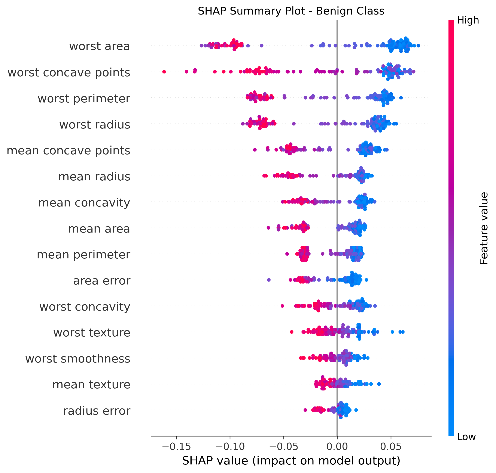
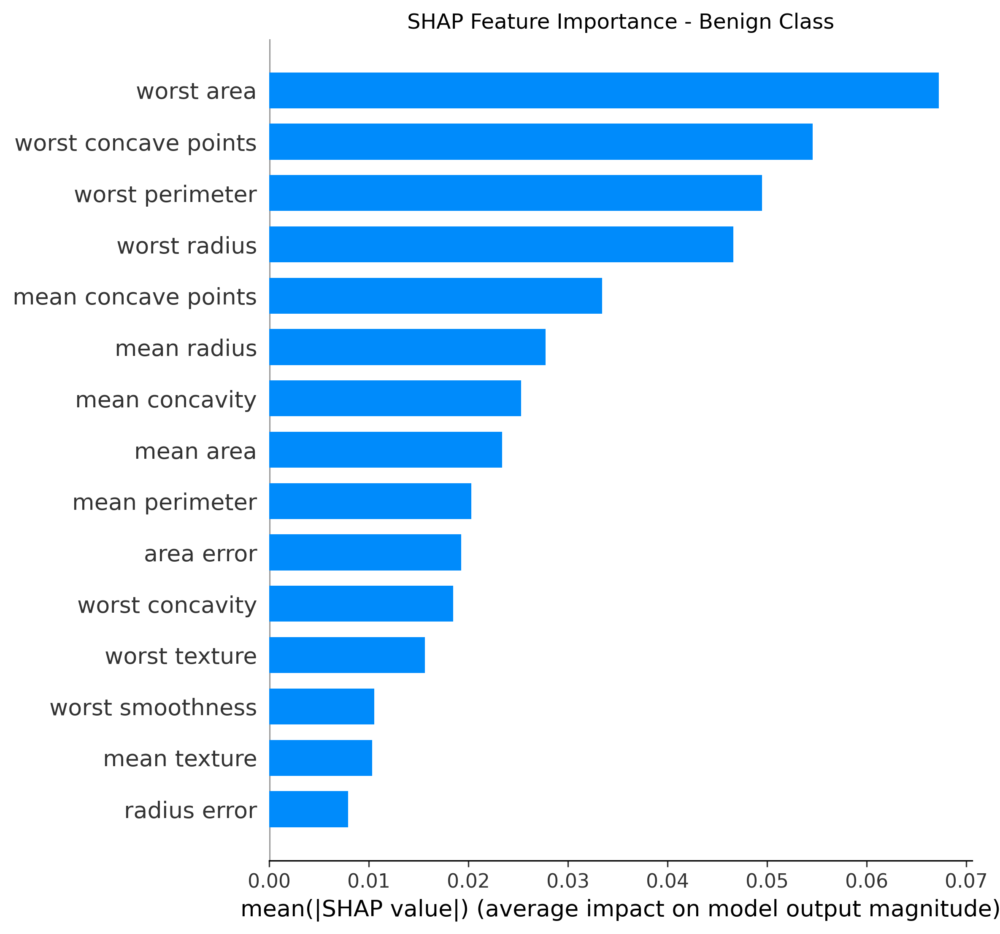
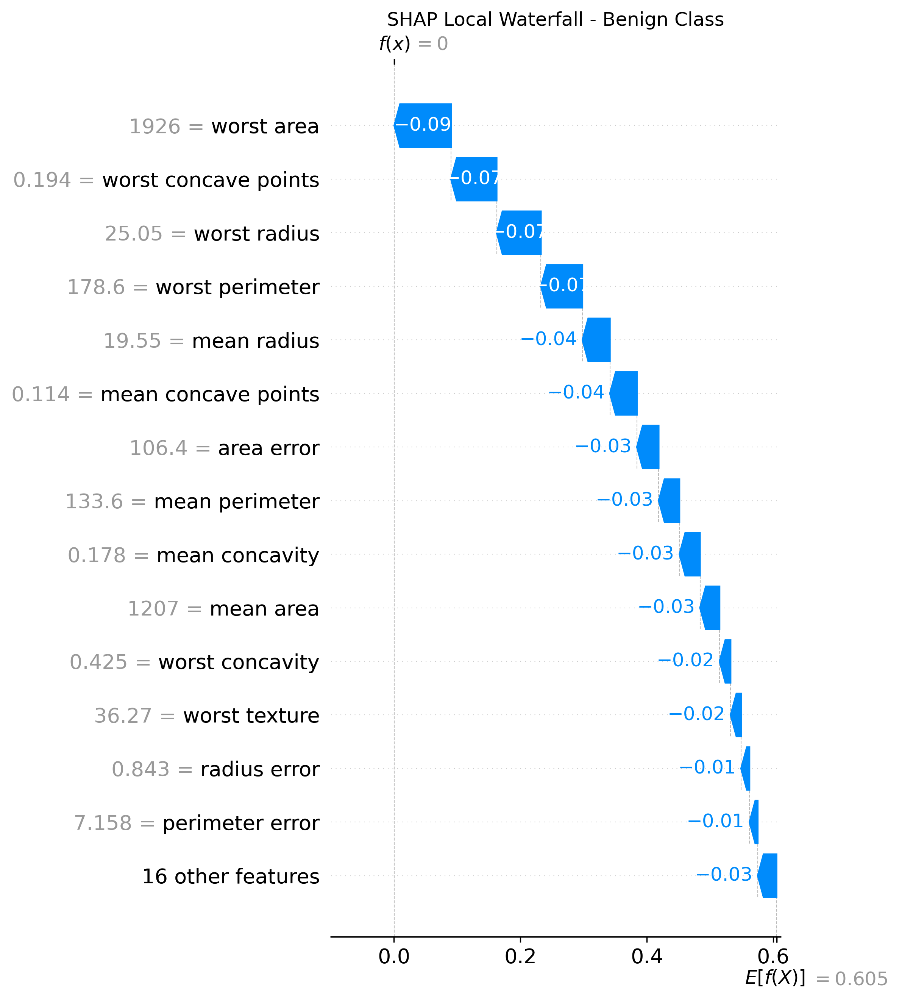
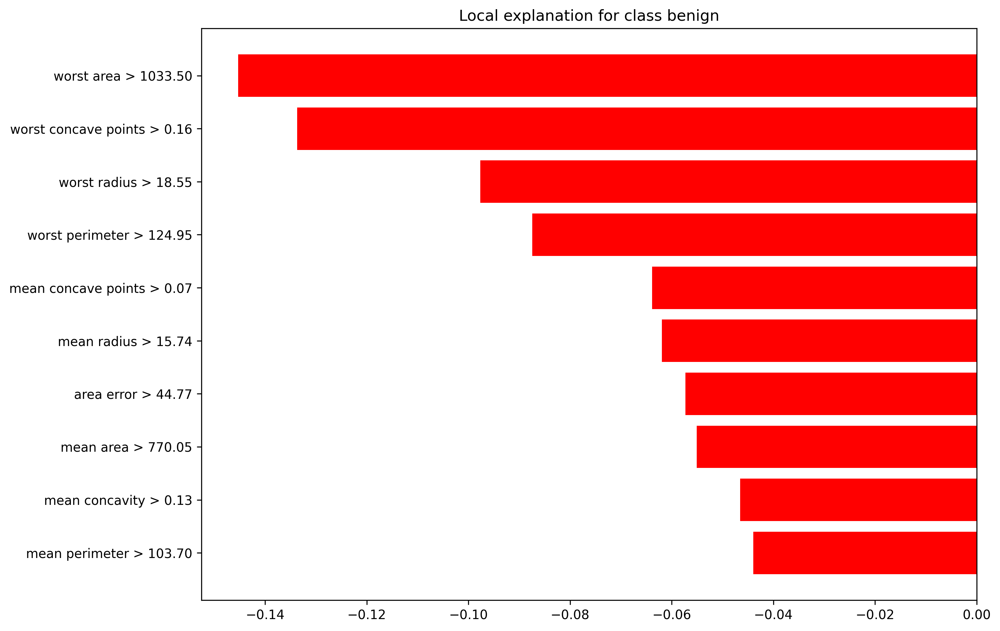

# PRACTICAL 13: EXPLAINABLE AI USING SHAP AND LIME

**Course:** Applied Machine Learning Laboratory (AML_L)  
**Practical Number:** 13  
**Practical Title:** Explainable AI Using SHAP and LIME  
**Programming Language:** Python 3.12  
**Dataset:** Breast Cancer Wisconsin Diagnostic Dataset  
**Machine Learning Algorithm:** Random Forest Classifier  
**Explainability Techniques:** SHAP and LIME  
**Course Outcome Mapping:** CO5

---

## 01. AIM

To implement Explainable Artificial Intelligence (XAI) techniques using SHAP (SHapley Additive exPlanations) and LIME (Local Interpretable Model-agnostic Explanations) to explain the predictions of a Random Forest classification model trained on the Breast Cancer Wisconsin Diagnostic Dataset.

The experiment aims to understand how different input features influence machine learning predictions by generating global and local explanations. It also demonstrates the importance of model interpretability, transparency, and explainability in machine learning applications.

---

## 02. OBJECTIVES

1. To understand the concept and importance of Explainable Artificial Intelligence (XAI).
2. To study the working principles of SHAP and LIME explainability techniques.
3. To load and explore the Breast Cancer Wisconsin Diagnostic Dataset.
4. To understand the features and class distribution of the dataset.
5. To divide the dataset into training and testing subsets.
6. To implement a Random Forest classification model.
7. To evaluate the trained model using accuracy, precision, recall, F1-score, and confusion matrix.
8. To implement SHAP using the TreeExplainer method.
9. To generate SHAP summary, feature importance, and waterfall visualizations.
10. To implement LIME using LimeTabularExplainer.
11. To explain an individual model prediction using local feature contributions.
12. To compare the working and interpretation approaches of SHAP and LIME.
13. To save the trained model, evaluation metrics, explanations, and generated visualizations.
14. To understand how explainability techniques improve the transparency and interpretability of machine learning models.

---

## 03. THEORY

### 3.1 Explainable Artificial Intelligence (XAI)

Explainable Artificial Intelligence (XAI) refers to a collection of methods and techniques that help humans understand and interpret the decisions made by artificial intelligence and machine learning systems.

Many machine learning algorithms can produce accurate predictions but do not directly explain why a particular prediction was generated. Such models are often treated as black-box models because their internal decision-making processes are difficult to understand.

XAI techniques attempt to make these predictions more understandable by identifying the input features that influence model outputs.

**Main objectives of XAI:**

- Improve the transparency of machine learning models.
- Explain why a model produces a particular prediction.
- Identify important input features.
- Understand individual prediction behavior.
- Support model debugging and evaluation.
- Improve confidence in model interpretation.
- Identify unexpected model behavior and possible biases.

Explainability is particularly important in domains such as healthcare, finance, education, and other applications where understanding model predictions is valuable.

### 3.2 SHAP (SHapley Additive exPlanations)

SHAP is an Explainable AI technique based on Shapley values from cooperative game theory.

In cooperative game theory, Shapley values are used to calculate how much each participant contributes to the total outcome of a cooperative game.

SHAP applies this concept to machine learning by calculating the contribution of individual input features to a model prediction.

Each feature receives a SHAP value that represents its contribution relative to a baseline model output.

The general SHAP additive explanation is represented as:

\[
f(x)=\phi_0+\sum_{i=1}^{M}\phi_i
\]

Where:

- (f(x)) represents the model output for the explained instance.
- (\phi_0) represents the baseline or expected model output.
- (\phi_i) represents the contribution of feature (i).
- (M) represents the total number of input features.

**Interpretation of SHAP values:**

- A positive SHAP value moves the explained model output in the positive direction relative to its baseline.
- A negative SHAP value moves the explained model output in the negative direction relative to its baseline.
- A value close to zero indicates a relatively small contribution for that particular prediction.

The meaning of positive and negative contributions depends on the output and class being explained.

#### 3.2.1 Types of SHAP Explanations

**1. SHAP Summary Plot**

A summary plot displays the distribution of SHAP values for different features across multiple observations.

It helps identify:

- Important features.
- The direction of feature contributions.
- The distribution of feature effects across observations.

**2. SHAP Feature Importance Plot**

The feature importance plot ranks features using their average absolute SHAP values.

The global importance of feature (i) can be represented as:

\[
Importance_i=\frac{1}{N}\sum_{j=1}^{N}|\phi_{ij}|
\]

Where:

- (N) represents the number of explained observations.
- (\phi_{ij}) represents the SHAP value of feature (i) for observation (j).

**3. SHAP Waterfall Plot**

A waterfall plot explains an individual prediction by displaying how the contributions of different features move the model output away from its baseline value.

It provides a local explanation of the selected observation.

#### 3.2.2 SHAP TreeExplainer

TreeExplainer is a SHAP implementation designed for tree-based machine learning models.

It supports models such as:

- Decision Tree.
- Random Forest.
- Gradient Boosting.
- XGBoost.
- LightGBM.

In this experiment, `shap.TreeExplainer` is used to explain the predictions of the trained Random Forest classifier.

The experiment generates global and local SHAP explanations for the benign class (class 1).

### 3.3 LIME (Local Interpretable Model-agnostic Explanations)

LIME is an Explainable AI technique that explains an individual prediction by approximating the behavior of a complex machine learning model using a simpler interpretable model in the neighborhood of the selected observation.

LIME stands for Local Interpretable Model-agnostic Explanations.

The main idea is that although a complex model may be difficult to understand globally, its behavior near a particular observation can be approximated using a simpler model.

LIME performs the following operations:

1. Select an observation whose prediction needs to be explained.
2. Generate perturbed samples around the selected observation.
3. Obtain predictions for these samples using the original machine learning model.
4. Calculate the similarity or proximity of the generated samples to the selected observation.
5. Fit a simple interpretable model using the weighted samples.
6. Display the contribution of individual features to the local prediction.

The general LIME optimization objective is:

\[
\xi(x)=\arg\min_{g\in G}
\left[L(f,g,\pi_x)+\Omega(g)\right]
\]

Where:

- (f) represents the original machine learning model.
- (g) represents the interpretable local explanation model.
- (G) represents the family of interpretable models.
- (\pi_x) represents the proximity measure around observation (x).
- (L(f,g,\pi_x)) represents the local approximation loss.
- (\Omega(g)) represents the complexity of the interpretable model.

#### 3.3.1 LimeTabularExplainer

LIME provides `LimeTabularExplainer` for explaining predictions involving tabular datasets.

It accepts numerical or appropriately encoded tabular features and uses the original model's prediction function to generate local explanations.

In this experiment, LIME is configured with:

- Training data from the Breast Cancer Wisconsin dataset.
- Feature names from the dataset.
- Class names: malignant and benign.
- Classification mode.
- Continuous feature discretization.
- A fixed random state for reproducibility.

The first observation in the test dataset is selected for individual explanation.

The experiment generates a graphical explanation and saves the detailed explanation in HTML and JSON formats.

### 3.4 Random Forest Classifier

Random Forest is a supervised ensemble learning algorithm used for classification and regression tasks.

It constructs multiple decision trees using different samples and feature selections. In classification, predictions from individual trees are combined to produce the final class prediction.

The main working steps are:

1. Generate multiple samples from the training dataset.
2. Construct individual decision trees.
3. Use different feature subsets while building the trees.
4. Obtain predictions from the individual trees.
5. Combine their predictions to determine the final classification.

**Advantages of Random Forest:**

- Combines multiple decision trees.
- Can model nonlinear relationships.
- Reduces dependence on a single decision tree.
- Supports feature importance analysis.
- Can be used for classification and regression.
- Works effectively with many numerical features.

In this practical, the Random Forest classifier is configured with 100 estimators, a maximum depth of 5, and a random state of 42.

### 3.5 SHAP and LIME Comparison

SHAP and LIME are widely used explainability techniques, but they use different approaches to interpret machine learning predictions.

| Comparison Parameter | SHAP | LIME |
|---|---|---|
| Full form | SHapley Additive exPlanations | Local Interpretable Model-agnostic Explanations |
| Theoretical foundation | Cooperative game theory | Local model approximation |
| Main purpose | Calculate feature contributions | Explain individual predictions |
| Explanation scope | Global and local | Primarily local |
| Explanation output | SHAP values | Feature conditions and contribution weights |
| Model compatibility | Explainers are available for different model types | Uses the model's prediction function |
| Tree model support | TreeExplainer | Model-agnostic prediction interface |
| Common visualizations | Summary, bar, waterfall plots | Local feature contribution plot |
| Interpretation | Contribution relative to a baseline | Local approximation around an observation |

Both techniques help users understand model behavior. However, their explanations may differ because they use different mathematical approaches, assumptions, and approximation methods.

### 3.6 Importance of Explainable AI

Explainable AI is important because a machine learning model should not only produce predictions but should also provide information that helps users understand its behavior.

For example, in a healthcare-related classification experiment, explaining the features that influenced a prediction can help demonstrate how a model uses the available input measurements.

However, an explanation of model behavior does not establish a medical cause or prove that a prediction is clinically correct.

SHAP and LIME are interpretation tools and should be used alongside proper model evaluation and domain expertise.

---

## 04. SOFTWARE AND HARDWARE REQUIREMENTS

### 4.1 Software Requirements

| Software / Library | Version / Specification | Purpose |
|---|---|---|
| Operating System | Ubuntu Linux | Development environment |
| Programming Language | Python 3.12.11 | Experiment implementation |
| NumPy | 2.2.6 | Numerical computations |
| Pandas | 2.2.3 | Dataset handling |
| Matplotlib | 3.10.0 | Data visualization |
| Scikit-learn | 1.6.1 | Dataset loading, model training and evaluation |
| SHAP | 0.48.0 | Model explainability |
| LIME | 0.2.0.1 | Local prediction explanation |
| Joblib | 1.4.2 | Model serialization |
| Python Virtual Environment | `.venv` | Dependency isolation |

### 4.2 Hardware Requirements

The experiment can run on a standard computer with the following recommended specifications:

| Component | Requirement |
|---|---|
| Processor | Intel Core i5 or equivalent and above |
| RAM | 8 GB or more recommended |
| Storage | Sufficient free disk space |
| Graphics | Integrated or dedicated graphics |
| Internet | Required for initial dependency installation |

### 4.3 Python Dependencies

The experiment uses the following packages:

```text
numpy==2.2.6
pandas==2.2.3
matplotlib==3.10.0
scikit-learn==1.6.1
shap==0.48.0
lime==0.2.0.1
joblib==1.4.2All dependencies are recorded in the requirements.txt file.
4.4 Environment Setup
A separate Python virtual environment is used to isolate the dependencies of Practical 13 from other laboratory experiments.
Create the virtual environment using:
python3.12 -m venv .venv


Activate it using:
source .venv/bin/activate


Install the required dependencies using:
pip install -r requirements.txt


Verify the installed packages using:
python -m pip list


## 05. DATASET DESCRIPTION
### 5.1 Dataset Overview
The experiment uses the Breast Cancer Wisconsin Diagnostic Dataset provided by the Scikit-learn library.
The dataset contains numerical measurements computed from digitized images of fine needle aspirate (FNA) samples of breast masses.
Each observation describes characteristics of cell nuclei present in the digitized image.
The dataset is designed for a binary classification task in which each observation belongs to either the malignant or benign class.
The dataset is loaded directly from Scikit-learn, so a separate external dataset download is not required.
### 5.2 Dataset Characteristics
Dataset Property	Actual Value
Dataset Name	Breast Cancer Wisconsin Diagnostic Dataset
Total Samples	569
Total Features	30
Number of Classes	2
Malignant Samples	212
Benign Samples	357
Feature Type	Numerical
Target Type	Binary
### 5.3 Target Class Description
The target variable contains two classes.
Target Value	Class Name	Description
0	Malignant	Malignant class
1	Benign	Benign class
The original Scikit-learn dataset uses this class ordering. The same mapping is maintained throughout the experiment.
### 5.4 Feature Description
The dataset contains 30 numerical features organized into three groups of measurements:
1. Mean Features
These features represent the mean measurements of the characteristics of cell nuclei.
Examples:
- Mean radius.
- Mean texture.
- Mean perimeter.
- Mean area.
- Mean smoothness.
- Mean compactness.
- Mean concavity.
- Mean concave points.
- Mean symmetry.
- Mean fractal dimension.
2. Standard Error Features
These features represent the standard error of the corresponding measurements.
Examples:
- Radius error.
- Texture error.
- Perimeter error.
- Area error.
- Smoothness error.
- Compactness error.
- Concavity error.
- Concave points error.
- Symmetry error.
- Fractal dimension error.
3. Worst Features
These features represent the mean of the three largest values of the corresponding measurements.
Examples:
- Worst radius.
- Worst texture.
- Worst perimeter.
- Worst area.
- Worst smoothness.
- Worst compactness.
- Worst concavity.
- Worst concave points.
- Worst symmetry.
- Worst fractal dimension.
Together, these 30 measurements form the feature matrix used to train and evaluate the classification model.
### 5.5 Dataset Loading
The dataset is imported using the load_breast_cancer() function from Scikit-learn.
The following Python code demonstrates dataset loading:
from sklearn.datasets import load_breast_cancerimport pandas as pd# Load the Breast Cancer Wisconsin datasetdataset = load_breast_cancer()# Create the feature DataFrameX = pd.DataFrame(    dataset.data,    columns=dataset.feature_names)# Create the target Seriesy = pd.Series(    dataset.target,    name="target")# Display dataset informationprint("Dataset samples:", X.shape[0])print("Dataset features:", X.shape[1])print("Target classes:", dataset.target_names)print("Class distribution:")print(y.value_counts().sort_index())


### 5.6 Verified Dataset Information
The actual dataset loading output confirmed:
Total samples: 569
Total features: 30
Target names: ['malignant', 'benign']

Class distribution:
0    212
1    357


Therefore, the dataset contains 212 malignant observations and 357 benign observations.

---

---

## 06. METHODOLOGY

The experiment follows a systematic workflow to train a classification model and interpret its predictions using SHAP and LIME.

### 6.1 Overall Workflow

The implementation consists of the following stages:

1. Import the required Python libraries.
2. Load the Breast Cancer Wisconsin Diagnostic Dataset.
3. Separate the input features and target labels.
4. Examine the dataset dimensions and class distribution.
5. Divide the dataset into training and testing subsets.
6. Initialize and train the Random Forest classifier.
7. Generate predictions on the testing dataset.
8. Evaluate the classification model.
9. Save the trained model and evaluation results.
10. Initialize the SHAP TreeExplainer.
11. Generate global and local SHAP explanations.
12. Initialize the LIME Tabular Explainer.
13. Explain an individual test observation.
14. Save the generated plots and explanation files.

### 6.2 Data Preparation

The dataset is loaded using Scikit-learn's built-in dataset loader.

The input feature matrix is represented by (X), and the target variable is represented by (y).

The dataset contains 569 observations and 30 numerical input features.

### 6.3 Training and Testing Split

The dataset is divided into training and testing subsets using the `train_test_split()` function.

| Parameter | Value |
|---|---|
| Test size | 0.20 |
| Training size | 0.80 |
| Random state | 42 |
| Stratification | Enabled |
| Total observations | 569 |
| Training observations | 455 |
| Testing observations | 114 |

Stratification maintains the approximate class distribution in both subsets.

### 6.4 Model Training

A Random Forest classifier is initialized and trained using the training dataset.

The model learns relationships between the numerical input features and the target classes.

After training, the model is used to predict the classes of the unseen testing observations.

### 6.5 Model Evaluation

The trained model is evaluated using accuracy, precision, recall, F1-score, and a confusion matrix.

**Accuracy**

\[
Accuracy=\frac{TP+TN}{TP+TN+FP+FN}
\]

**Precision**

\[
Precision=\frac{TP}{TP+FP}
\]

**Recall**

\[
Recall=\frac{TP}{TP+FN}
\]

**F1-Score**

\[
F1=2\times\frac{Precision\times Recall}{Precision+Recall}
\]

Where:

- (TP) = True Positive.
- (TN) = True Negative.
- (FP) = False Positive.
- (FN) = False Negative.

### 6.6 SHAP Explanation Procedure

SHAP is implemented using `shap.TreeExplainer`.

The trained Random Forest model is supplied to the explainer, and SHAP values are calculated for the test observations.

The explanation focuses on class 1, which represents the benign class.

Three visualizations are generated:

1. SHAP summary plot.
2. SHAP feature importance plot.
3. SHAP waterfall plot.

The summary plot provides an overview of feature contributions across observations.

The feature importance plot ranks features according to their mean absolute SHAP values.

The waterfall plot explains the contribution of individual features for a selected observation.

### 6.7 LIME Explanation Procedure

LIME is implemented using `LimeTabularExplainer`.

The explainer is initialized with the training data, feature names, class names, and classification configuration.

The first observation in the test dataset is selected for explanation.

The model prediction function is supplied to LIME so that it can generate predictions for perturbed samples.

LIME then fits a locally interpretable approximation and identifies the feature conditions contributing to the selected class prediction.

The experiment explains the benign class (class 1) for the selected observation.

The generated explanation is saved in the following formats:

- PNG visualization.
- HTML explanation.
- JSON explanation.

### 6.8 Saving Experimental Outputs

The experiment saves the trained model, performance metrics, classification report, execution log, explanation files, and visualizations in the `output/` directory.

This makes the experiment reproducible and allows the generated results to be inspected without repeating the entire training process.

---

## 07. ALGORITHMS AND MODEL CONFIGURATION

### 7.1 Random Forest Algorithm

The Random Forest classifier is used as the primary machine learning model.

**Algorithm:**

1. Start.
2. Load the input dataset.
3. Separate features and target labels.
4. Split the dataset into training and testing subsets.
5. Initialize the Random Forest classifier.
6. Train the classifier using the training dataset.
7. Predict the target classes for the testing dataset.
8. Calculate the classification performance metrics.
9. Save the trained classifier.
10. Generate SHAP and LIME explanations.
11. Save the explanations and visualizations.
12. Stop.

### 7.2 Random Forest Configuration

| Parameter | Value | Description |
|---|---:|---|
| Model | RandomForestClassifier | Classification algorithm |
| Number of estimators | 100 | Number of decision trees |
| Maximum depth | 5 | Maximum depth of each tree |
| Random state | 42 | Ensures reproducibility |

The classifier is implemented using:

```python
from sklearn.ensemble import RandomForestClassifier

model = RandomForestClassifier(
    n_estimators=100,
    max_depth=5,
    random_state=42
)

model.fit(X_train, y_train)7.3 SHAP Configuration
The SHAP explainer is configured for the trained tree-based model.
Parameter	Configuration
Library	SHAP
Explainer	TreeExplainer
Model	Trained Random Forest classifier
Explained class	Class 1 (benign)
Explanation scope	Global and local
Generated plots	Summary, feature importance, waterfall
The basic explainer initialization is:
import shapexplainer = shap.TreeExplainer(model)shap_values = explainer.shap_values(X_test)


The implementation handles the SHAP output structure for the installed library version and selects the benign-class explanation for visualization.
7.4 LIME Configuration
The LIME explainer is configured for tabular classification.
Parameter	Configuration
Library	LIME
Explainer	LimeTabularExplainer
Data type	Tabular numerical data
Mode	Classification
Class names	Malignant, Benign
Selected observation	First test observation (index 0)
Explained class	Class 1 (benign)
Feature discretization	Continuous features discretized
Random state	Fixed for reproducibility
Number of features displayed	10
The implementation uses the model's probability prediction function to explain the selected observation.
7.5 Prediction and Explanation Target
The target mapping is:
Class Index	Class Name
0	Malignant
1	Benign
The SHAP visualizations explain the benign-class output.
The selected LIME observation is also explained for the benign class, even though the model predicts the malignant class for that observation.
This distinction is important when interpreting the direction of local feature contributions.

## 08. EXPERIMENTAL RESULTS

### 8.1 Dataset Splitting Results

The dataset contains 569 total observations.

After applying an 80:20 training and testing split with stratification, the following results were obtained:

| Dataset Subset | Number of Samples |
|---|---:|
| Complete dataset | 569 |
| Training dataset | 455 |
| Testing dataset | 114 |

### 8.2 Model Training Results

The Random Forest classifier was trained successfully using the training subset.

The trained model was saved as:

`output/models/random_forest.joblib`

The saved model was reloaded successfully, and its model type and configuration were verified.

### 8.3 Model Evaluation Results

The trained classifier achieved a test accuracy of 95.61%.

| Evaluation Metric | Actual Result |
|---|---:|
| Accuracy | 0.956140350877193 |
| Accuracy (Percentage) | 95.61% |
| Correct predictions | 109 |
| Incorrect predictions | 5 |
| Total test observations | 114 |

### 8.4 Confusion Matrix

The confusion matrix obtained from the testing dataset is:

\[
\begin{bmatrix}
39 & 3 \\
2 & 70
\end{bmatrix}
\]

| Actual Class | Predicted Malignant | Predicted Benign |
|---|---:|---:|
| Malignant | 39 | 3 |
| Benign | 2 | 70 |

**Interpretation:**

- 39 malignant observations were correctly classified as malignant.
- 3 malignant observations were incorrectly classified as benign.
- 2 benign observations were incorrectly classified as malignant.
- 70 benign observations were correctly classified as benign.
- The model correctly classified 109 out of 114 test observations.

### 8.5 Classification Report

The following classification report was generated:

| Class | Precision | Recall | F1-Score | Support |
|---|---:|---:|---:|---:|
| Malignant | 0.9512 | 0.9286 | 0.9398 | 42 |
| Benign | 0.9589 | 0.9722 | 0.9655 | 72 |
| Macro Average | 0.9551 | 0.9504 | 0.9526 | 114 |
| Weighted Average | 0.9561 | 0.9561 | 0.9560 | 114 |

The model achieved a weighted F1-score of approximately 0.9560.

The benign class achieved a recall of 0.9722, while the malignant class achieved a recall of 0.9286.

These results describe the performance of the trained model on the selected test split. They do not establish clinical suitability or diagnostic reliability.

### 8.6 SHAP Explanation Results

SHAP was successfully implemented using TreeExplainer.

The experiment generated three SHAP visualizations:

| Visualization | Generated File | Purpose |
|---|---|---|
| SHAP Summary Plot | `shap_summary.png` | Displays feature contributions across observations |
| SHAP Feature Importance | `shap_feature_importance.png` | Ranks features by mean absolute SHAP values |
| SHAP Waterfall Plot | `shap_waterfall.png` | Explains an individual prediction |

The explanations focus on the benign class (class 1).

SHAP values show how individual feature values contribute to the model output relative to the baseline. These contributions explain model behavior and should not be interpreted as causal relationships.

### 8.7 LIME Explanation Results

LIME was successfully executed for the first observation in the test dataset.

The selected observation produced the following results:

| Parameter | Result |
|---|---|
| Test observation index | 0 |
| Actual class | Malignant |
| Predicted class | Malignant |
| Explained class | Benign |
| Malignant probability | 0.9996072779072779 |
| Benign probability | 0.0003927220927220927 |

**Probability interpretation:**

| Class | Predicted Probability |
|---|---:|
| Malignant | 99.9607% |
| Benign | 0.0393% |

The selected observation was correctly classified as malignant by the model.

The LIME explanation was generated for the benign class to show which local feature conditions supported or opposed that class output.

### 8.8 LIME Feature Contributions

The following table contains the top 10 feature conditions and their actual LIME contribution weights for the benign class:

| No. | Feature Condition | Contribution |
|---:|---|---:|
| 1 | worst area > 1033.50 | -0.145282 |
| 2 | worst concave points > 0.16 | -0.133700 |
| 3 | worst radius > 18.55 | -0.097655 |
| 4 | worst perimeter > 124.95 | -0.087412 |
| 5 | mean concave points > 0.07 | -0.063843 |
| 6 | mean radius > 15.74 | -0.061923 |
| 7 | area error > 44.77 | -0.057323 |
| 8 | mean area > 770.05 | -0.055086 |
| 9 | mean concavity > 0.13 | -0.046563 |
| 10 | mean perimeter > 103.70 | -0.043978 |

**Interpretation:**

All ten displayed feature conditions have negative contribution weights for the benign class.

This means that, within the local LIME explanation, these conditions decrease support for the benign-class output.

The negative values are consistent with the model's very low predicted probability for the benign class in this observation.

These weights represent local explanation contributions. They do not demonstrate that the features cause a malignant condition.

### 8.9 Generated Explanation Files

The following explanation files were generated successfully:

| File | Description |
|---|---|
| `output/explanations/lime_explanation.html` | Detailed HTML explanation |
| `output/explanations/lime_explanation.json` | Structured LIME explanation data |
| `output/plots/lime_explanation.png` | LIME feature contribution visualization |

The HTML explanation can be opened in a web browser for detailed inspection.

---

## 09. VISUALIZATION OF EXPERIMENTAL RESULTS

The experiment generates five PNG visualizations to demonstrate the model evaluation and explainability results.

### 9.1 Confusion Matrix

The confusion matrix displays the number of correct and incorrect predictions made by the Random Forest classifier.

It helps identify how the classifier performs for both target classes.



**Observation:** The model correctly classified 109 out of 114 test observations, with 5 incorrect predictions.

### 9.2 SHAP Summary Plot

The SHAP summary plot displays feature contributions across the test observations.

It helps identify the features that influence the model output and shows the distribution of their SHAP values.



**Observation:** The plot provides a global view of how feature values contribute to the benign-class output across observations.

### 9.3 SHAP Feature Importance Plot

The SHAP feature importance plot ranks input features according to their mean absolute SHAP values.

Features with larger mean absolute SHAP values have greater average influence on the explained model output.



**Observation:** The visualization provides a global ranking of feature importance for the selected class.

### 9.4 SHAP Waterfall Plot

The SHAP waterfall plot explains the prediction of an individual observation.

It displays how feature contributions move the model output from its baseline value toward the output for the selected observation.



**Observation:** The visualization demonstrates the individual contributions of input features to the explained benign-class model output.

### 9.5 LIME Explanation Plot

The LIME plot displays the feature conditions and their contribution weights for the selected observation.

Positive and negative weights indicate the direction in which the local explanation supports the selected class.



**Observation:** The selected observation is predicted as malignant. The displayed feature conditions have negative weights for the benign class, indicating reduced local support for that class.

### 9.6 Detailed LIME HTML Explanation

The complete LIME explanation is also available in HTML format.

[Open Detailed LIME Explanation](output/explanations/lime_explanation.html)

The HTML file provides an additional way to inspect the local explanation beyond the saved PNG visualization.

---

## 10. OBSERVATIONS

The following observations were obtained from the experiment:

1. The Breast Cancer Wisconsin Diagnostic Dataset contains 569 observations and 30 numerical features.
2. The dataset contains two target classes: malignant and benign.
3. Stratified splitting produced 455 training observations and 114 testing observations.
4. The Random Forest classifier was trained successfully using 100 decision trees and a maximum tree depth of 5.
5. The model achieved a test accuracy of approximately 95.61%.
6. The confusion matrix showed 109 correct predictions and 5 incorrect predictions.
7. The malignant class achieved a recall of 0.9286.
8. The benign class achieved a recall of 0.9722.
9. SHAP TreeExplainer successfully generated global and local explanations for the Random Forest model.
10. The SHAP summary plot displayed the distribution of feature contributions across test observations.
11. The SHAP feature importance plot provided a ranking based on mean absolute SHAP values.
12. The SHAP waterfall plot explained the contributions of features for an individual prediction.
13. LIME successfully generated a local explanation for the first test observation.
14. The selected observation belonged to the malignant class and was predicted as malignant.
15. The predicted malignant probability was approximately 99.9607%.
16. The predicted benign probability was approximately 0.0393%.
17. The displayed LIME feature conditions had negative contributions for the benign class.
18. The SHAP and LIME methods provided different but useful approaches to understanding model predictions.
19. The generated model, metrics, plots, and explanation files were saved successfully.
20. Explainability results describe how the trained model uses input features; they do not establish causation or clinical validity.

---

## 11. CONCLUSION

The Explainable Artificial Intelligence experiment was successfully implemented using SHAP and LIME techniques with a Random Forest classification model.

The Breast Cancer Wisconsin Diagnostic Dataset was used to train and evaluate the classifier. The dataset contained 569 observations and 30 numerical features, representing two classes: malignant and benign.

The Random Forest classifier was trained using 100 decision trees with a maximum depth of 5. The model achieved an accuracy of approximately 95.61% on the testing dataset.

SHAP was implemented using TreeExplainer to understand global and individual feature contributions. The experiment generated a SHAP summary plot, a feature importance plot, and a waterfall plot.

LIME was implemented using LimeTabularExplainer to explain an individual prediction. It generated a local feature contribution visualization and saved the detailed explanation in HTML and JSON formats.

The experiment demonstrated two important approaches to model explainability:

1. **SHAP:** Provides feature contribution explanations based on Shapley values and supports global and local interpretation.
2. **LIME:** Explains individual predictions by approximating the model locally using an interpretable model.

Both techniques help improve the transparency and interpretability of machine learning predictions.

The experiment successfully generated the trained model, evaluation metrics, visualizations, and explanation files.

**Important limitation:** This experiment is intended for academic learning and demonstration. The trained model and its explanations are not clinically validated and must not be used as a medical diagnostic system. Feature contributions explain model behavior and do not establish causation.

---

## 12. GENERATED FILES AND OUTPUT STRUCTURE

### 12.1 Project Directory Structure

```text
Experiment - 13/
├── experiment_13_xai.py
├── requirements.txt
├── README.md
└── output/
    ├── models/
    │   └── random_forest.joblib
    ├── logs/
    │   ├── classification_report.txt
    │   ├── metrics.json
    │   └── training.log
    ├── plots/
    │   ├── confusion_matrix.png
    │   ├── lime_explanation.png
    │   ├── shap_feature_importance.png
    │   ├── shap_summary.png
    │   └── shap_waterfall.png
    └── explanations/
        ├── lime_explanation.html
        └── lime_explanation.json
```

### 12.2 Generated File Description

| File or Directory | Description |
|---|---|
| `experiment_13_xai.py` | Main Python implementation of the experiment |
| `requirements.txt` | Required Python libraries and versions |
| `output/models/random_forest.joblib` | Saved trained Random Forest model |
| `output/logs/classification_report.txt` | Classification performance report |
| `output/logs/metrics.json` | Structured model evaluation metrics |
| `output/logs/training.log` | Experiment execution and training log |
| `output/plots/confusion_matrix.png` | Confusion matrix visualization |
| `output/plots/lime_explanation.png` | LIME local explanation visualization |
| `output/plots/shap_feature_importance.png` | SHAP feature importance visualization |
| `output/plots/shap_summary.png` | SHAP summary visualization |
| `output/plots/shap_waterfall.png` | SHAP individual prediction visualization |
| `output/explanations/lime_explanation.html` | Detailed HTML explanation generated by LIME |
| `output/explanations/lime_explanation.json` | Structured LIME explanation data |

### 12.3 Output Verification

The generated model, evaluation logs, five PNG visualizations, and two LIME explanation files were checked during the experiment.

All expected output files were verified as non-empty, and all five PNG images were successfully opened and inspected.

The saved Random Forest model was also reloaded successfully.

---

## 13. REFERENCES

The following official documentation and learning resources were used for the implementation and understanding of this experiment.

1. **Scikit-learn — Breast Cancer Wisconsin Dataset**  
   https://scikit-learn.org/stable/modules/generated/sklearn.datasets.load_breast_cancer.html

2. **Scikit-learn — Random Forest Classifier**  
   https://scikit-learn.org/stable/modules/generated/sklearn.ensemble.RandomForestClassifier.html

3. **Scikit-learn — Model Evaluation**  
   https://scikit-learn.org/stable/modules/model_evaluation.html

4. **SHAP Documentation**  
   https://shap.readthedocs.io/

5. **SHAP — TreeExplainer**  
   https://shap.readthedocs.io/en/latest/generated/shap.TreeExplainer.html

6. **LIME — Local Interpretable Model-Agnostic Explanations**  
   https://github.com/marcotcr/lime

7. **LIME Documentation — LimeTabularExplainer**  
   https://lime-ml.readthedocs.io/

8. **Matplotlib Documentation**  
   https://matplotlib.org/stable/

---

## 14. FINAL RESULT

The Explainable Artificial Intelligence experiment was successfully completed using SHAP and LIME.

A Random Forest classifier was trained on the Breast Cancer Wisconsin Diagnostic Dataset and achieved a test accuracy of approximately 95.61%.

SHAP successfully generated global and local feature contribution explanations, while LIME generated a local explanation for an individual test observation.

The experiment produced the trained model, classification report, evaluation metrics, five visualization images, and detailed LIME explanation files.

Therefore, the practical successfully demonstrated how SHAP and LIME can be used to interpret machine learning model predictions and improve model transparency.

**Result:** Explainable Artificial Intelligence using SHAP and LIME was successfully implemented and verified.

---

END OF PRACTICAL 13

COURSE OUTCOME MAPPING: CO5
