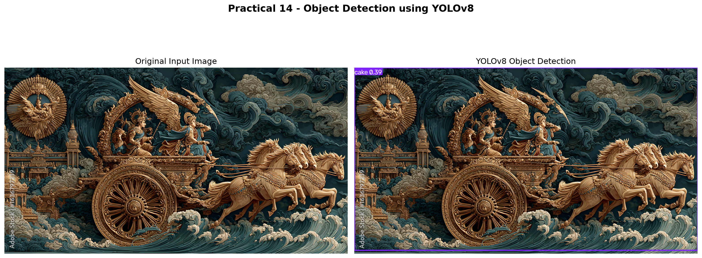
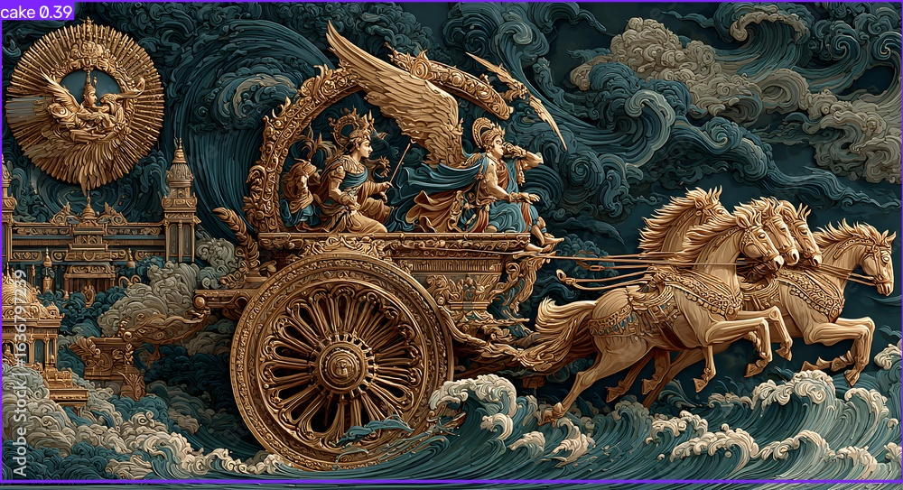

# PRACTICAL 14: OBJECT DETECTION USING YOLO

**Course:** Applied Machine Learning Laboratory  
**Practical Number:** 14  
**Course Outcome Mapping:** CO5  
**Model:** YOLOv8 Nano  
**Programming Language:** Python  

---

## 01. AIM

To implement an object detection system using the pretrained YOLOv8 Nano model and identify objects present in an input image. The experiment demonstrates object classification and localization through predicted class labels, confidence scores, and bounding boxes.

## 02. OBJECTIVES

1. To understand the fundamental concepts of object detection.
2. To study the YOLO (You Only Look Once) object detection architecture.
3. To load and use a pretrained YOLOv8 model.
4. To identify and classify objects in an input image.
5. To locate detected objects using bounding-box coordinates.
6. To understand confidence scores associated with predictions.
7. To visualize and save the annotated detection results.
8. To examine the practical applications of object detection in real-world systems.

## 03. THEORY

### 3.1 Introduction to Object Detection

Object detection is a computer vision task that identifies and locates objects within an image or video. Unlike image classification, which assigns a label to an entire image, object detection provides both the class of an object and its location.

An object detection system generally produces:

- **Class Label:** The predicted category of an object.
- **Confidence Score:** The model's confidence in the predicted class.
- **Bounding Box:** A rectangular region surrounding the predicted object.
- **Class ID:** The numerical identifier associated with the predicted category.

Object detection is used in surveillance, autonomous vehicles, robotics, industrial inspection, traffic monitoring, and smart retail systems.

### 3.2 YOLO (You Only Look Once)

YOLO is a family of real-time object detection models. It processes an input image through a neural network and predicts object locations and classes in a single inference pipeline.

The main characteristics of YOLO include:

1. Single-stage object detection.
2. Simultaneous object localization and classification.
3. Bounding-box prediction.
4. Confidence-based predictions.
5. Efficient inference compared with traditional multi-stage detection pipelines.

### 3.3 YOLOv8 Nano

YOLOv8 Nano (`yolov8n.pt`) is a lightweight pretrained model provided through the Ultralytics framework. It is suitable for demonstrating object detection with relatively low computational requirements.

This experiment uses pretrained COCO weights. The model supports 80 object categories, including person, bicycle, car, motorcycle, bus, truck, dog, cat, chair, bottle, laptop, and cell phone.

### 3.4 Bounding Boxes

A bounding box represents the predicted location of an object using four coordinates:

- `x1`: Left coordinate.
- `y1`: Top coordinate.
- `x2`: Right coordinate.
- `y2`: Bottom coordinate.

The predicted box width and height are calculated as:

\[
Width = x_2 - x_1
\]

\[
Height = y_2 - y_1
\]

### 3.5 Confidence Score

The confidence score represents the model's confidence in a particular detection. It is expressed as a value between 0 and 1.

A higher confidence score indicates a stronger model prediction, but it does not independently prove that the prediction is correct.

### 3.6 Object Detection Workflow

1. Load the pretrained YOLOv8 model.
2. Read the input image.
3. Perform model inference.
4. Obtain predicted classes, confidence scores, and bounding boxes.
5. Draw bounding boxes and labels on the image.
6. Save the annotated image and detection information.
7. Analyze the experimental results.

## 04. SOFTWARE AND HARDWARE REQUIREMENTS

### 4.1 Software Requirements

| Component | Used Version / Description |
|---|---|
| Operating System | Ubuntu Linux |
| Programming Language | Python 3.13.5 |
| Deep Learning Framework | PyTorch 2.15.0+cu132 |
| Object Detection Framework | Ultralytics 8.4.194 |
| Image Processing | OpenCV 5.0.0 |
| Numerical Computing | NumPy 2.5.4 |
| Visualization | Matplotlib 3.11.2 |
| Image Handling | Pillow 13.0.0 |
| Model | YOLOv8 Nano |
| Development Environment | Python virtual environment and terminal |

### 4.2 Hardware Requirements

- Processor: Intel Core i7-8665U.
- RAM: 14 GB.
- GPU: NVIDIA CUDA GPU not available.
- Inference Device: CPU.
- Storage: Sufficient free space for the Python environment, pretrained weights, and generated outputs.

## 05. DATASET DESCRIPTION

### 5.1 Dataset

This experiment uses the pretrained YOLOv8 Nano model with weights trained on the COCO dataset.

COCO (Common Objects in Context) is a widely used dataset for object detection, segmentation, and image understanding. The pretrained model supports 80 object categories.

### 5.2 Input Image

A sample JPEG image is used as the input to the pretrained model.

| Property | Value |
|---|---|
| Filename | `object.jpg` |
| Format | JPEG |
| Width | 1000 pixels |
| Height | 543 pixels |
| Color Mode | RGB |
| File Size | Approximately 532.29 KB |
| Input Location | `input/object.jpg` |

### 5.3 Pretrained Model

| Property | Value |
|---|---|
| Model Name | YOLOv8 Nano |
| Weight File | `yolov8n.pt` |
| Model Task | Object Detection |
| Supported Classes | 80 |
| Model File Size | Approximately 6.25 MB |
| Model Location | `models/yolov8n.pt` |

The model is used without additional training. It performs inference using its pretrained weights.

## 06. METHODOLOGY

The experiment follows these steps:

### Step 1: Environment Preparation

A dedicated Python virtual environment is created to isolate the dependencies required for the experiment.

### Step 2: Dependency Installation

The required libraries are installed:

```bash
python -m pip install ultralytics opencv-python matplotlib numpy pillow
```

### Step 3: Model Loading

The pretrained YOLOv8 Nano model is loaded using the Ultralytics Python interface.

```python
from ultralytics import YOLO

model = YOLO("models/yolov8n.pt")
```

### Step 4: Input Image Reading

The input image is loaded using OpenCV.

```python
import cv2

image = cv2.imread("input/object.jpg")
```

OpenCV reads images in BGR color order. The image can be converted into RGB for visualization.

```python
image_rgb = cv2.cvtColor(image, cv2.COLOR_BGR2RGB)
```

### Step 5: Object Detection

The model performs prediction on the input image using a confidence threshold of 0.25.

```python
results = model.predict(
    source="input/object.jpg",
    conf=0.25,
    device="cpu"
)
```

### Step 6: Result Extraction

The model output provides the class ID, class name, confidence score, and bounding-box coordinates.

### Step 7: Bounding-Box Visualization

The prediction result is annotated using the model's plotting method.

```python
annotated_image = results[0].plot()
```

### Step 8: Result Saving

The annotated image, detection records, comparison plot, and execution log are saved inside the `output/` directory.

## 07. ALGORITHMS AND MODEL CONFIGURATION

### 7.1 YOLO Object Detection Algorithm

The YOLO detection pipeline can be represented as:

1. Input an image.
2. Preprocess the image for model inference.
3. Pass the image through the pretrained neural network.
4. Predict object classes and bounding-box coordinates.
5. Apply confidence filtering.
6. Apply prediction filtering and post-processing.
7. Return the final object detections.
8. Visualize the predicted bounding boxes.

### 7.2 Model Configuration

| Parameter | Configuration |
|---|---|
| Architecture | YOLOv8 |
| Model Variant | Nano |
| Weights | `yolov8n.pt` |
| Task | Detect |
| Dataset | COCO pretrained weights |
| Number of Classes | 80 |
| Confidence Threshold | 0.25 |
| Inference Device | CPU |
| Input Image | `input/object.jpg` |

### 7.3 Bounding-Box Representation

Each detected object is represented by four coordinates:

\[
B = (x_1, y_1, x_2, y_2)
\]

The width and height of the predicted region are obtained from the coordinate differences.

### 7.4 Confidence Filtering

Only predictions satisfying the configured confidence threshold are retained for the reported detections.

The threshold used in this experiment is 0.25.

## 08. EXPERIMENTAL RESULTS

### 8.1 Execution Environment

The experiment was executed using Python 3.13.5, PyTorch 2.15.0, and Ultralytics 8.4.194. Inference was performed on the CPU because CUDA was unavailable.

### 8.2 Actual Detection Results

The model detected one object in the input image.

| Object ID | Class ID | Predicted Class | Confidence |
|---:|---:|---|---:|
| 1 | 55 | Cake | 0.3872 |

### 8.3 Bounding-Box Coordinates

| Coordinate / Measurement | Actual Value |
|---|---:|
| X1 | 0.00 |
| Y1 | 0.00 |
| X2 | 1000.00 |
| Y2 | 533.56 |
| Width | 1000.00 |
| Height | 533.56 |

### 8.4 Performance Measurement

| Metric | Observed Result |
|---|---:|
| Total Detected Objects | 1 |
| Inference Time | 3.3416 seconds |
| Confidence Threshold | 0.25 |
| Detected Category | Cake |
| Confidence Score | 38.72% |
| Inference Device | CPU |

These values are the actual results recorded during this experiment. Inference time is specific to the execution environment and may vary across runs.

## 09. VISUALIZATION OF EXPERIMENTAL RESULTS

### 9.1 Original and Detected Image Comparison

The following visualization compares the original input image with the annotated image produced by YOLOv8.



**Figure 14.1:** Original input image and YOLOv8 object detection result.

### 9.2 Annotated Detection Image

The annotated image contains the predicted class label, confidence score, and bounding box.



**Figure 14.2:** Annotated output generated by the pretrained YOLOv8 Nano model.

### 9.3 Detection Records

The detection details are stored in CSV format.

File: `output/detections/detection_results.csv`

The CSV contains:

- Object ID.
- Class ID.
- Class name.
- Confidence score.
- Bounding-box coordinates.
- Bounding-box width and height.

## 10. OBSERVATIONS

1. The pretrained YOLOv8 Nano model loaded successfully.
2. The model supports 80 COCO object categories.
3. The input image was successfully processed with CPU inference.
4. One object was detected and classified as `cake`.
5. The detected object's confidence score was 0.3872.
6. The measured inference time was 3.3416 seconds.
7. The annotated image was generated and saved successfully.
8. The detection details were exported into a CSV file.
9. The original and annotated images were combined into a comparison visualization.
10. The predicted bounding box covered nearly the entire input image, indicating that the localization result should be interpreted cautiously.
11. A successful model execution does not necessarily imply accurate object localization.
12. The experiment demonstrates the basic workflow of pretrained object detection and result visualization.

## 11. CONCLUSION

The object detection experiment was successfully implemented using the pretrained YOLOv8 Nano model and the Ultralytics framework.

The model processed the input image and produced one detection classified as cake, with a confidence score of 0.3872. The measured inference time was 3.3416 seconds on the CPU.

The experiment demonstrated model loading, image processing, object classification, bounding-box extraction, confidence-score analysis, and visualization of detection results. The annotated image, CSV detection records, comparison plot, and execution logs were generated successfully.

The predicted bounding box covered nearly the entire image. Therefore, although the detection pipeline executed successfully, the localization result requires cautious interpretation. The practical provided hands-on experience with pretrained deep-learning models for computer vision applications.

## 12. GENERATED FILES AND OUTPUT STRUCTURE

### 12.1 Project Directory Structure

```text
Experiment - 14/
│
├── .venv/
│
├── input/
│   └── object.jpg
│
├── models/
│   └── yolov8n.pt
│
├── output/
│   ├── detections/
│   │   ├── detected_output.jpg
│   │   └── detection_results.csv
│   │
│   ├── logs/
│   │   ├── detection_log.txt
│   │   └── experiment_report.txt
│   │
│   └── plots/
│       └── detection_comparison.png
│
├── experiment_14_yolo.py
└── README.md
```

### 12.2 Generated File Description

| File | Description |
|---|---|
| `input/object.jpg` | Input image used for object detection |
| `models/yolov8n.pt` | Pretrained YOLOv8 Nano weights |
| `experiment_14_yolo.py` | Main object detection implementation |
| `output/detections/detected_output.jpg` | Annotated image with predicted detections |
| `output/detections/detection_results.csv` | Structured detection records |
| `output/plots/detection_comparison.png` | Original-versus-detected image comparison |
| `output/logs/detection_log.txt` | Actual model execution and detection log |
| `output/logs/experiment_report.txt` | Detailed experimental report |
| `README.md` | Practical documentation |

### 12.3 Execution Command

Run the experiment from its project directory:

```bash
.venv/bin/python experiment_14_yolo.py
```

## 13. REFERENCES

1. Ultralytics Documentation: https://docs.ultralytics.com/
2. Ultralytics Predict Mode: https://docs.ultralytics.com/modes/predict/
3. Ultralytics Python Usage: https://docs.ultralytics.com/usage/python/
4. COCO Dataset: https://cocodataset.org/
5. OpenCV Documentation: https://docs.opencv.org/
6. OpenCV Python Package: https://pypi.org/project/opencv-python/
7. Ultralytics GitHub Repository: https://github.com/ultralytics/ultralytics

## 14. FINAL RESULT

The pretrained YOLOv8 Nano object detection model was successfully implemented and executed using Python.

The experiment detected one object classified as **cake**, with a confidence score of **0.3872**, and generated the annotated image, detection CSV, comparison visualization, and execution logs.

The practical successfully demonstrated pretrained object detection, object classification, confidence-score extraction, bounding-box generation, and result visualization.

END OF PRACTICAL 14

COURSE OUTCOME MAPPING: CO5
