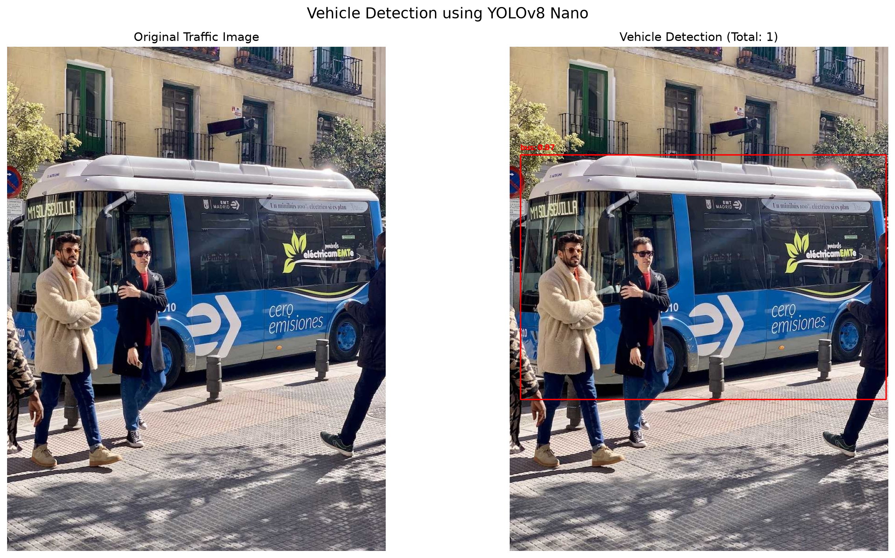
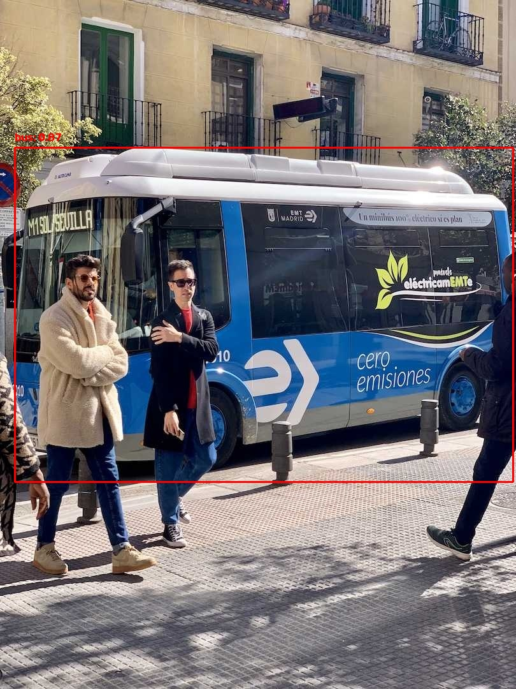
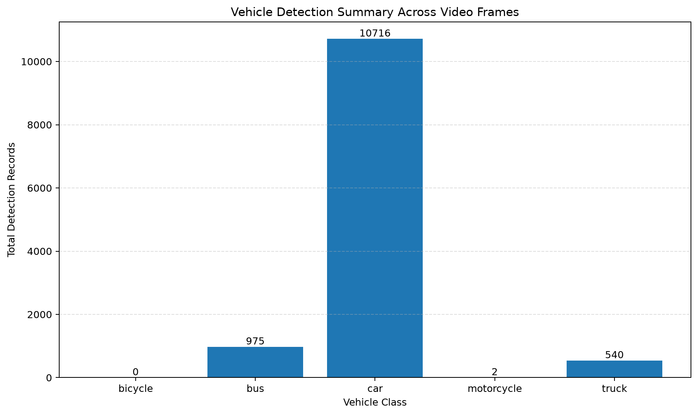
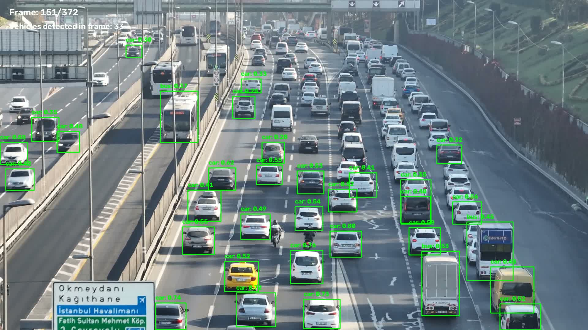

# AML LAB PRACTICAL 15
# VEHICLE DETECTION IN ROAD TRAFFIC USING YOLO

**Course Outcome Mapping:** CO5  
**Experiment:** 15  
**Domain:** Artificial Intelligence and Machine Learning  
**Technique:** Deep Learning - Object Detection  
**Model:** YOLOv8 Nano (YOLOv8n)  
**Framework:** Ultralytics YOLO

---

## 01. AIM

To implement a vehicle detection system for road traffic using a pretrained YOLO (You Only Look Once) object detection model.

The system detects and localizes vehicles in traffic images and videos. It identifies vehicle categories, draws bounding boxes around detected objects, displays class labels and confidence scores, and calculates vehicle detection counts.

The experiment demonstrates the application of deep learning-based object detection in intelligent transportation systems and traffic monitoring.

## 02. OBJECTIVES

1. To understand vehicle detection in road traffic monitoring.
2. To study the YOLO object detection algorithm.
3. To use a pretrained YOLOv8 model for vehicle detection.
4. To identify cars, buses, trucks, motorcycles, and bicycles.
5. To localize vehicles using bounding boxes.
6. To display class labels and confidence scores.
7. To calculate vehicle detection counts.
8. To process static traffic images and video streams.
9. To save annotated images, videos, CSV records, logs, and visualization plots.
10. To understand the application of object detection in intelligent transportation systems.

## 03. THEORY

### 3.1 Vehicle Detection

Vehicle detection is a computer vision task that identifies and localizes vehicles in images or video frames. It is an important application of artificial intelligence and deep learning.

A vehicle detection system generally performs two operations:

- **Classification:** Identifies the category of a detected vehicle, such as car, bus, truck, motorcycle, or bicycle.
- **Localization:** Determines the position of the vehicle using a bounding box.

Vehicle detection is useful in:

- Intelligent traffic monitoring.
- Traffic density analysis.
- Vehicle counting.
- Road safety monitoring.
- Smart transportation systems.
- Traffic surveillance and analysis.

### 3.2 YOLO Algorithm

YOLO stands for **You Only Look Once**. It is a deep learning-based object detection approach that predicts object locations and class probabilities in a single forward pass through a neural network.

YOLO performs object detection as a unified prediction task. Its output contains bounding box coordinates, predicted object classes, and confidence scores.

### 3.3 YOLOv8

YOLOv8 is an object detection model provided by Ultralytics. This experiment uses the lightweight pretrained `yolov8n.pt` model, where `n` represents the Nano model variant.

The pretrained model is loaded locally and performs inference on the CPU.

### 3.4 Confidence Score

A confidence score represents the model's confidence in a particular detection. This experiment uses a confidence threshold of `0.25`. Detections below the configured threshold are excluded from the reported vehicle results.

### 3.5 Bounding Boxes

A bounding box represents the location of a detected object.

Each detection stores four coordinates:

- `x1`: Left coordinate.
- `y1`: Top coordinate.
- `x2`: Right coordinate.
- `y2`: Bottom coordinate.

The bounding box is drawn around the detected vehicle together with its class name and confidence score.

### 3.6 Image and Video Detection

**Image detection:** The model processes a single traffic image and generates an annotated image.

**Video detection:** The video is read frame by frame. Each frame is processed by the model, and the annotated frames are combined to generate an output video.

Video CSV records represent detections in individual frames. They do not necessarily represent unique vehicles.

## 04. SOFTWARE AND HARDWARE REQUIREMENTS

### 4.1 Software Requirements

| Component | Version / Description |
|---|---|
| Operating System | Ubuntu Linux |
| Programming Language | Python 3.13.5 |
| Ultralytics | 8.4.194 |
| PyTorch | 2.15.0 |
| OpenCV | 5.0.0 |
| NumPy | 2.5.4 |
| Matplotlib | 3.11.2 |
| Pillow | 13.0.0 |
| FFmpeg | 8.0.1 |
| Model | YOLOv8n (`yolov8n.pt`) |
| Environment | Python virtual environment |

### 4.2 Hardware Requirements

| Component | Available Configuration |
|---|---|
| Processor | Intel Core i7-8665U |
| Memory | 14 GB RAM |
| Graphics | Intel UHD Graphics 620 |
| Inference Device | CPU |
| CUDA | Unavailable |

### 4.3 Python Environment

A dedicated `.venv` virtual environment was created inside the experiment directory. Required libraries were installed and verified before running the experiment.

## 05. DATASET DESCRIPTION

This experiment uses a traffic image and a traffic video as input.

### 5.1 Image Dataset

| Property | Details |
|---|---|
| Input File | `traffic.jpg` |
| Source | Ultralytics sample image |
| Source URL | https://ultralytics.com/images/bus.jpg |
| Format | JPEG |
| Width | 810 pixels |
| Height | 1080 pixels |
| Channels | 3 (RGB) |

### 5.2 Video Dataset

| Property | Details |
|---|---|
| Input File | `traffic_video.mp4` |
| Source | Public traffic video hosted on GitHub |
| Format | MP4 |
| Video Codec | H.264 |
| Original Resolution | 3840 × 2160 |
| Frame Rate | 29.970 FPS |
| Duration | Approximately 12.416 seconds |
| Total Frames | 372 |

Video source:

https://raw.githubusercontent.com/withaarav/traffic-analyzer/main/traffic%281%29.mp4

### 5.3 Vehicle Categories

| Category | Description |
|---|---|
| Car | Passenger cars and automobiles |
| Bus | Passenger buses |
| Truck | Heavy goods and transport vehicles |
| Motorcycle | Two-wheeled motor vehicles |
| Bicycle | Non-motorized bicycles |

The implementation retains detections belonging to these five vehicle categories.

## 06. METHODOLOGY

### 6.1 Environment Preparation

1. Create a dedicated Python virtual environment.
2. Install the required libraries.
3. Verify the installed framework versions.
4. Confirm CPU inference and video processing support.

### 6.2 Model Loading

1. Load the local pretrained `yolov8n.pt` model.
2. Initialize the Ultralytics YOLO interface.
3. Configure the confidence threshold to `0.25`.

### 6.3 Image Detection

1. Read the input traffic image.
2. Pass the image to the YOLO model.
3. Obtain predicted bounding boxes, class IDs, and confidence scores.
4. Filter detections to the selected vehicle categories.
5. Draw bounding boxes and labels.
6. Calculate category-wise vehicle counts.
7. Save the annotated image, CSV results, plot, and execution log.

### 6.4 Video Detection

1. Open the input video using OpenCV `VideoCapture`.
2. Read the video resolution, frame rate, and frame count.
3. Resize each frame to 1280 × 720 for inference.
4. Run YOLO inference on each frame.
5. Filter detections to the selected vehicle categories.
6. Draw bounding boxes, class labels, and confidence scores.
7. Resize annotated frames to 1920 × 1080.
8. Write processed frames into an output MP4 video.
9. Save frame-level detection records in CSV format.
10. Generate a vehicle detection summary plot.
11. Save the execution log.

### 6.5 Output Generation

The system generates annotated images, an annotated video, CSV detection records, preview images, plots, and execution logs.

## 07. ALGORITHMS AND MODEL CONFIGURATION

### 7.1 YOLO Detection Algorithm

1. Accept an input image or video frame.
2. Preprocess the input for model inference.
3. Perform a forward pass through the pretrained YOLO model.
4. Obtain predicted bounding boxes, class IDs, and confidence scores.
5. Apply confidence filtering.
6. Retain detections belonging to the selected vehicle classes.
7. Draw bounding boxes and class labels.
8. Store the detection information.
9. Generate the final annotated output.

### 7.2 Model Configuration

| Parameter | Image Detection | Video Detection |
|---|---|---|
| Model | YOLOv8n | YOLOv8n |
| Model File | `models/yolov8n.pt` | `models/yolov8n.pt` |
| Confidence Threshold | 0.25 | 0.25 |
| Inference Device | CPU | CPU |
| Input | Traffic image | Traffic video |
| Inference Resolution | 640 image size | 1280 × 720 |
| Output | Annotated JPEG | Annotated MP4 |

### 7.3 Vehicle Class Filtering

The implementation filters the following vehicle classes:

```python
vehicle_classes = [
    "bicycle",
    "bus",
    "car",
    "motorcycle",
    "truck"
]7.4 Image Detection Implementation
The image detection implementation is stored in:
experiment_15_vehicle_detection.py
It loads the local model, processes the traffic image, filters vehicle detections, draws bounding boxes, calculates category counts, and saves the results.
7.5 Video Detection Implementation
The video detection implementation is stored in:
experiment_15_video_detection.py
It processes the traffic video frame by frame, records vehicle detections, generates the annotated output video, and saves the detection summary.
## 08. EXPERIMENTAL RESULTS
The experiment was executed successfully using the pretrained YOLOv8n model on the CPU.
### 8.1 Image Detection Results
Input image: traffic.jpg
Parameter	Actual Result
Image Width	810 pixels
Image Height	1080 pixels
Confidence Threshold	0.25
Inference Device	CPU
Inference Time	2.2883 seconds
Total Vehicles Detected	1
Vehicle detection counts:
Vehicle Category	Detected Count
Bicycle	0
Bus	1
Car	0
Motorcycle	0
Truck	0
Total	1
Individual detection:
Detection ID	Class	Confidence	Bounding Box
1	Bus	0.8727 (87.27%)	[23, 231, 805, 755]
The model detected one bus with a confidence score of approximately 87.27%.
### 8.2 Video Detection Results
Input video: traffic_video.mp4
Parameter	Actual Result
Original Resolution	3840 × 2160
Inference Resolution	1280 × 720
Output Resolution	1920 × 1080
Frame Rate	29.970 FPS
Expected Frames	372
Processed Frames	372
Confidence Threshold	0.25
Inference Device	CPU
Total Inference Time	25.0546 seconds
Average Inference Time per Frame	0.0674 seconds
Total Processing Time	47.5919 seconds
Average Processing FPS	7.8165
Vehicle detection record counts:
Vehicle Category	Detection Records
Bicycle	0
Bus	975
Car	10,716
Motorcycle	2
Truck	540
Total	12,233
Important: These counts represent vehicle detection records across video frames. A vehicle appearing in multiple frames can generate multiple records. Therefore, 12,233 must not be interpreted as the number of unique vehicles.
### 8.3 Generated Results
Output	File
Annotated Image	output/detections/vehicle_detection_output.jpg
Image Detection CSV	output/detections/vehicle_detection_results.csv
Image Comparison Plot	output/plots/vehicle_detection_comparison.png
Annotated Video	output/videos/vehicle_detection_output.mp4
Video Detection CSV	output/detections/video_detection_results.csv
Video Preview	output/detections/video_detection_preview.jpg
Video Count Plot	output/plots/video_vehicle_count_summary.png
Image Execution Log	output/logs/vehicle_detection_log.txt
Video Execution Log	output/logs/video_detection_log.txt
## 09. VISUALIZATION OF EXPERIMENTAL RESULTS
### 9.1 Original and Annotated Image Comparison


### 9.2 Annotated Traffic Image


The annotated image displays the detected bus with its bounding box, class label, and confidence score.
### 9.3 Video Vehicle Detection Summary


### 9.4 Annotated Video Preview


### 9.5 Output Video
The complete annotated video is available at:
output/videos/vehicle_detection_output.mp4
It can be opened using a compatible media player such as VLC.
## 10. OBSERVATIONS
1. The pretrained YOLOv8n model successfully performed vehicle detection on image and video inputs.
2. The image experiment identified one bus with a confidence score of 0.8727.
3. The image output included the predicted bounding box and class label.
4. The video implementation successfully processed all 372 input frames.
5. The video pipeline generated 12,233 frame-level vehicle detection records.
6. Cars represented the largest category of detection records, with 10,716 records.
7. The video also contained 975 bus records, 540 truck records, and 2 motorcycle records.
8. No bicycle detections were recorded in the processed video.
9. CPU inference was used because CUDA was unavailable.
10. The measured average video processing speed was approximately 7.82 FPS.
11. The video output was generated at 1920 × 1080 resolution.
12. Detection records were stored in CSV format for further analysis.
13. Execution logs were generated for both image and video processing.
14. The experiment demonstrates the use of pretrained object detection for basic traffic monitoring.
## 11. CONCLUSION
The vehicle detection experiment was successfully implemented using the pretrained YOLOv8n object detection model.
The system detected and localized vehicles in a traffic image and processed a traffic video frame by frame. It generated bounding boxes, vehicle class labels, confidence scores, category-wise detection counts, CSV records, annotated images, and an annotated output video.
In the image experiment, one bus was detected with a confidence score of 87.27%. In the video experiment, all 372 frames were processed successfully, producing 12,233 vehicle detection records.
The experiment provided practical understanding of deep learning-based object detection and its application in intelligent transportation systems, traffic monitoring, and vehicle analysis.
## 12. GENERATED FILES AND OUTPUT STRUCTURE
### 12.1 Project Directory Structure
Experiment - 15/
│
├── README.md
├── experiment_15_vehicle_detection.py
├── experiment_15_video_detection.py
│
├── input/
│   ├── traffic.jpg
│   └── traffic_video.mp4
│
├── models/
│   └── yolov8n.pt
│
├── output/
│   ├── detections/
│   │   ├── vehicle_detection_output.jpg
│   │   ├── vehicle_detection_results.csv
│   │   ├── video_detection_preview.jpg
│   │   └── video_detection_results.csv
│   │
│   ├── logs/
│   │   ├── vehicle_detection_log.txt
│   │   └── video_detection_log.txt
│   │
│   ├── plots/
│   │   ├── vehicle_detection_comparison.png
│   │   └── video_vehicle_count_summary.png
│   │
│   └── videos/
│       └── vehicle_detection_output.mp4
│
└── .venv/
    └── Python virtual environment


### 12.2 File Descriptions
File	Description
experiment_15_vehicle_detection.py	Image-based vehicle detection implementation
experiment_15_video_detection.py	Video-based vehicle detection implementation
input/traffic.jpg	Input traffic image
input/traffic_video.mp4	Input traffic video
models/yolov8n.pt	Pretrained YOLOv8 Nano model
vehicle_detection_output.jpg	Annotated image
vehicle_detection_results.csv	Image detection records
video_detection_preview.jpg	Preview image extracted from the annotated video
video_detection_results.csv	Frame-level video detection records
vehicle_detection_comparison.png	Original and annotated image comparison
video_vehicle_count_summary.png	Video detection count visualization
vehicle_detection_output.mp4	Complete annotated output video
vehicle_detection_log.txt	Image execution details
video_detection_log.txt	Video processing details
.venv/	Dedicated Python environment
### 12.3 Execution Commands
Activate the virtual environment:
source .venv/bin/activate


Run image detection:
python experiment_15_vehicle_detection.py


Run video detection:
python experiment_15_video_detection.py


Deactivate the environment:
deactivate


## 13. REFERENCES
1. Ultralytics, YOLO Predict Mode Documentation:
   docs.ultralytics.com
2. Ultralytics, Python Usage Documentation:
   docs.ultralytics.com
3. Ultralytics, COCO Dataset Documentation:
   docs.ultralytics.com
4. COCO Dataset Official Website:
   cocodataset.org
5. OpenCV Documentation:
   docs.opencv.org
6. Vehicle Dataset for YOLO:
   datasetninja.com
7. Ultralytics Sample Traffic Image:
   ultralytics.com
8. Public Traffic Video:
   raw.githubusercontent.com
## 14. FINAL RESULT
The vehicle detection system was successfully implemented using the pretrained YOLOv8n model.
The system detected vehicles in a traffic image and processed a traffic video containing 372 frames. It generated annotated image and video outputs, bounding boxes, class labels, confidence scores, vehicle detection counts, CSV records, visualization plots, and execution logs.
The experiment demonstrates the practical application of deep learning-based object detection in road traffic monitoring and intelligent transportation systems.
Practical 15 completed successfully.

END OF PRACTICAL 15
COURSE OUTCOME MAPPING: CO5